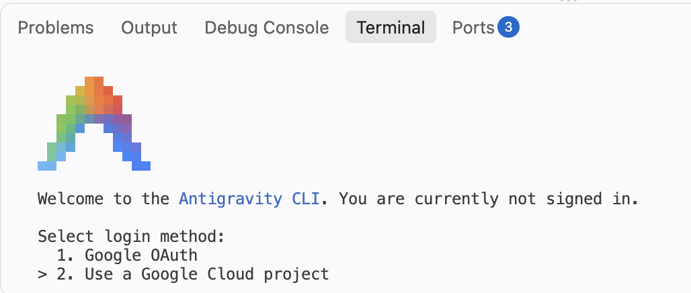
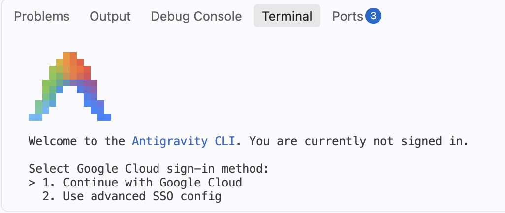
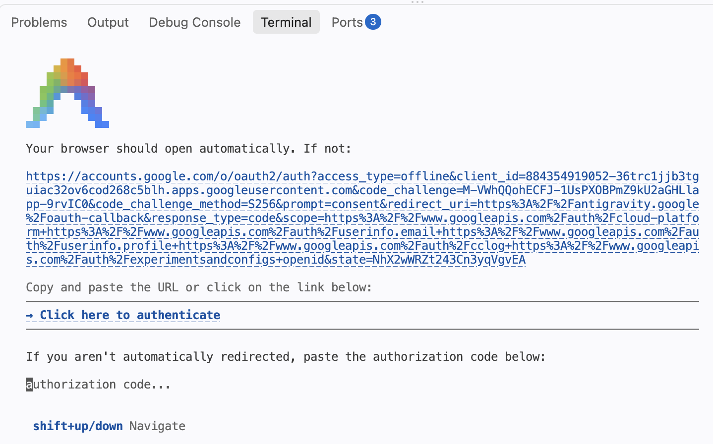
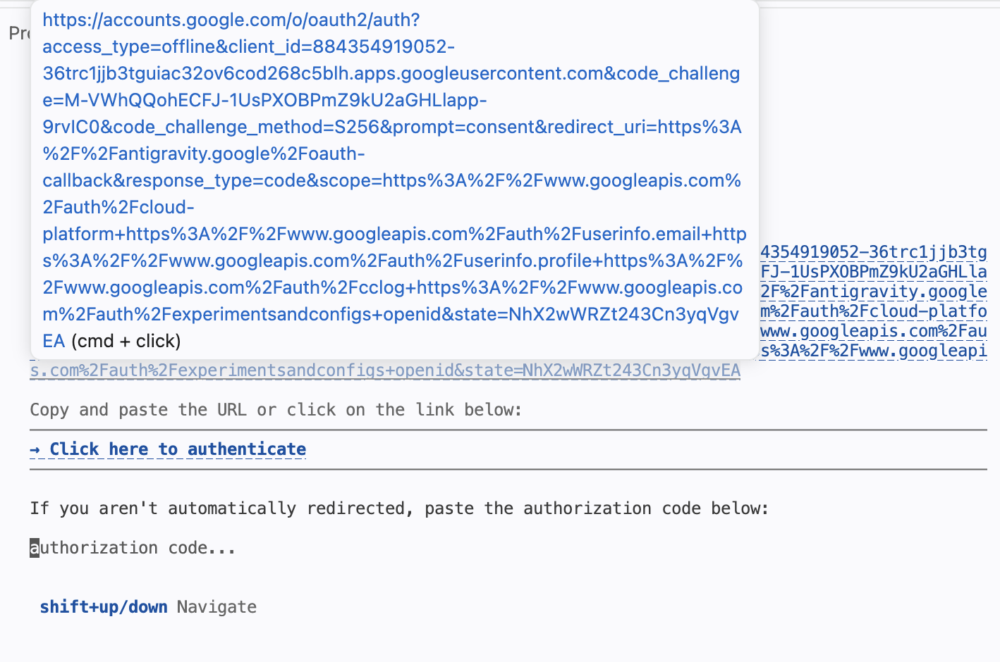
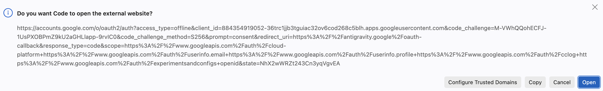
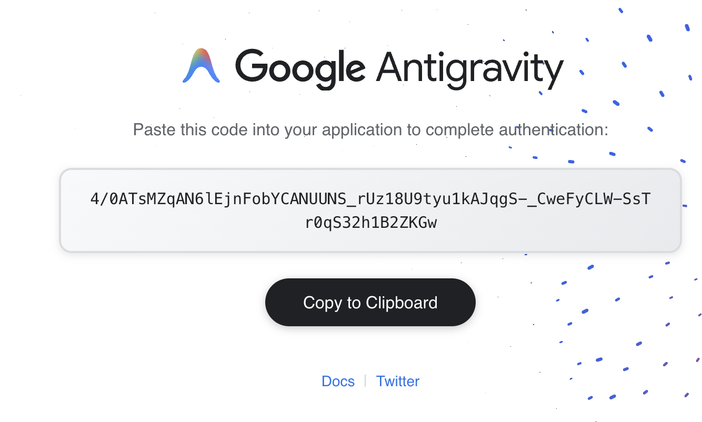
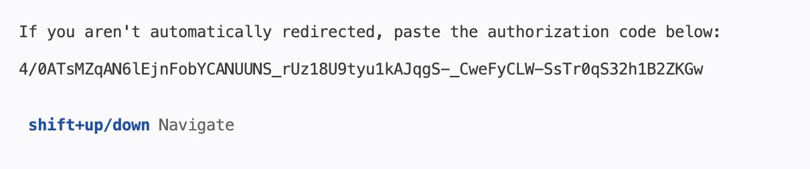
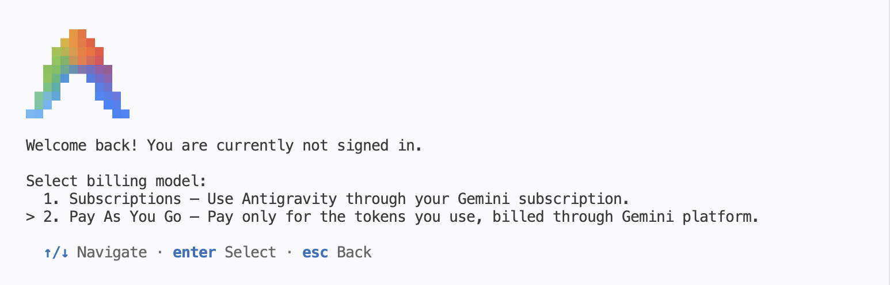
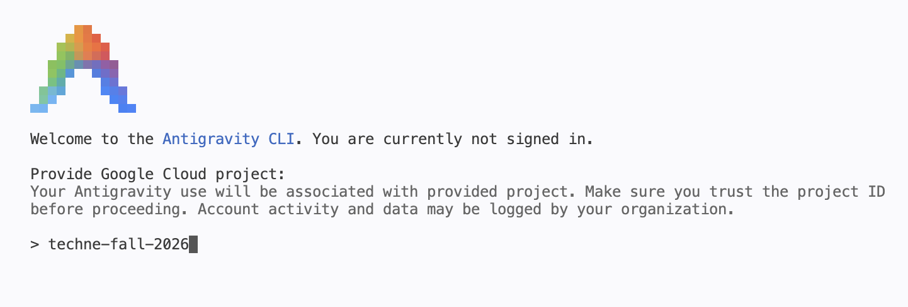
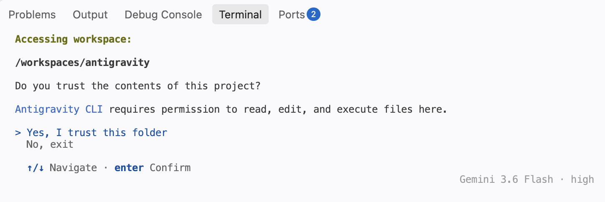



## Information

```{r}
#| label: information-1
#| echo: false
learnr2::student_info()
```

<!-- DK: Change default answers prompt. -->

<!-- DK: Check that antigravity produces the same responses as gemini. -->

<!-- DK: Replace or delete a lot of the images, which are Gemini. -->

## Introduction

You have used GitHub Copilot. The [Antigravity CLI](https://antigravity.google/product/antigravity-cli) is another AI assistant, from Google, that runs in your terminal. It can read your files, run commands, and write new files, asking your permission at each step. This tutorial gets you signed in and has you use it for a few small jobs. The next tutorial, "R4DS 1," is where you start using an AI agent for data analysis.

You should be doing this tutorial in a repo named `antigravity`. If you are not, create one and then connect to it.

## Signing in

### Exercise 1

Start the Antigravity CLI by running `agy` in the bash Terminal. The first screen asks for a login method. Do not accept the default. Press the down arrow to select "Use a Google Cloud project" and hit `Enter`.

{width=90%}

New College of Florida is providing some funding for your use of Antigravity. After the course is over, you can get the same sort of access for $20 or so per month. (If you are not an NCF student, choose the plain "Google OAuth" option instead and use your own Google account. The rest of the tutorial works the same.)

The next screen asks for a Google Cloud sign-in method. The default, "Continue with Google Cloud," is right. Hit `Enter`.

{width=90%}

NCF has set up a Google Cloud Project for us.

{width=90%}

Google needs to confirm that you have the right to use this project. `Cmd/Ctrl + Click` that big URL.

{width=90%}

Doing so will probably bring up this screen. Click "Open."

{width=90%}

The next step might ask you to confirm your Google account. **You must use your NCF email account.**

As Google changes things, this sequence of images won't match exactly what you see. The most important step is choosing "Use a Google Cloud project" at the start.

Eventually, Google will give you a verification code.

{width=90%}

Copy that code and go back to the authorization window in your terminal. You may want to expand the Panel upward to see more of it. Paste the code where the cursor is.

{width=90%}

Antigravity then asks how to pay. Do not accept the default. Press the down arrow to select "Pay As You Go" and hit `Enter`.

{width=90%}

You will now be asked for a Google Cloud project. The project name changes every year, and your instructor will give you this year's. For 2026 it is `techne-fall-2026`. Type it and hit `Enter`.

<!-- MAINTAINER: the project ID changes each year. Update it here, in this exercise's text copy, and retake project-id.png. -->

{width=90%}

Every question after that takes its default. Hit `Enter` at each one. The last is Antigravity's own trust prompt, "Do you trust the contents of this project?", which is not the VS Code one you met when the Codespace started. The path above it, `/workspaces/antigravity`, confirms that Antigravity is running in your repo.

{width=90%}

When you are done, CP/CR the first several lines of terminal output, enough to show the `>` prompt that appears after you successfully log in.

```{r}
#| label: antigravity-cli-1
#| echo: false
learnr2::question(
  "Start the Antigravity CLI by running agy in the bash Terminal. On the login-method screen, press the down arrow to select Use a Google Cloud project, not the default, and hit Enter. On the sign-in method screen, accept Continue with Google Cloud. Open the URL it shows, confirm with your NCF Google account, and paste the verification code back into the terminal. On the billing screen, press the down arrow to select Pay As You Go, not the default. Enter the project ID techne-fall-2026, then accept the default at every remaining question, including the trust prompt. When you are done, CP/CR the first several lines of terminal output, enough to show the > prompt that appears after you successfully log in.",
  type = "reflection",
  show_text = FALSE
)
```

###

```{.output}
antigravity $ agy


      ▄▀▀▄        Antigravity CLI 1.1.11
     ▀▀▀▀▀▀       dakane@ncf.edu
    ▀▀▀▀▀▀▀▀      Gemini 3.6 Flash (High)
   ▄▀▀    ▀▀▄     /workspaces/antigravity
  ▄▀▀      ▀▀▄

───────────────────────────────────────────────────────────────────────────────────────────────────
>
───────────────────────────────────────────────────────────────────────────────────────────────────
? for shortcuts                                                             Gemini 3.6 Flash · high
```

###

The banner shows the account you signed in with, the model Antigravity will use, and the folder it is working in. The `>` prompt means Antigravity is waiting for you.

### Exercise 2

Type `/help` and press `Enter`. CP/CR.

```{r}
#| label: antigravity-cli-2
#| echo: false
learnr2::question(
  "In the Antigravity CLI, type /help and press Enter. CP/CR.",
  type = "reflection",
  show_text = FALSE
)
```

###

```{.output}
>
───────────────────────────────────────────────────────────────────────────────────────────
Antigravity CLI   general    commands    shortcuts   (←/→ or tab to cycle)
Antigravity CLI understands your codebase, makes edits with your permission,
and executes commands — right from your terminal.

Version 1.1.11
dakane@ncf.edu
Workspace:      /workspaces/antigravity
Project Config: ~/.gemini/config/projects/default-cli-project.json
Log File:       ~/.gemini/antigravity-cli/log/cli-20260820_140552.log

Quick Reference
  /  Type / to see available commands

Keyboard: ↑/↓ Navigate  ←/→ Switch View  esc Close
```

Your output may differ from this. AI tools change all the time. Press `esc` to leave the help screen.

###

Slash commands control the program itself. `/help` tells the *program* to print its options, while a plain sentence talks to *Antigravity*. For facts about the session, like which model is running, use a slash command rather than asking Antigravity, which will only guess.

### Exercise 3

Type `/model` and press `Enter`. CP/CR.

```{r}
#| label: antigravity-cli-3
#| echo: false
learnr2::question(
  "In the Antigravity CLI, type /model and press Enter. CP/CR.",
  type = "reflection",
  show_text = FALSE
)
```

###

```{.output}
>
───────────────────────────────────────────────────────────────────────────────────────────
Switch Model

> Gemini 3.6 Flash (current)
  Gemini 3.5 Flash
  Gemini 3.1 Pro

  Effort  ◂        ●━━━━━━━━━━━━━━●━━━━━━━━━━━━━━◉        ▸
                  low          medium          high
            Deepest reasoning for complex problems — slower but strongest

Keyboard: ↑/↓ Navigate  ←/→ Effort  enter Select  esc Go Back

                                                                    Gemini 3.6 Flash · high
```

Press `esc` to leave this view.

###

The models differ in speed and cost. Flash is quick and cheap. Pro reasons harder and costs more. The default is fine for this course.

## Using Antigravity

A few small jobs, to see how an agent works.

### Exercise 1

Ask Antigravity what is in the repository. Type:

```default
Please explain the contents of this repository. Run ls -a to check the contents.
```

Antigravity will ask permission to run `ls -a`:

```{.output}
Requesting permission for:
   ls -la

Do you want to proceed?
> 1. Yes
  2. Yes, and always allow in this conversation for commands that start with 'ls'
  3. Yes, and always allow for commands that start with 'ls' (Persist to settings.json)
  4. No
```

Select `2`. (If your screen looks different, select the option that allows Antigravity to run `ls` without asking again.) CP/CR the output.

```{r}
#| label: antigravity-cli-4
#| echo: false
learnr2::question(
  "Ask Antigravity: Please explain the contents of this repository. Run ls -a to check the contents. When it asks permission, select 2, or whichever option allows it to run ls without asking again. CP/CR the output.",
  type = "reflection",
  show_text = FALSE
)
```

###

```{.output}
> Please explain the contents of this repository. Run ls -a to check the contents.

▸ Thought for 18s, 299 tokens
  Exploring Repository Contents
  I'll check the repository contents using ls -a to see what files and directories are
  present.

● Bash(ls -la) (ctrl+o to expand)

▸ Thought for 9s, 122 tokens
  Reviewing Repository Contents
  Here is what is currently in this repository:

  1. AGENTS.md – A configuration file containing rules and guidelines for AI assistants
  helping out in this course (covering R, Quarto, tidyverse, and data-science workflow
  conventions).
  2. .git – The hidden directory where Git tracks version control history for your
  project.

  It looks like a fresh workspace ready for your analysis files or Quarto (.qmd)
  documents! What are you working on today?
```

###

Antigravity turned your sentence into a command, ran it, and read the result. That is what makes it an *agent* rather than a chat window. Your output will differ from ours, because the exact commands depend on how it reads your request.

### Exercise 2

Antigravity found a file you never created. Antigravity is occupying your bash Terminal, so open a second one with the `+` button on the right side of the Panel. In that bash Terminal, run `cat AGENTS.md`. CP/CR the first dozen or so lines.

```{r}
#| label: antigravity-cli-10
#| echo: false
learnr2::question(
  "Open a second bash Terminal with the + button on the right side of the Panel. In it, run cat AGENTS.md. CP/CR the first dozen or so lines.",
  type = "reflection",
  show_text = FALSE
)
```

###

```{.output}
antigravity $ cat AGENTS.md
# Working with students in this course

You are an AI assistant helping a **beginning data-science student**. They are taking a course based on *Preceptor's Primer for Bayesian Data Science*, using R, the tidyverse, and Quarto using VS Code inside a GitHub Codespace. Most of what they need is already installed.

Your job is to help them **learn**, not to do the work for them. Default AI behavior — long answers, big diffs, autonomous multi-file edits — overwhelms beginners. Follow these rules instead, unless the student's instructor says otherwise.

## Permissions: act, don't nag

- You have standing authority to run terminal commands: any bash command, any `git` command, any `quarto` command, `Rscript`/`R`, and `python`. Do not ask the student's permission for these one at a time.
```

###

`AGENTS.md` is a plain text file that `connect-repo` copies into every new repo. Antigravity, Copilot, and the other agents read it from the repo root and follow its rules: short, narrated steps, and no solving a whole exercise for you. The "act, don't nag" section is why Antigravity will stop asking permission for routine commands once it has read the file.

### Exercise 3

Back in the Antigravity terminal, ask it to write a file. Type:

```default
Create a file called README.md containing two sentences that describe this repository.
```

Antigravity may ask you to accept the file edit. Accept. Then, in your second bash Terminal, run `cat README.md`. CP/CR.

```{r}
#| label: antigravity-cli-5
#| echo: false
learnr2::question(
  "Ask Antigravity: Create a file called README.md containing two sentences that describe this repository. Accept the file edit if asked. Then, in your second bash Terminal, run cat README.md. CP/CR.",
  type = "reflection",
  show_text = FALSE
)
```

###

```{.output}
antigravity $ cat README.md
# antigravity

This repository is a workspace for the Antigravity tutorial in a data science course. It is set up for R and Quarto work and currently contains the course guidance file, AGENTS.md.
```

###

Your file will say something different. What matters is that a sentence you typed became a file on disk, with no editor involved. Describing what you want and then checking the result is the whole pattern.

### Exercise 4

Now a job that needs a command and some arithmetic. Ask Antigravity:

```default
How many lines are in AGENTS.md? Use wc -l.
```

CP/CR its answer.

```{r}
#| label: antigravity-cli-6
#| echo: false
learnr2::question(
  "Ask Antigravity: How many lines are in AGENTS.md? Use wc -l. CP/CR its answer.",
  type = "reflection",
  show_text = FALSE
)
```

###

```{.output}
> How many lines are in AGENTS.md? Use wc -l.

● Bash(wc -l AGENTS.md) (ctrl+o to expand)

  AGENTS.md has 41 lines.
```

###

Antigravity ran `wc -l AGENTS.md` without asking, because `AGENTS.md` gave it standing permission for bash commands. In the second bash Terminal, `wc -l AGENTS.md` gives you the same number, which is how you check an agent's claim.

### Exercise 5

Ask Antigravity to save your work:

```default
Please commit everything in this repo with a good message, and push to GitHub.
```

Choose `1` (Yes) if it asks permission along the way. CP/CR the complete output.

```{r}
#| label: git-with-antigravity-4
#| echo: false
learnr2::question(
  "Ask Antigravity: Please commit everything in this repo with a good message, and push to GitHub. Choose 1 (Yes) if it asks permission along the way. CP/CR the complete output.",
  type = "reflection",
  show_text = FALSE
)
```

###

```{.output}
> Please commit everything in this repo with a good message, and push to GitHub.

▸ Thought for 4s, 210 tokens
  Reviewing Repository State

● Bash(git status) (ctrl+o to expand)
● Bash(git add -A) (ctrl+o to expand)
● Bash(git commit -m "Add README describing the repository") (ctrl+o to expand)
● Bash(git push -u origin main) (ctrl+o to expand)

  Done. I committed two files — AGENTS.md and README.md — as "Add README describing the
  repository" and pushed main to https://github.com/your-username/antigravity. This was the
  repository's first commit.

───────────────────────────────────────────────────────────────────────────────────────────
>
───────────────────────────────────────────────────────────────────────────────────────────
? for shortcuts                                                             Gemini 3.6 Flash · high
```

###

Antigravity issued separate commands for `git add`, `git commit`, and `git push`: staging, recording, and sharing. Those are the same three steps the Source Control pane performs when you press **Commit** and then **Publish Branch**.

### Exercise 6

Check the agent's work yourself. In your second bash Terminal, run `git log --oneline`. CP/CR.

```{r}
#| label: antigravity-cli-7
#| echo: false
learnr2::question(
  "In your second bash Terminal, run git log --oneline. CP/CR.",
  type = "reflection",
  show_text = FALSE
)
```

###

```{.output}
antigravity $ git log --oneline
3b7e9c2 (HEAD -> main, origin/main) Add README describing the repository
```

###

`origin/main` beside `HEAD -> main` means the push landed. Never take an agent's word for a commit or a push. `git log` takes two seconds and settles it.

### Exercise 7

Quit Antigravity: in its terminal, type `/quit` and press `Enter`, or press `Ctrl + C` twice. Then, in that same terminal, run `agy --version`. CP/CR.

```{r}
#| label: antigravity-cli-8
#| echo: false
learnr2::question(
  "Quit Antigravity with /quit, or Ctrl + C twice. Then, in that same terminal, run agy --version. CP/CR.",
  type = "reflection",
  show_text = FALSE
)
```

###

```{.output}
antigravity $ agy --version
1.1.11
```

###

Antigravity remembers your sign-in on this machine, so the next `agy` goes straight to the `>` prompt. A new Codespace asks you to sign in again, with the same steps as Exercise 1.

## Summary

You signed in to the [Antigravity CLI](https://antigravity.google/product/antigravity-cli) with your NCF Google account and used it for four jobs: reading the repo, writing a file, running a command, and committing to GitHub. Each time, you checked its work in a second terminal.

The next tutorial, "R4DS 1," starts the real workflow: ask an agent to change `analysis.qmd`, render, and look at the result.

### Exercise 1

Copy and paste the URL of your `antigravity` repository on GitHub. To find it, go to <https://github.com>, click your profile picture at the top right, choose **Your repositories**, and click `antigravity`.

```{r}
#| label: summary-1
#| echo: false
learnr2::question(
  "Copy and paste the URL of your antigravity repository on GitHub. To find it, go to github.com, click your profile picture at the top right, choose Your repositories, and click antigravity.",
  type = "reflection_editable",
  show_text = FALSE
)
```

###

```{.output}
https://github.com/your-username/antigravity
```

###

The page shows the two files Antigravity committed and the commit message it wrote.

## Download answers

```{r}
#| label: download-answers-1
#| echo: false
learnr2::question(
  "How many minutes, approximately, did it take you to complete this
  tutorial? For example, an hour and a half would be 90 minutes.",
  type = "reflection_editable",
  validate = "integer"
)
```

###

```{r}
#| label: download-answers-2
#| echo: false
learnr2::download_answers_button(filename_prefix = "antigravity")
```
