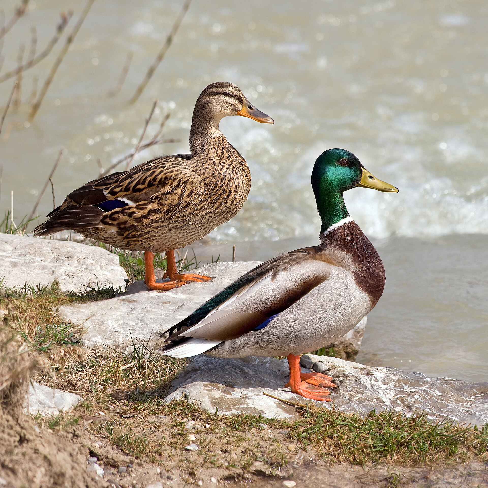
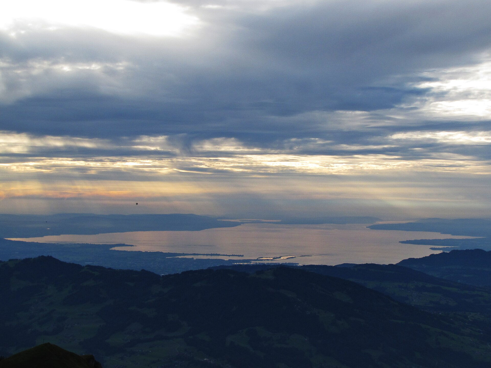
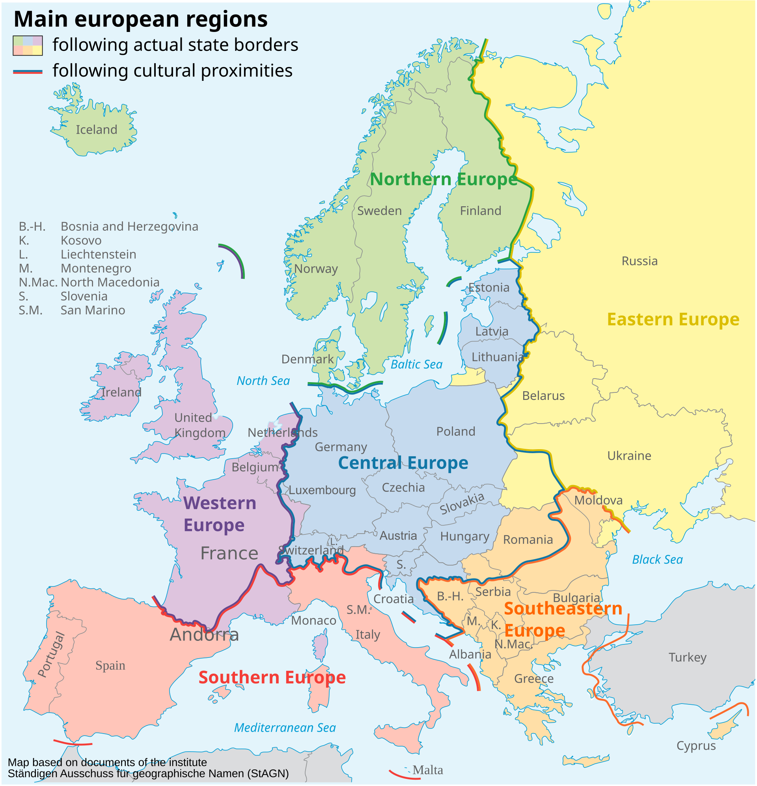
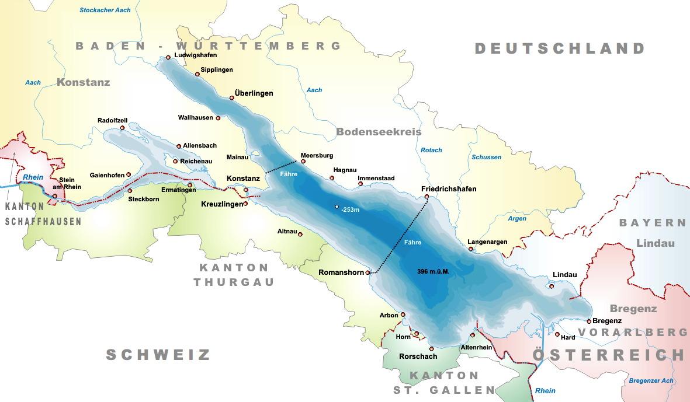



```{r}
#| label: setup
#| include: false
library(tidyverse)
library(sf)
library(rnaturalearth)
library(ggridges)

mallards <- read_csv("data/mallards.csv",
                     show_col_types = FALSE) |>
  mutate(
    timestamp = ymd_hms(timestamp),
    month     = month(timestamp, label = TRUE, abbr = TRUE),
    month_num = month(timestamp),
    year      = year(timestamp),
    season    = case_when(
      month_num %in% c(3, 4, 5)   ~ "Spring",
      month_num %in% c(6, 7, 8)   ~ "Summer",
      month_num %in% c(9, 10, 11) ~ "Autumn",
      TRUE                         ~ "Winter"
    ),
    season = factor(season, levels = c("Spring", "Summer", "Autumn", "Winter"))
  )
```

## Information

```{r}
#| label: information-1
#| echo: false
learnr2::student_info()
```

## Introduction

In this tutorial you will build a small **website** about the movements of Mallard ducks. You will use AI to do the analysis and GPS tracking data from 52 Mallards (*Anas platyrhynchos*) fitted with solar-powered collars at Lake Constance, on the border of Germany and Switzerland, as your data source. Your job is to steer the analysis, render often, inspect the output, and write the words that turn a map and a chart into a site worth reading.

<div style="display: flex; justify-content: center; gap: 20px; align-items: flex-start;">
  
  
</div>

Pictured above: a male and female Mallard (left) and Lake Constance (Bodensee), one of the largest freshwater lakes in Central Europe (right), sitting at the border of Germany, Austria, and Switzerland. It has been an important wintering and staging site for waterfowl for centuries — each autumn, tens of thousands of ducks, geese, and other waterbirds gather here before and after their migrations.

The data comes from a published study by Korner, Sauter, Fiedler, and Jenni (2016) — ["Variable allocation of activity to daylight and night in the mallard"](https://doi.org/10.1016/j.anbehav.2016.02.026) — and is freely available through [Movebank](https://movebank.org/), the world's largest archive of animal tracking data. The dataset is licensed under Creative Commons Attribution (CC BY).

###

Use AI however you like.

### Exercise 1

You should be doing this tutorial in a repo named `ducks`. If you are not, create one and then connect to it. You may need to restart this tutorial after you do so.

In this repo, create a new Quarto **website** project, as you did in the Websites tutorials. The project should include a `_quarto.yml` configuration file and a home page named `index.qmd`. Give the site the title `"Mallard Duck Movement"`. Quarto also creates an `about.qmd` page and a `styles.css` file: delete both, and remove the lines that mention them from `_quarto.yml`, so the site starts with just the home page.

In a bash Terminal, render the whole site:

```bash
quarto render
```

Quarto builds the site into a `_site` directory. Open `_site/index.html` with Live Server (right-click it in the Explorer → **Open with Live Server**) and keep the tab open. It refreshes every time you render. Going forward, we will just tell you to "Render" when we want you to take these steps.

Make sure your `.gitignore` ignores the generated site and Quarto's intermediate files, each entry on its own line:

```default
/_site/
/.quarto/
/*_files/
```

Commit and push. Use the commit message:

```default
Create ducks website
```

In the R Terminal, run:

```r
show_file(".gitignore")
```

If that fails, it is probably because you have not yet loaded `library(learnr2)` in the R Terminal.

CP/CR.

```{r}
#| label: introduction-1
#| echo: false
learnr2::question(
  "You should be doing this tutorial in a repo named ducks. If you are not, create one and then connect to it. You may need to restart this tutorial after you do so. In this repo, create a new Quarto website project, as you did in the Websites tutorials. The project should include a _quarto.yml configuration file and a home page named index.qmd. Give the site the title \"Mallard Duck Movement\". Quarto also creates an about.qmd page and a styles.css file: delete both, and remove the lines that mention them from _quarto.yml. In a bash Terminal, render the whole site with quarto render. Open _site/index.html with Live Server and keep the tab open. Make sure your .gitignore ignores /_site/, /.quarto/, and /*_files/, each entry on its own line. Commit and push with the message Create ducks website. In the R Terminal, run show_file(\".gitignore\"). If that fails, it is probably because you have not yet loaded library(learnr2) in the R Terminal. CP/CR.",
  type = "reflection",
  show_text = FALSE
)
```

###

```{.output}
/.quarto/
**/*.quarto_ipynb
/_site/
/*_files/
```

###

The site so far is one page, `index.qmd`, built into `_site/`. A map page and a seasons page will join it, and because a Quarto website's navigation lives in `_quarto.yml` rather than in the pages, adding each one means editing two files.

### Exercise 2

Tell Quarto to hide code across the whole site. In `_quarto.yml`, add:

```yaml
execute:
  echo: false
```

Render. In the R Terminal, run:

```r
show_file("_quarto.yml")
```

CP/CR.

```{r}
#| label: introduction-2
#| echo: false
learnr2::question(
  "Tell Quarto to hide code across the whole site. In _quarto.yml, add execute: echo: false. Render. In the R Terminal, run show_file(\"_quarto.yml\"). CP/CR.",
  type = "reflection",
  show_text = FALSE
)
```

###

```{.output}
project:
  type: website

website:
  title: "Mallard Duck Movement"
  navbar:
    left:
      - href: index.qmd
        text: Home

format:
  html:
    theme:
      - cosmo
      - brand
    toc: true

execute:
  echo: false
```

###

Setting `echo: false` once in `_quarto.yml` applies it to every page of the site, so you never repeat it in a page's own header.

### Exercise 3

Create a `data` directory at the top level of the `ducks` repo. In the bash Terminal, run `ls`.

CP/CR.

```{r}
#| label: introduction-3
#| echo: false
learnr2::question(
  "Create a data directory at the top level of the ducks repo. In the bash Terminal, run ls. CP/CR.",
  type = "reflection",
  show_text = FALSE
)
```

###

```{.output}
AGENTS.md  data  index.qmd  _quarto.yml  _site
```

###

The one file that will go in `data` holds 83,279 GPS fixes from 52 ducks tracked between 2007 and 2017, every one of them tagged at Lake Constance.

## Where do they go?

Lake Constance sits at the border of Germany, Switzerland, and Austria at roughly 47.5°N, 9.5°E. It is one of the largest freshwater lakes in Central Europe and an important staging area for waterfowl. But Mallards are not purely resident birds — some individuals make substantial seasonal movements while others barely leave the lake. The GPS data reveals exactly who goes where.

### Exercise 1

Download the mallard tracking data from this URL and save it in your `data/` directory:

```default
https://github.com/PPBDS/misc.tutorials/raw/refs/heads/main/inst/tutorials/ducks/data/mallards.csv
```

In the bash Terminal, run:

```bash
ls data
```

CP/CR.

```{r}
#| label: where-do-they-go-1
#| echo: false
learnr2::question(
  "Download the mallard tracking data from https://github.com/PPBDS/misc.tutorials/raw/refs/heads/main/inst/tutorials/ducks/data/mallards.csv and save it in your data/ directory. In the bash Terminal, run ls data. CP/CR.",
  type = "reflection",
  show_text = FALSE
)
```

###

```{.output}
mallards.csv
```

###

The original Movebank download contained 748,082 rows mixing GPS fixes and accelerometer records across 36 columns. This teaching version keeps only the GPS rows and the seven columns needed for movement analysis: timestamp, latitude, longitude, speed, heading, duck identifier, and species name.

### Exercise 2

Create a new page in your website named `map.qmd`, giving it the title `"Map"`, and add it to the site navigation in `_quarto.yml` so it appears in the navbar with the same label.

At the top of `map.qmd`, add a code chunk that loads `library(tidyverse)`, `library(sf)`, and `library(rnaturalearth)`, with `#| message: false` so startup messages stay out of the page. Keep the `library()` lines in a chunk of their own, and add a second chunk below it that reads `data/mallards.csv` and prints the first 10 rows.

Render. In the R Terminal, run `show_file("map.qmd")`.

CP/CR.

```{r}
#| label: where-do-they-go-2
#| echo: false
learnr2::question(
  "Create a new page in your website named map.qmd, giving it the title \"Map\", and add it to the site navigation in _quarto.yml so it appears in the navbar with the same label. At the top of map.qmd, add a code chunk that loads library(tidyverse), library(sf), and library(rnaturalearth), with #| message: false so startup messages stay out of the page. Keep the library() lines in a chunk of their own, and add a second chunk below it that reads data/mallards.csv and prints the first 10 rows. Render. In the R Terminal, run show_file(\"map.qmd\"). CP/CR.",
  type = "reflection",
  show_text = FALSE
)
```

###

```{r}
#| label: where-do-they-go-2-answer
#| echo: true
read_csv("data/mallards.csv", show_col_types = FALSE) |>
  head(10)
```

###

Each row is one **GPS fix** — a single location recorded by one duck at one moment in time. The `duck_id` column uses the tag identifier from the original study, combining a numeric code with the tagging location.

### Exercise 3

Count GPS fixes per duck, sorted from most to least. Render.

In the R Terminal, run `show_file("map.qmd")`. CP/CR.

```{r}
#| label: where-do-they-go-3
#| echo: false
learnr2::question(
  "Count GPS fixes per duck, sorted from most to least. Render. In the R Terminal, run show_file(\"map.qmd\"). CP/CR.",
  type = "reflection",
  show_text = FALSE
)
```

###

```{r}
#| label: where-do-they-go-3-answer
#| echo: true
read_csv("data/mallards.csv", show_col_types = FALSE) |>
  count(duck_id, sort = TRUE)
```

###

Duck `2351` has over 20,000 fixes — the most of any individual, tracked continuously for several years. Fourteen ducks have fewer than 100 fixes, suggesting their collars failed early or the birds died.

### Exercise 4

Summarize the geographic range of the data: minimum and maximum latitude and longitude. Render.

In the R Terminal, run `show_file("map.qmd")`. CP/CR.

```{r}
#| label: where-do-they-go-4
#| echo: false
learnr2::question(
  "Summarize the geographic range of the data: minimum and maximum latitude and longitude. Render. In the R Terminal, run show_file(\"map.qmd\"). CP/CR.",
  type = "reflection",
  show_text = FALSE
)
```

###

```{r}
#| label: where-do-they-go-4-answer
#| echo: true
read_csv("data/mallards.csv", show_col_types = FALSE) |>
  summarise(
    lat_min  = min(lat, na.rm = TRUE),
    lat_max  = max(lat, na.rm = TRUE),
    long_min = min(long, na.rm = TRUE),
    long_max = max(long, na.rm = TRUE)
  )
```

###

Latitudes range from 47.3°N to 53.9°N and longitudes from 7.8°E to 23.6°E — roughly from Lake Constance in southern Germany up to northern Germany, and as far east as Poland or Hungary. Lake Constance sits at the southwestern corner of this range, so some ducks are traveling 500 km or more from their starting point.

Below: the full region the ducks travel through (left) and a detailed view of Lake Constance itself, where all 52 ducks in this study were originally tagged (right).

<div style="display: flex; justify-content: center; gap: 20px; align-items: flex-start;">
  
  
</div>

### Exercise 5

Read `data/mallards.csv`, parse the timestamp, and add `month`, `month_num`, `year`, and `season` columns. Define season as: Spring (March–May), Summer (June–August), Autumn (September–November), Winter (December–February). Make `season` a factor whose levels run in calendar order. Assign the result to `mallards` and print it. Render.

In the R Terminal, run `show_file("map.qmd")`. CP/CR.

```{r}
#| label: where-do-they-go-5
#| echo: false
learnr2::question(
  "Read data/mallards.csv, parse the timestamp, and add month, month_num, year, and season columns. Define season as: Spring (March–May), Summer (June–August), Autumn (September–November), Winter (December–February). Make season a factor whose levels run in calendar order. Assign the result to mallards and print it. Render. In the R Terminal, run show_file(\"map.qmd\"). CP/CR.",
  type = "reflection",
  show_text = FALSE
)
```

###

```{r}
#| label: where-do-they-go-5-answer
#| echo: true
mallards <- read_csv("data/mallards.csv",
                     show_col_types = FALSE) |>
  mutate(
    timestamp = ymd_hms(timestamp),
    month     = month(timestamp, label = TRUE, abbr = TRUE),
    month_num = month(timestamp),
    year      = year(timestamp),
    season    = case_when(
      month_num %in% c(3, 4, 5)   ~ "Spring",
      month_num %in% c(6, 7, 8)   ~ "Summer",
      month_num %in% c(9, 10, 11) ~ "Autumn",
      TRUE                         ~ "Winter"
    ),
    season = factor(season, levels = c("Spring", "Summer", "Autumn", "Winter"))
  )
mallards
```

###

The `season` column is a factor so plots display seasons in calendar order rather than alphabetically. The dataset has `r nrow(mallards)` GPS fixes across 52 individual ducks tracked from 2007 to 2017.

### Exercise 6

Before caching anything, clean up the chunk. Delete the line that prints `mallards`, so the chunk holds only the pipeline, and add one line at the end that saves `mallards` to `data/mallards.rds` — the seasons page will read that file instead of repeating the pipeline. Render.

In the R Terminal, run `show_file("map.qmd")`. CP/CR.

```{r}
#| label: where-do-they-go-12
#| echo: false
learnr2::question(
  "Before caching anything, clean up the chunk. Delete the line that prints mallards, so the chunk holds only the pipeline, and add one line at the end that saves mallards to data/mallards.rds. Render. In the R Terminal, run show_file(\"map.qmd\"). CP/CR.",
  type = "reflection",
  show_text = FALSE
)
```

###

```{.output}
mallards <- read_csv("data/mallards.csv",
                     show_col_types = FALSE) |>
  mutate(
    timestamp = ymd_hms(timestamp),
    month     = month(timestamp, label = TRUE, abbr = TRUE),
    month_num = month(timestamp),
    year      = year(timestamp),
    season    = case_when(
      month_num %in% c(3, 4, 5)   ~ "Spring",
      month_num %in% c(6, 7, 8)   ~ "Summer",
      month_num %in% c(9, 10, 11) ~ "Autumn",
      TRUE                         ~ "Winter"
    ),
    season = factor(season, levels = c("Spring", "Summer", "Autumn", "Winter"))
  )

write_rds(mallards, "data/mallards.rds")
```

###

**RDS** is R's native format for saving one R object exactly as it is, so `mallards` comes back with its parsed timestamps and its season factor intact; the CSV would have to be re-parsed and re-cleaned every time.

### Exercise 7

Now cache the data chunk. Add `#| cache: true` as the first line inside the `mallards` chunk. Render. Caching saves that chunk's result to disk so later renders reload it instead of recomputing; the first cached render creates a `map_cache/` directory next to `map.qmd`.

To confirm the directory is there, in the bash Terminal, run `ls`.

CP/CR.

```{r}
#| label: where-do-they-go-13
#| echo: false
learnr2::question(
  "Now cache the data chunk. Add #| cache: true as the first line inside the mallards chunk. Render. To confirm the map_cache/ directory is there, in the bash Terminal, run ls. CP/CR.",
  type = "reflection",
  show_text = FALSE
)
```

###

```{.output}
AGENTS.md  data  index.qmd  map_cache  map_files  map.qmd  _quarto.yml  _site
```

###

`ls data` would now show `mallards.rds` beside `mallards.csv`: the first cached render wrote it, and it holds the same 83,279 fixes with the timestamp already parsed and the season column already built.

### Exercise 8

The Source Control change count just jumped, because `map_cache/` and `data/mallards.rds` now look like untracked work to git. Both are regenerated by a render, so neither belongs on GitHub.

Add two lines to your `.gitignore`:

```default
/*_cache/
data/mallards.rds
```

In the R Terminal, run `show_file(".gitignore")`.

CP/CR.

```{r}
#| label: where-do-they-go-14
#| echo: false
learnr2::question(
  "Add two lines to your .gitignore: /*_cache/ and data/mallards.rds. In the R Terminal, run show_file(\".gitignore\"). CP/CR.",
  type = "reflection",
  show_text = FALSE
)
```

###

```{.output}
/.quarto/
**/*.quarto_ipynb
/_site/
/*_files/
/*_cache/
data/mallards.rds
```

###

`data/mallards.csv` stays unignored: it is the source the whole site rebuilds from, and the next commit puts it on GitHub.

### Exercise 9

Start a new working chunk in `map.qmd` that makes a map of all GPS fixes, colored by individual duck, filtered to the region of interest (latitudes 47–55°N, longitudes 8–25°E) and drawn over country outlines from **[rnaturalearth](https://docs.ropensci.org/rnaturalearth/)**. Render.

Take a screenshot of the map in your rendered page and paste it below. To take a screenshot, press `Cmd + Ctrl + Shift + 4` on a Mac, `Win + Shift + S` on Windows, or `Ctrl + Shift + Show windows` on a Chromebook, select the area, then click in the answer box and press `Cmd + V` (Mac) or `Ctrl + V` (Windows) to paste it.

```{r}
#| label: where-do-they-go-10
#| echo: false
learnr2::question(
  "Start a new working chunk in map.qmd that makes a map of all GPS fixes, colored by individual duck, filtered to the region of interest (latitudes 47–55°N, longitudes 8–25°E) and drawn over country outlines from rnaturalearth. Render. Take a screenshot of the map in your rendered page and paste it below.",
  type = "reflection",
  allow_image = TRUE,
  allow_text = FALSE,
  show_text = FALSE
)
```

###

```{r}
#| label: where-do-they-go-10-answer
#| echo: true
world <- ne_countries(scale = "medium", returnclass = "sf")

mallards_box <- mallards |>
  filter(lat >= 47, lat <= 55, long >= 8, long <= 25) |>
  arrange(duck_id, timestamp)

ggplot() +
  geom_sf(data = world, fill = "#e8f4f8", color = "gray70", linewidth = 0.2) +
  geom_path(
    data = mallards_box,
    aes(x = long, y = lat, group = duck_id, color = duck_id),
    alpha = 0.4, linewidth = 0.3
  ) +
  geom_point(
    data = mallards_box,
    aes(x = long, y = lat, color = duck_id),
    alpha = 0.6, size = 0.8
  ) +
  coord_sf(xlim = c(8, 25), ylim = c(47, 55)) +
  scale_color_viridis_d(option = "turbo") +
  labs(
    title    = "Mallard duck GPS fixes, 2007–2017",
    subtitle = "Each color is one individual duck; lines show movement paths",
    x        = NULL,
    y        = NULL,
    caption  = "Source: Korner, Sauter, Fiedler & Jenni (2016) via Movebank (CC BY)"
  ) +
  theme_minimal() +
  theme(
    axis.text        = element_blank(),
    axis.ticks       = element_blank(),
    legend.position  = "none",
    panel.background = element_rect(fill = "#d0e8f0", color = NA)
  )
```

###

Most GPS fixes cluster tightly around Lake Constance in the southwest corner of the map, while a scatter of points extends several hundred kilometers northeast toward Poland and Hungary. Mallards are a **partially migratory species**: some populations are fully resident year-round, others travel long distances, and many fall somewhere between.

### Exercise 10

Commit and push the map page. Use the commit message:

```default
Add duck map
```

In the bash Terminal, run:

```bash
git log --oneline -3
```

CP/CR.

```{r}
#| label: where-do-they-go-11
#| echo: false
learnr2::question(
  "Commit and push the map page, using the commit message Add duck map. In the bash Terminal, run git log --oneline -3. CP/CR.",
  type = "reflection",
  show_text = FALSE
)
```

###

```{.output}
3f8a2c1 (HEAD -> main, origin/main) Add duck map
9c4e1b7 Create ducks website
```

###

This commit puts `data/mallards.csv` on GitHub too: the trimmed, GPS-only version of the Movebank export, with `r nrow(mallards)` rows and seven columns.

## When do they move?

GPS speed tells us not just where a duck was, but how actively it was moving at each fix. A speed near zero means the duck was resting or feeding; **higher speeds mean active flight**. Combined with timestamps, speed reveals the seasonal rhythm of duck activity across the 10-year study.

### Exercise 1

Create a new page named `seasons.qmd`, giving it the title `"Seasons"`, and add it to the navbar in `_quarto.yml` with the same label.

At the top of the page, add a code chunk that loads `library(tidyverse)` and `library(ggridges)` with `#| message: false`, then a second chunk that reads `data/mallards.rds` into `mallards` — the cleaned table the map page saved. Then add a working chunk that counts GPS fixes per month. Render.

In the R Terminal, run `show_file("seasons.qmd")`. CP/CR.

```{r}
#| label: when-do-they-move-1
#| echo: false
learnr2::question(
  "Create a new page named seasons.qmd, giving it the title \"Seasons\", and add it to the navbar in _quarto.yml with the same label. At the top of the page, add a code chunk that loads library(tidyverse) and library(ggridges) with #| message: false, then a second chunk that reads data/mallards.rds into mallards. Then add a working chunk that counts GPS fixes per month. Render. In the R Terminal, run show_file(\"seasons.qmd\"). CP/CR.",
  type = "reflection",
  show_text = FALSE
)
```

###

```{r}
#| label: when-do-they-move-1-answer
#| echo: true
mallards |>
  count(month)
```

###

September dominates with roughly 21,000 fixes — more than double any other month. This reflects when the collars were most active, not duck behavior: most collars were deployed in August or September, so the early weeks of tracking accumulate many fixes before some collars fail or ducks leave the study area.

### Exercise 2

Get summary statistics for `speed`. Render.

In the R Terminal, run `show_file("seasons.qmd")`. CP/CR.

```{r}
#| label: when-do-they-move-2
#| echo: false
learnr2::question(
  "Get summary statistics for speed. Render. In the R Terminal, run show_file(\"seasons.qmd\"). CP/CR.",
  type = "reflection",
  show_text = FALSE
)
```

###

```{r}
#| label: when-do-they-move-2-answer
#| echo: true
mallards |>
  summarise(
    min_speed    = min(speed, na.rm = TRUE),
    median_speed = median(speed, na.rm = TRUE),
    mean_speed   = mean(speed, na.rm = TRUE),
    max_speed    = max(speed, na.rm = TRUE)
  )
```

###

The median speed is 0.22 m/s — most fixes catch a duck that is barely moving, resting or feeding at the water's edge. The maximum, 127 m/s, is physically impossible for a Mallard (real flight speeds top out around 25–30 m/s) and is almost certainly a GPS error; only 22 fixes exceed 30 m/s, and they should be dropped before any speed-based analysis.

### Exercise 3

Drop the fixes with speeds above 30 m/s, then make a ridge plot of the speed distributions by month, one ridge per month in calendar order. Render.

Take a screenshot of the plot in your rendered page and paste it below.

```{r}
#| label: when-do-they-move-4
#| echo: false
learnr2::question(
  "Drop the fixes with speeds above 30 m/s, then make a ridge plot of the speed distributions by month, one ridge per month in calendar order. Render. Take a screenshot of the plot in your rendered page and paste it below.",
  type = "reflection",
  allow_image = TRUE,
  allow_text = FALSE,
  show_text = FALSE
)
```

###

```{r}
#| label: when-do-they-move-4-answer
#| echo: true
mallards |>
  filter(speed <= 30) |>
  mutate(month = fct_reorder(month, month_num)) |>
  ggplot(aes(x = speed, y = month, fill = after_stat(x))) +
  geom_density_ridges_gradient(scale = 3, rel_min_height = 0.01) +
  scale_fill_viridis_c(option = "turbo") +
  labs(
    title    = "Most ducks are barely moving — but summer has the most active fliers",
    subtitle = "Distribution of GPS-recorded ground speeds by month (speed ≤ 30 m/s)",
    x        = "Ground speed (m/s)",
    y        = NULL,
    fill     = "Speed",
    caption  = "Source: Korner, Sauter, Fiedler & Jenni (2016) via Movebank (CC BY)"
  ) +
  theme_minimal()
```

###

With the GPS errors removed, mean speed peaks in July (0.48 m/s) and stays high through August (0.47) and September (0.44) before falling off in October (0.40). The summer peak aligns with the post-breeding season, when young ducks from this year's broods begin exploring beyond their natal area and adults resume longer-range movements after the moult.

### Exercise 4

Commit and push the seasons page. Use the commit message:

```default
Add seasonal movement analysis
```

In the bash Terminal, run:

```bash
git log --oneline -3
```

CP/CR.

```{r}
#| label: when-do-they-move-5
#| echo: false
learnr2::question(
  "Commit and push the seasons page, using the commit message Add seasonal movement analysis. In the bash Terminal, run git log --oneline -3. CP/CR.",
  type = "reflection",
  show_text = FALSE
)
```

###

```{.output}
7b2e9d4 (HEAD -> main, origin/main) Add seasonal movement analysis
3f8a2c1 Add duck map
9c4e1b7 Create ducks website
```

###

The map and the seasonal chart answer different questions: the map shows the geographic range of duck movements, and the seasonal chart shows when ducks are most and least active.

## Summary

This tutorial used AI to build a multi-page website about the movements of 52 Mallard ducks tracked by GPS at Lake Constance. You mapped where the ducks go — most stay close to the lake while a few travel several hundred kilometers northeast — and showed when they move, with activity peaking in July and August after the breeding season.

### Exercise 1

Turn the home page into a real introduction to the finished site. In `index.qmd`, replace the placeholder content with a short paragraph or two that tells a visitor what the site found — where the ducks go and when they move — says where Lake Constance is and where the data comes from, and points to the Map and Seasons pages in the navbar. Draft it with AI and keep what reads well.

Render. In the R Terminal, run:

```r
show_file("index.qmd")
```

CP/CR.

```{r}
#| label: summary-2
#| echo: false
learnr2::question(
  "Turn the home page into a real introduction to the finished site. In index.qmd, replace the placeholder content with a short paragraph or two that tells a visitor what the site found (where the ducks go and when they move), says where Lake Constance is and where the data comes from, and points to the Map and Seasons pages in the navbar. Draft it with AI and keep what reads well. Render. In the R Terminal, run show_file(\"index.qmd\"). CP/CR.",
  type = "reflection",
  show_text = FALSE
)
```

###

```{.output}
---
title: "Mallard Duck Movement"
---

## Welcome

Mallards (*Anas platyrhynchos*) are the most familiar duck in the world, the
green-headed bird found on park ponds across the Northern Hemisphere. Between
2007 and 2017, researchers fitted 52 of them with GPS collars at Lake
Constance, one of the largest freshwater lakes in Central Europe, on the
border of Germany, Switzerland, and Austria. The data is archived on Movebank.

The **Map** page shows where the ducks went: most fixes cluster around the
lake, but a few birds traveled several hundred kilometers to the northeast.
The **Seasons** page shows when they moved: most fixes catch a resting bird,
and activity peaks in July and August, after the breeding season.
```

###

The home page should give a reader who knows nothing about the study enough context to understand the map and the seasonal chart. Stating the findings up front — and pointing to the pages that back them up — is what makes two charts feel like one coherent project.

### Exercise 2

Publish the site to GitHub Pages. In a bash Terminal, run:

```bash
quarto publish gh-pages
```

Copy/paste the resulting URL below.

```{r}
#| label: summary-3
#| echo: false
learnr2::question(
  "Publish the site to GitHub Pages. In a bash Terminal, run quarto publish gh-pages. Copy/paste the resulting URL below.",
  type = "reflection",
  show_text = FALSE
)
```

###

```{.output}
? Publish site to https://your-username.github.io/ducks/ using gh-pages? (Y/n) › Yes
Switched to a new branch 'gh-pages'
...
Rendering for publish:

[1/3] index.qmd
[2/3] map.qmd
[3/3] seasons.qmd

Output created: _site/index.html
...
[gh-pages abc1234] Built site for gh-pages
...
To https://github.com/your-username/ducks.git
[✓] Deploying gh-pages branch to website (this may take a few minutes)
[✓] Published to https://your-username.github.io/ducks/
```

Your answer is the URL on the last line: `https://your-username.github.io/ducks/`.

###

The site is served from the `gh-pages` branch, so only the rendered HTML — home page, map, seasons, and the navbar that links them — is published; your `.qmd` source, `data/mallards.csv`, and the cache stay on `main` or on your machine.

### Exercise 3

Commit and push any remaining changes. Copy/paste the URL to your GitHub repo.

```{r}
#| label: summary-4
#| echo: false
learnr2::question(
  "Commit and push any remaining changes. Copy/paste the URL to your GitHub repo.",
  type = "reflection",
  show_text = FALSE
)
```

###

```{.output}
https://github.com/your-username/ducks
```

###

Movebank hosts thousands of published animal tracking studies under open licenses. The **[move2](https://cran.r-project.org/package=move2)** R package connects directly to Movebank's API, so for a more advanced project you could pull any tracking dataset straight into R without a manual download.

## Download answers

```{r}
#| label: download-answers-1
#| echo: false
learnr2::question(
  "How many minutes, approximately, did it take you to complete this
  tutorial? For example, an hour and a half would be 90 minutes.",
  type = "reflection_editable",
  validate = "integer"
)
```

###

```{r}
#| label: download-answers-2
#| echo: false
learnr2::download_answers_button(filename_prefix = "ducks")
```
