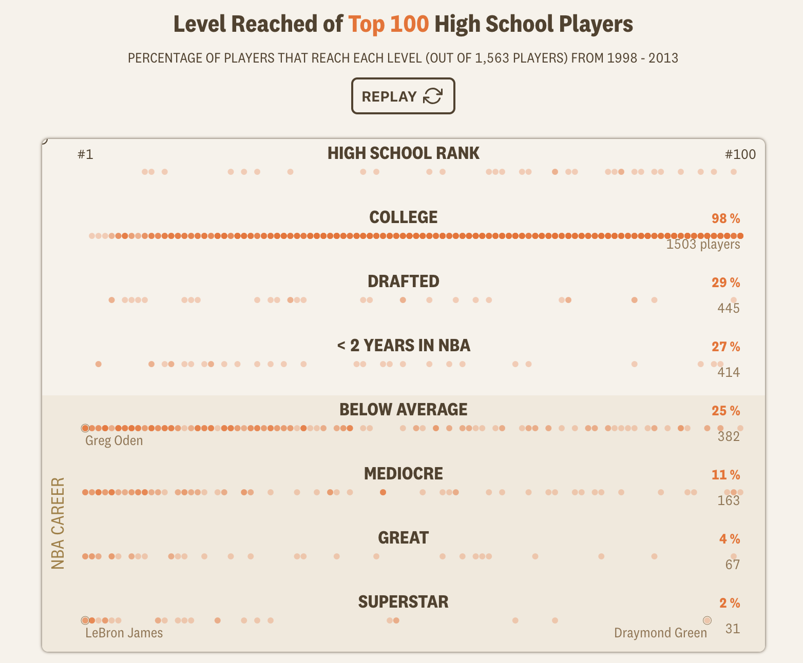



```{r}
#| label: setup
#| include: false
library(tidyverse)
library(readxl)

basketball_tibble <- read_excel("data/nba_recruits.xlsx") |>
  mutate(
    tier = factor(
      tier,
      levels = c("Never played", "Brief career", "Solid career",
                 "All-Star level", "Superstar")
    ),
    recruit_group = factor(
      recruit_group,
      levels = c("#1–10", "#11–25", "#26–50", "#51–100", "Outside top 100")
    )
  )
```

## Information

```{r}
#| label: information-1
#| echo: false
learnr2::student_info()
```

## Introduction

This tutorial covers key concepts from [Chapter 20: Spreadsheets](https://r4ds.hadley.nz/spreadsheets.html), [Chapter 16: Factors](https://r4ds.hadley.nz/factors.html), and [Chapter 10: Exploratory Data Analysis](https://r4ds.hadley.nz/EDA.html) from [*R for Data Science (2e)*](https://r4ds.hadley.nz/) by Hadley Wickham, Mine Çetinkaya-Rundel, and Garrett Grolemund.

You will read a spreadsheet of top-ranked high school basketball recruits with **[readxl](https://readxl.tidyverse.org/)**, turn its text columns into factors with a meaningful level order, and use **[ggplot2](https://ggplot2.tidyverse.org/)** to ask whether being a top-ranked teenager predicts an NBA career. Key techniques include ordered factors for correct axis sorting, proportional bar charts, and scatter plots with annotated outliers.

Use AI however you like.

### Exercise 1

You should be doing this tutorial in a repo named `nba-recruits`. If you are not, create one and then connect to it.

Create a new file and save it as `analysis.qmd`. Add a YAML header at the top with a title (`"Analyzing NBA Recruits"`) and your name as author. In a bash Terminal, run:

```bash
quarto render analysis.qmd
```

Open `analysis.html` with Live Server (right-click it in the Explorer → **Open with Live Server**) and keep the tab open. It refreshes on every render. Going forward, we will just tell you to "Render" when we want you to take these steps.

Create a `.gitignore` with `analysis_files` followed by a blank line. Commit and push.

In the R Terminal, run:

```r
show_file(".gitignore")
```

If that fails, it is probably because you have not yet loaded `library(learnr2)` in the R Terminal.

CP/CR.

```{r}
#| label: introduction-1
#| echo: false
learnr2::question(
  "You should be doing this tutorial in a repo named nba-recruits. If you are not, create one and then connect to it. Create a new file and save it as analysis.qmd. Add a YAML header at the top with a title (\"Analyzing NBA Recruits\") and your name as author. In a bash Terminal, run: quarto render analysis.qmd Open analysis.html with Live Server (right-click it in the Explorer, then Open with Live Server) and keep the tab open. It refreshes on every render. Going forward, we will just tell you to \"Render\" when we want you to take these steps. Create a .gitignore with analysis_files followed by a blank line. Commit and push. In the R Terminal, run: show_file(\".gitignore\") If that fails, it is probably because you have not yet loaded library(learnr2) in the R Terminal. CP/CR.",
  type = "reflection",
  show_text = FALSE
)
```

###

```{.output}
analysis_files
```

###

This tutorial works with one dataset: The Pudding's record of every top-100 high school basketball recruit from the 1998 through 2013 classes and how each one's NBA career turned out. It arrives as an `.xlsx` Excel workbook, so `library(readxl)` will be needed alongside `library(tidyverse)`, which does not load **readxl** for you.

### Exercise 2

In your QMD, put `library(tidyverse)` and `library(readxl)` in a new code chunk. Render.

Notice that the file does not look good because the code is visible and there are annoying messages. To take care of this, add `#| message: false` to remove all the messages in this code chunk. Also add the following to the YAML header to remove all code echoes from the HTML:

```yaml
execute:
  echo: false
```

In the R Terminal, run:

```r
show_file("analysis.qmd")
```

CP/CR.

```{r}
#| label: introduction-2
#| echo: false
learnr2::question(
  "In your QMD, put library(tidyverse) and library(readxl) in a new code chunk. Render. Notice that the file does not look good because the code is visible and there are annoying messages. To take care of this, add #| message: false to remove all the messages in this code chunk. Also add the following to the YAML header to remove all code echoes from the HTML: execute: echo: false In the R Terminal, run: show_file(\"analysis.qmd\") CP/CR.",
  type = "reflection",
  show_text = FALSE
)
```

###

```{.output}
#| message: false
library(tidyverse)
library(readxl)
```

###

Spreadsheets store a categorical variable as plain text, so a column like a player's career tier arrives in R as `<chr>` and sorts alphabetically — "All-Star level" before "Brief career." Chapter 16's fix is the factor: a variable with a fixed, ordered set of levels, which tells **ggplot2** to lay out "Never played" through "Superstar" in career order.

### Exercise 3

Create a `data` directory at the top level of the `nba-recruits` repo. In the bash Terminal, run `ls`.

CP/CR.

```{r}
#| label: introduction-3
#| echo: false
learnr2::question(
  "Create a data directory at the top level of the nba-recruits repo. In the bash Terminal, run ls. CP/CR.",
  type = "reflection",
  show_text = FALSE
)
```

###

```{.output}
AGENTS.md  analysis_files  analysis.html  analysis.qmd  data
```

###

Chapter 20's central warning about spreadsheets is that **readxl** guesses each column's type from the cells it sees, so a numeric column with one stray text note comes in as character. Keeping the downloaded workbook untouched in `data/` and making every fix in code is what lets someone else re-run the analysis and get the same answer.

## Basketball recruits

In 2019, The Pudding published [*How Many High School Stars Actually Make It in the NBA?*](https://pudding.cool/2019/03/hype/), which tracked every top-ranked high school basketball recruit from 1998 onward to see how their careers actually unfolded.

{width=90%}

The guiding question is whether being a top-ranked teenager predicts who becomes an NBA star. Our spreadsheet `data/nba_recruits.xlsx` contains The Pudding's dataset — one row per player, with recruit ranking, draft information, and career statistics.

### Exercise 1

Download the Excel file `nba_recruits.xlsx` into your `data/` directory from:

```default
https://github.com/PPBDS/misc.tutorials/raw/refs/heads/main/inst/tutorials/nba-recruits/data/nba_recruits.xlsx
```

Excel `.xlsx` files are binary, not plain text, so whatever fetches the file must write it in binary mode.

In a bash Terminal, run:

```bash
ls data
```

CP/CR.

```{r}
#| label: basketball-recruits-1
#| echo: false
learnr2::question(
  "Download the Excel file nba_recruits.xlsx into your data/ directory from: https://github.com/PPBDS/misc.tutorials/raw/refs/heads/main/inst/tutorials/nba-recruits/data/nba_recruits.xlsx Excel .xlsx files are binary, not plain text, so whatever fetches the file must write it in binary mode. In a bash Terminal, run: ls data CP/CR.",
  type = "reflection",
  show_text = FALSE
)
```

###

```{.output}
nba_recruits.xlsx
```

###

The Pudding collected recruit rankings from 247Sports and career statistics from Basketball-Reference. The dataset covers recruit classes from 1998 through 2013 — more recent players did not yet have enough career data to evaluate.

### Exercise 2

Display the structure of `data/nba_recruits.xlsx` — its column names, their types, and a few example values. Render.

In the R Terminal, run `show_file("analysis.qmd")`. CP/CR.

```{r}
#| label: basketball-recruits-2
#| echo: false
learnr2::question(
  "Display the structure of data/nba_recruits.xlsx — its column names, their types, and a few example values. Render. In the R Terminal, run show_file(\"analysis.qmd\"). CP/CR.",
  type = "reflection",
  show_text = FALSE
)
```

###

```{r}
#| label: basketball-recruits-2-answer
#| echo: true
read_excel("data/nba_recruits.xlsx") |> glimpse()
```

###

One row per player, 1,873 of them. `nba_mean_ws48` is Win Shares per 48 minutes, a measure of career productivity normalized for playing time. It is `NA` for the third and sixth players listed, who never accumulated enough NBA minutes for career stats to register.

### Exercise 3

Show summary statistics for `rank`, `nba_mean_ws48`, `top_mean_wa`, `total_seasons`, and `drafted`. Render.

In the R Terminal, run `show_file("analysis.qmd")`. CP/CR.

```{r}
#| label: basketball-recruits-3
#| echo: false
learnr2::question(
  "Show summary statistics for rank, nba_mean_ws48, top_mean_wa, total_seasons, and drafted. Render. In the R Terminal, run show_file(\"analysis.qmd\"). CP/CR.",
  type = "reflection",
  show_text = FALSE
)
```

###

```{r}
#| label: basketball-recruits-3-answer
#| echo: true
read_excel("data/nba_recruits.xlsx") |>
  select(rank, nba_mean_ws48, top_mean_wa, total_seasons, drafted) |>
  summary()
```

###

`nba_mean_ws48` has 1,504 NAs — 80% of all players never accumulated enough NBA minutes for career stats to register. The 338 NAs in `rank` belong to the "Outside top 100" group — players The Pudding tracked who the ranking services never rated.

### Exercise 4

Build a tibble named `basketball_tibble` from the spreadsheet in which `tier` is an ordered factor running `"Never played"`, `"Brief career"`, `"Solid career"`, `"All-Star level"`, `"Superstar"` and `recruit_group` is an ordered factor running `"#1–10"`, `"#11–25"`, `"#26–50"`, `"#51–100"`, `"Outside top 100"`. Count the players in each tier, then count the players in each recruit group. Render.

In the R Terminal, run:

```r
show_file("analysis.qmd")
```

CP/CR.

```{r}
#| label: basketball-recruits-5
#| echo: false
learnr2::question(
  "Build a tibble named basketball_tibble from the spreadsheet in which tier is an ordered factor running \"Never played\", \"Brief career\", \"Solid career\", \"All-Star level\", \"Superstar\" and recruit_group is an ordered factor running \"#1–10\", \"#11–25\", \"#26–50\", \"#51–100\", \"Outside top 100\". Count the players in each tier, then count the players in each recruit group. Render. In the R Terminal, run: show_file(\"analysis.qmd\") CP/CR.",
  type = "reflection",
  show_text = FALSE
)
```

###

```{r}
#| label: basketball-recruits-5-answer
#| echo: true
basketball_tibble <- read_excel("data/nba_recruits.xlsx") |>
  mutate(
    tier = factor(
      tier,
      levels = c("Never played", "Brief career", "Solid career",
                 "All-Star level", "Superstar")
    ),
    recruit_group = factor(
      recruit_group,
      levels = c("#1–10", "#11–25", "#26–50", "#51–100", "Outside top 100")
    )
  )

count(basketball_tibble, tier)

count(basketball_tibble, recruit_group)
```

###

More than half of the 1,873 players — 1,014 — fall into "Never played," another 640 had only a brief career, and just 40 reached "Superstar." Because `tier` is now a factor, the rows run in career order instead of alphabetically. Each ranked group spans a known rank range, so across 16 recruit classes the expected counts are 160, 240, 400, and 800 players. Every group falls slightly short — 158, 232, 382, and 763 — with the gap growing down the rankings.

### Exercise 5

`basketball_tibble` is the object the rest of this tutorial is built on, so the chunk that creates it should do nothing else. Delete the two counting lines from that chunk, leaving only the definition of `basketball_tibble`. Render.

In the R Terminal, run:

```r
show_file("analysis.qmd")
```

CP/CR.

```{r}
#| label: basketball-recruits-7
#| echo: false
learnr2::question(
  "basketball_tibble is the object the rest of this tutorial is built on, so the chunk that creates it should do nothing else. Delete the two counting lines from that chunk, leaving only the definition of basketball_tibble. Render. In the R Terminal, run: show_file(\"analysis.qmd\") CP/CR.",
  type = "reflection",
  show_text = FALSE
)
```

###

```{.output}
basketball_tibble <- read_excel("data/nba_recruits.xlsx") |>
  mutate(
    tier = factor(
      tier,
      levels = c("Never played", "Brief career", "Solid career",
                 "All-Star level", "Superstar")
    ),
    recruit_group = factor(
      recruit_group,
      levels = c("#1–10", "#11–25", "#26–50", "#51–100", "Outside top 100")
    )
  )
```

###

The `college` column is `NA` for 81 players, among them the prep-to-pro stars who skipped college before the NBA's 2006 age rule — Amar'e Stoudemire (2002), LeBron James (2003), and Dwight Howard (2004). Among the rest, Kentucky (41), Duke (39), and Kansas (38) sent the most top-100 recruits in these 16 classes.

### Exercise 6

Add `#| cache: true` as the first line inside the `basketball_tibble` chunk. Render.

In the bash Terminal, run `ls`.

CP/CR.

```{r}
#| label: basketball-recruits-8
#| echo: false
learnr2::question(
  "Add #| cache: true as the first line inside the basketball_tibble chunk. Render. In the bash Terminal, run ls. CP/CR.",
  type = "reflection",
  show_text = FALSE
)
```

###

```{.output}
AGENTS.md  analysis_cache  analysis_files  analysis.html  analysis.qmd  data
```

###

`drafted` is FALSE for 1,255 of the 1,873 players in `basketball_tibble` and TRUE for only 618: most of the top-ranked high school players The Pudding tracked were never drafted at all.

### Exercise 7

The Source Control change count just jumped, because `analysis_cache/` and everything inside it now look like untracked work to git.

Add `analysis_cache` to your `.gitignore` on its own line. In the R Terminal, run `show_file(".gitignore")`. CP/CR.

```{r}
#| label: basketball-recruits-15
#| echo: false
learnr2::question(
  "Add analysis_cache to your .gitignore on its own line. In the R Terminal, run show_file(\".gitignore\"). CP/CR.",
  type = "reflection",
  show_text = FALSE
)
```

###

```{.output}
analysis_files
analysis_cache
```

###

Of the 40 players in the "Superstar" tier, 12 came from the "#1–10" group, but 8 were never ranked in the top 100 at all. The draft gap is far wider than the stardom gap: 84% of "#1–10" recruits were drafted, against 13% of the "#51–100" group.

### Exercise 8

Add a new code chunk to your QMD that creates a bar chart from `basketball_tibble` showing the proportion of players in each career tier broken down by recruit group, with recruit groups on the y-axis and career tier as the fill color. Render.

Take a screenshot of the plot in your rendered page and paste it below. To take a screenshot, press `Cmd + Ctrl + Shift + 4` on a Mac, `Win + Shift + S` on Windows, or `Ctrl + Shift + Show windows` on a Chromebook, select the area, then click in the answer box and press `Cmd + V` (Mac) or `Ctrl + V` (Windows) to paste it.

```{r}
#| label: basketball-recruits-9
#| echo: false
learnr2::question(
  "Add a new code chunk to your QMD that creates a bar chart from basketball_tibble showing the proportion of players in each career tier broken down by recruit group, with recruit groups on the y-axis and career tier as the fill color. Render. Take a screenshot of the plot in your rendered page and paste it below.",
  type = "reflection",
  allow_image = TRUE,
  allow_text = FALSE,
  show_text = FALSE
)
```

###

```{r}
#| label: basketball-recruits-9-answer
#| echo: true
basketball_tibble |>
  ggplot(aes(x = fct_rev(recruit_group), fill = tier)) +
  geom_bar(position = "fill") +
  coord_flip() +
  scale_fill_brewer(palette = "RdYlGn", direction = 1) +
  labs(
    title = "Career Outcomes by High School Recruit Rank",
    subtitle = "Higher-ranked recruits are more likely to reach the NBA",
    x = "Recruit group",
    y = "Proportion",
    fill = "Career tier",
    caption = "Source: The Pudding, 2019"
  ) +
  theme_minimal()
```

###

Among the four ranked groups, the "Never played" segment shrinks steadily from "#51–100" to "#1–10," while the share of players with solid, All-Star, or superstar careers grows. One bar breaks the funnel, though: the "Outside top 100" group shows no "Never played" segment at all, a sampling artifact — unranked players entered this dataset only because they reached the NBA, so the thousands who never did are absent.

### Exercise 9

Replace the code in the previous chunk to filter `basketball_tibble` to the four ranked groups (excluding `"Outside top 100"`) before plotting the proportional bar chart, so all groups share the same data structure. Render.

Take a screenshot of the plot in your rendered page and paste it below.

```{r}
#| label: basketball-recruits-10
#| echo: false
learnr2::question(
  "Replace the code in the previous chunk to filter basketball_tibble to the four ranked groups (excluding \"Outside top 100\") before plotting the proportional bar chart, so all groups share the same data structure. Render. Take a screenshot of the plot in your rendered page and paste it below.",
  type = "reflection",
  allow_image = TRUE,
  allow_text = FALSE,
  show_text = FALSE
)
```

###

```{r}
#| label: basketball-recruits-10-answer
#| echo: true
basketball_tibble |>
  filter(recruit_group != "Outside top 100") |>
  ggplot(aes(x = fct_rev(recruit_group), fill = tier)) +
  geom_bar(position = "fill") +
  coord_flip() +
  scale_fill_brewer(palette = "RdYlGn", direction = 1) +
  labs(
    title = "Career Outcomes by High School Recruit Rank",
    subtitle = "Top-100 recruits only — all groups include players who never reached the NBA",
    x = "Recruit group",
    y = "Proportion",
    fill = "Career tier",
    caption = "Source: The Pudding, 2019"
  ) +
  theme_minimal()
```

###

With the "Outside top 100" group removed, the four bars represent comparable cohorts — every group includes players who made the NBA and players who did not. "Never played" is highest in the "#51–100" group and falls steadily toward the "#1–10" group.

### Exercise 10

Replace the code in that chunk with a table of the ten players with the highest career WS48, showing each one's name, recruit rank, recruit group, and WS48. Render.

In the R Terminal, run `show_file("analysis.qmd")`. CP/CR.

```{r}
#| label: basketball-recruits-12
#| echo: false
learnr2::question(
  "Replace the code in that chunk with a table of the ten players with the highest career WS48, showing each one's name, recruit rank, recruit group, and WS48. Render. In the R Terminal, run show_file(\"analysis.qmd\"). CP/CR.",
  type = "reflection",
  show_text = FALSE
)
```

###

```{r}
#| label: basketball-recruits-12-answer
#| echo: true
basketball_tibble |>
  filter(!is.na(nba_mean_ws48)) |>
  arrange(desc(nba_mean_ws48)) |>
  select(name, rank, recruit_group, nba_mean_ws48) |>
  head(10)
```

###

Three of the ten — Stephen Curry (5th), Hassan Whiteside (7th), and Jimmy Butler (10th) — have a missing `rank` and sit in the "Outside top 100" group: the ranking services never rated any of them as a top-100 high school prospect. Chris Paul (#6) tops the list ahead of LeBron James (#1).

### Exercise 11

Replace the code in that chunk with a scatter plot of peak Wins Added against recruit rank, colored by career tier, with a straight-line trend added and at least four notable players labelled by name. Only players who have both a rank and a peak Wins Added value belong in the plot. Render.

Take a screenshot of the plot in your rendered page and paste it below.

```{r}
#| label: basketball-recruits-13
#| echo: false
learnr2::question(
  "Replace the code in that chunk with a scatter plot of peak Wins Added against recruit rank, colored by career tier, with a straight-line trend added and at least four notable players labelled by name. Only players who have both a rank and a peak Wins Added value belong in the plot. Render. Take a screenshot of the plot in your rendered page and paste it below.",
  type = "reflection",
  allow_image = TRUE,
  allow_text = FALSE,
  show_text = FALSE
)
```

###

```{r}
#| label: basketball-recruits-13-answer
#| echo: true
basketball_tibble |>
  filter(!is.na(rank), !is.na(top_mean_wa)) |>
  ggplot(aes(x = rank, y = top_mean_wa, color = tier)) +
  geom_point(alpha = 0.6) +
  geom_smooth(method = "lm", se = FALSE, color = "black", linewidth = 0.5) +
  geom_text(
    data = \(d) d |> filter(name %in% c("LeBron James", "Kevin Durant",
                                         "Klay Thompson")),
    aes(label = name),
    nudge_y = 1.2, hjust = 0,
    size = 3, show.legend = FALSE
  ) +
  geom_text(
    data = \(d) d |> filter(name %in% c("Draymond Green", "Gilbert Arenas")),
    aes(label = name),
    nudge_y = 1.2, hjust = 1,
    size = 3, show.legend = FALSE
  ) +
  scale_color_manual(values = c(
    "Never played"   = "gray80",
    "Brief career"   = "#74add1",
    "Solid career"   = "#fee090",
    "All-Star level" = "#f46d43",
    "Superstar"      = "#d73027"
  )) +
  labs(
    title = "Does High School Recruit Rank Predict NBA Stardom?",
    subtitle = "Among players who reached the NBA — rank predicts average careers but not superstars",
    x = "High school recruit rank (1 = top recruit)",
    y = "Peak Wins Added (best 5-season average)",
    color = "Career level",
    caption = "Source: The Pudding, 2019"
  ) +
  theme_minimal()
```

###

The trendline is nearly flat — the correlation between recruit rank and peak Wins Added among the 267 players with both values is about −0.09 — and career WS48 tells the same story: only 369 of the 1,873 players have career stats at all, and across recruit groups their distributions overlap almost completely. Draymond Green (#95), Klay Thompson (#58), and Gilbert Arenas (#99) sit at the top right, while Stephen Curry and Damian Lillard are missing because their `rank` is `NA`.

### Exercise 12

Commit `analysis.qmd` with the message `"Add basketball recruits analysis"` and push to GitHub.

In the bash Terminal, run:

```bash
git log --oneline -3
```

CP/CR.

```{r}
#| label: basketball-recruits-14
#| echo: false
learnr2::question(
  "Commit analysis.qmd with the message \"Add basketball recruits analysis\" and push to GitHub. In the bash Terminal, run: git log --oneline -3 CP/CR.",
  type = "reflection",
  show_text = FALSE
)
```

###

```{.output}
f7e8d9c (HEAD -> main, origin/main) Add basketball recruits analysis
e4f5a6b Add analysis.qmd and .gitignore
```

###

The analysis shows a two-part finding: recruit rank predicts NBA entry (the bar chart), but not career quality once there (the scatter plot).

## Summary

This tutorial covered key concepts from [Chapter 20: Spreadsheets](https://r4ds.hadley.nz/spreadsheets.html), [Chapter 16: Factors](https://r4ds.hadley.nz/factors.html), and [Chapter 10: Exploratory Data Analysis](https://r4ds.hadley.nz/EDA.html) from [*R for Data Science (2e)*](https://r4ds.hadley.nz/) by Hadley Wickham, Mine Çetinkaya-Rundel, and Garrett Grolemund.

You read a spreadsheet of top-ranked high school basketball recruits with **readxl**, turned its text columns into factors with a meaningful level order, and used **ggplot2** to ask whether being a top-ranked teenager predicts an NBA career. Key techniques included ordered factors for correct axis sorting, proportional bar charts, and scatter plots with annotated outliers.

### Exercise 1

Render. Check your Live Server tab — the resulting HTML page should be attractive, showing a clean version of your plot.

In the R Terminal, run:

```r
show_file("analysis.qmd")
```

CP/CR.

```{r}
#| label: summary-1
#| echo: false
learnr2::question(
  "Render. Check your Live Server tab — the resulting HTML page should be attractive, showing a clean version of your plot. In the R Terminal, run: show_file(\"analysis.qmd\") CP/CR.",
  type = "reflection",
  show_text = FALSE
)
```

###

````{verbatim}
---
title: "Analyzing NBA Recruits"
author: <your name>
execute:
  echo: false
---

```{r}
#| message: false
library(tidyverse)
library(readxl)
```

```{r}
#| cache: true
basketball_tibble <- read_excel("data/nba_recruits.xlsx") |>
  mutate(
    tier = factor(
      tier,
      levels = c("Never played", "Brief career", "Solid career",
                 "All-Star level", "Superstar")
    ),
    recruit_group = factor(
      recruit_group,
      levels = c("#1–10", "#11–25", "#26–50", "#51–100", "Outside top 100")
    )
  )
```

```{r}
basketball_tibble |>
  filter(!is.na(rank), !is.na(top_mean_wa)) |>
  ggplot(aes(x = rank, y = top_mean_wa, color = tier)) +
  geom_point(alpha = 0.6) +
  geom_smooth(method = "lm", se = FALSE, color = "black", linewidth = 0.5) +
  geom_text(
    data = \(d) d |> filter(name %in% c("LeBron James", "Kevin Durant",
                                        "Klay Thompson")),
    aes(label = name),
    nudge_y = 1.2, hjust = 0,
    size = 3, show.legend = FALSE
  ) +
  geom_text(
    data = \(d) d |> filter(name %in% c("Draymond Green", "Gilbert Arenas")),
    aes(label = name),
    nudge_y = 1.2, hjust = 1,
    size = 3, show.legend = FALSE
  ) +
  scale_color_manual(values = c(
    "Never played"   = "gray80",
    "Brief career"   = "#74add1",
    "Solid career"   = "#fee090",
    "All-Star level" = "#f46d43",
    "Superstar"      = "#d73027"
  )) +
  labs(
    title = "Does High School Recruit Rank Predict NBA Stardom?",
    subtitle = "Among players who reached the NBA — rank predicts average careers but not superstars",
    x = "High school recruit rank (1 = top recruit)",
    y = "Peak Wins Added (best 5-season average)",
    color = "Career level",
    caption = "Source: The Pudding, 2019"
  ) +
  theme_minimal()
```
````

###

The whole analysis rests on one data-preparation step: reading the Excel file and converting `tier` and `recruit_group` to factors with the right level sequence. Skipping that step would leave the recruit groups sorted as text — `"#11–25"` ahead of `"#1–10"` — on every axis and in every legend.

### Exercise 2

Publish your rendered QMD to GitHub Pages. In a bash Terminal, run:

```bash
quarto publish gh-pages analysis.qmd
```

Copy/paste the resulting URL below.

```{r}
#| label: summary-2
#| echo: false
learnr2::question(
  "Publish your rendered QMD to GitHub Pages. In a bash Terminal, run: quarto publish gh-pages analysis.qmd Copy/paste the resulting URL below.",
  type = "reflection",
  show_text = FALSE
)
```

###

```{.output}
? Publish site to https://your-username.github.io/nba-recruits/ using gh-pages? (Y/n) › Yes
Switched to a new branch 'gh-pages'
...
Rendering for publish:

[1/1] analysis.qmd

Output created: analysis.html
...
[gh-pages abc1234] Built site for gh-pages
...
To https://github.com/your-username/nba-recruits.git
[✓] Deploying gh-pages branch to website (this may take a few minutes)
[✓] Published to https://your-username.github.io/nba-recruits/
```

Your answer is the URL on the last line: `https://your-username.github.io/nba-recruits/`.

###

The published page carries one finding: high school recruit rank predicts whether a player reaches the NBA, but not how good he becomes once there. A top-10 recruit was drafted 84% of the time, yet 8 of the 40 superstars were never ranked in the top 100.

### Exercise 3

Commit and push any remaining changes. Copy/paste the URL to your GitHub repo.

```{r}
#| label: summary-3
#| echo: false
learnr2::question(
  "Commit and push any remaining changes. Copy/paste the URL to your GitHub repo.",
  type = "reflection",
  show_text = FALSE
)
```

###

```{.output}
https://github.com/your-username/nba-recruits
```

###

The dataset stops with the 2013 recruit class, whose players had at most 4 NBA seasons behind them when The Pudding gathered the data in 2019, against up to 18 for the 1999 class. Any later class had too little career to be placed in a tier at all.

## Download answers

```{r}
#| label: download-answers-1
#| echo: false
learnr2::question(
  "How many minutes, approximately, did it take you to complete this
  tutorial? For example, an hour and a half would be 90 minutes.",
  type = "reflection_editable",
  validate = "integer"
)
```

###

```{r}
#| label: download-answers-2
#| echo: false
learnr2::download_answers_button(filename_prefix = "nba-recruits")
```
