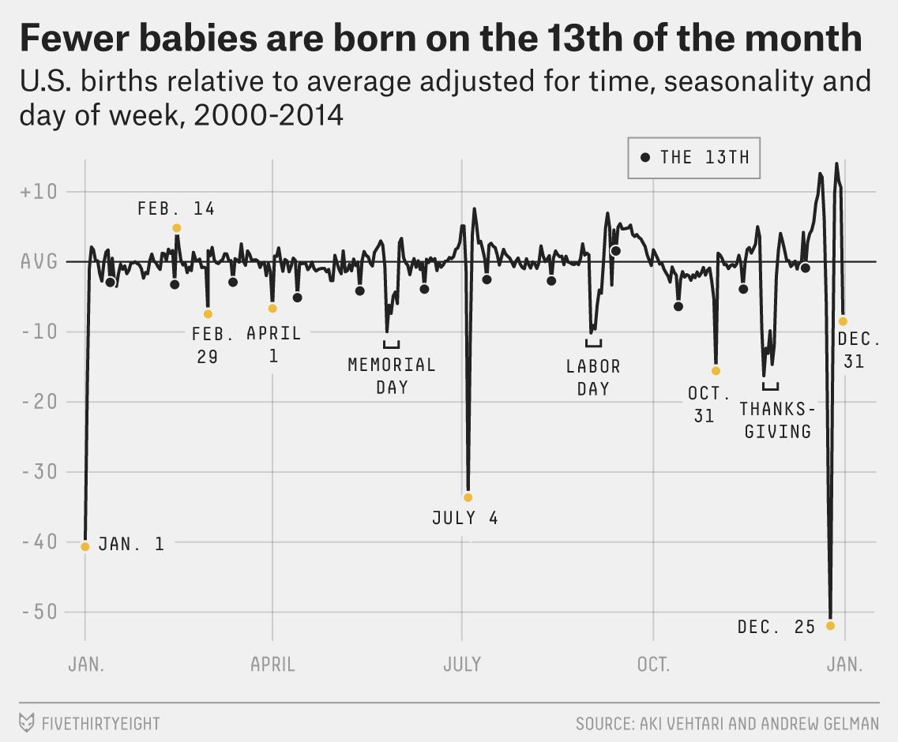



```{r}
#| label: setup
#| include: false
library(tidyverse)
library(readxl)

births_tibble <- read_excel("data/us_births_1994_2014.xlsx") |>
  mutate(
    day_of_week = factor(
      day_of_week,
      levels = c("Sun", "Mon", "Tues", "Wed", "Thurs", "Fri", "Sat"),
      ordered = TRUE
    )
  )
```

## Information

```{r}
#| label: information-1
#| echo: false
learnr2::student_info()
```

## Introduction

This tutorial covers key concepts from [Chapter 20: Spreadsheets](https://r4ds.hadley.nz/spreadsheets.html), [Chapter 9: Layers](https://r4ds.hadley.nz/layers.html), [Chapter 10: Exploratory Data Analysis](https://r4ds.hadley.nz/EDA.html), and [Chapter 11: Communication](https://r4ds.hadley.nz/communication.html) from [*R for Data Science (2e)*](https://r4ds.hadley.nz/) by Hadley Wickham, Mine Çetinkaya-Rundel, and Garrett Grolemund.

You will learn about working with tabular data from Excel files using **[readxl](https://readxl.tidyverse.org/)** and **[ggplot2](https://ggplot2.tidyverse.org/)**. Key techniques include calendar heatmaps with `geom_tile()`, ordered factors for correct axis sorting, grouped summaries as the foundation for visualizations, and a linear model whose residuals isolate a holiday effect.

Use AI however you like.

### Exercise 1

You should be doing this tutorial in a repo named `r4ds-2`. If you are not, create one and then connect to it. You may need to restart this tutorial after you do so. All lowercase: `r4ds-2`, not `R4DS-2` — every path and URL below assumes it.

Create a new file and save it as `analysis.qmd`. Add a YAML header at the top with a title (`"Analyzing US Births"`) and your name as author. In a bash Terminal, run:

```bash
quarto render analysis.qmd
```

Open `analysis.html` with Live Server (right-click it in the Explorer → **Open with Live Server**) and keep the tab open. It refreshes on every render. Going forward, we will just tell you to "Render" when we want you to take these steps.

Create a `.gitignore` with `analysis_files` followed by a blank line. Commit and push.

In the R Terminal, run:

```r
show_file(".gitignore")
```

If that fails, it is probably because you have not yet loaded `library(learnr2)` in the R Terminal.

CP/CR.

```{r}
#| label: introduction-1
#| echo: false
learnr2::question(
  "You should be doing this tutorial in a repo named r4ds-2. If you are not, create one and then connect to it. You may need to restart this tutorial after you do so. All lowercase: r4ds-2, not R4DS-2 — every path and URL below assumes it. Create a new file and save it as analysis.qmd. Add a YAML header at the top with a title (\"Analyzing US Births\") and your name as author. In a bash Terminal, run: quarto render analysis.qmd Open analysis.html with Live Server (right-click it in the Explorer, then Open with Live Server) and keep the tab open. It refreshes on every render. Going forward, we will just tell you to \"Render\" when we want you to take these steps. Create a .gitignore with analysis_files followed by a blank line. Commit and push. In the R Terminal, run: show_file(\".gitignore\") If that fails, it is probably because you have not yet loaded library(learnr2) in the R Terminal. CP/CR.",
  type = "reflection",
  show_text = FALSE
)
```

###

```{.output}
analysis_files
```

###

This tutorial works with one dataset: US daily birth counts (1994–2014) from FiveThirtyEight. It arrives as an `.xlsx` Excel file, so `library(readxl)` will be needed alongside `library(tidyverse)`, which does not load **readxl** for you.

### Exercise 2

In your QMD, put `library(tidyverse)` and `library(readxl)` in a new code chunk. Render.

Notice that the file does not look good because the code is visible and there are annoying messages. To take care of this, add `#| message: false` to remove all the messages in this code chunk. Also add the following to the YAML header to remove all code echoes from the HTML:

```yaml
execute:
  echo: false
```

In the R Terminal, run:

```r
show_file("analysis.qmd", chunk = "Last")
```

If that fails, it is probably because you have not yet loaded `library(learnr2)` in the R Terminal.

CP/CR.

```{r}
#| label: introduction-2
#| echo: false
learnr2::question(
  "In your QMD, put library(tidyverse) and library(readxl) in a new code chunk. Render. Notice that the file does not look good because the code is visible and there are annoying messages. To take care of this, add #| message: false to remove all the messages in this code chunk. Also add the following to the YAML header to remove all code echoes from the HTML: execute: echo: false In the R Terminal, run: show_file(\"analysis.qmd\", chunk = \"Last\") If that fails, it is probably because you have not yet loaded library(learnr2) in the R Terminal. CP/CR.",
  type = "reflection",
  show_text = FALSE
)
```

###

```{.output}
#| message: false
library(tidyverse)
library(readxl)
```

###

Excel files exported from spreadsheet software often encode categorical variables as plain text. Before those columns display in the right order on a plot axis they need to be converted to ordered factors — you will do that for the day of the week in this tutorial.

### Exercise 3

In the R Terminal, run these three commands:

`getwd()`  
`dir.create("data")`  
`list.files()`  

This will create a `data` directory in your project. This is a good place to store any data that you are working with. If `analysis.qmd` is not in this listing, you saved it somewhere else; move it into the `r4ds-2` folder before going on.

We will soon stop giving you commands like these and just have AI do it.

CP/CR.

```{r}
#| label: introduction-3
#| echo: false
learnr2::question(
  "In the R Terminal, run these three commands: getwd() dir.create(\"data\") list.files() This will create a data directory in your project. This is a good place to store any data that you are working with. If analysis.qmd is not in this listing, you saved it somewhere else; move it into the r4ds-2 folder before going on. We will soon stop giving you commands like these and just have AI do it. CP/CR.",
  type = "reflection",
  show_text = FALSE
)
```

###

```{.output}
> getwd()
[1] "/workspaces/r4ds-2"
> dir.create("data")
> list.files()
[1] "AGENTS.md"      "analysis.html"  "analysis.qmd"   "analysis_files" "data"
>
```

###

Keeping raw data in its own `data/` directory is the convention [Chapter 20: Spreadsheets](https://r4ds.hadley.nz/spreadsheets.html) assumes: the spreadsheet you download stays untouched in one known place, and every change you make to it lives in code rather than in the file itself. That is what makes a spreadsheet analysis reproducible — an Excel workbook edited by hand carries no record of what was edited, while a QMD that reads the original workbook records every step.

## Births

In 2016, FiveThirtyEight published ["Some People Are Too Superstitious to Have a Baby on Friday the 13th"](https://fivethirtyeight.com/features/some-people-are-too-superstitious-to-have-a-baby-on-friday-the-13th/), which showed US births relative to average — adjusted for time trends, seasonality, and day of week — across the full calendar year.

{width=90%}

New Year's Day and Christmas show the deepest dips; even the 13th of each month is slightly lower than surrounding days. You will investigate this dataset and produce a version of this chart.

### Exercise 1

Download the Excel file `us_births_1994_2014.xlsx` into your `data/` directory. In the R Terminal, run:

```r
download.file(
  "https://github.com/PPBDS/misc.tutorials/raw/refs/heads/main/inst/tutorials/r4ds-2/data/us_births_1994_2014.xlsx",
  "data/us_births_1994_2014.xlsx",
  mode = "wb"
)
```

Excel `.xlsx` files are binary, not plain text, which is why `download.file()` needs `mode = "wb"` ("write binary").

In a bash Terminal, run:

```bash
ls data
```

CP/CR.

```{r}
#| label: births-1
#| echo: false
learnr2::question(
  "Download the Excel file us_births_1994_2014.xlsx into your data/ directory. In the R Terminal, run: download.file(\"https://github.com/PPBDS/misc.tutorials/raw/refs/heads/main/inst/tutorials/r4ds-2/data/us_births_1994_2014.xlsx\", \"data/us_births_1994_2014.xlsx\", mode = \"wb\") Excel .xlsx files are binary, not plain text, which is why download.file() needs mode = \"wb\" (\"write binary\"). In a bash Terminal, run: ls data CP/CR.",
  type = "reflection",
  show_text = FALSE
)
```

###

```{.output}
us_births_1994_2014.xlsx
```

###

FiveThirtyEight published this data under a CC-BY license alongside their 2016 article. It combines two overlapping government sources: a CDC-derived file covering 1994–1999 and a Social Security Administration (SSA) file covering 2000–2014; the combined spreadsheet uses the SSA data for the 2000–2003 overlap to avoid double-counting.

### Exercise 2

Display the structure of `data/us_births_1994_2014.xlsx` — its column names, their types, and a few example values. Render.

In the R Terminal, run `show_file("analysis.qmd", chunk = "Last")`. CP/CR.

```{r}
#| label: births-2
#| echo: false
learnr2::question(
  "Display the structure of data/us_births_1994_2014.xlsx — its column names, their types, and a few example values. Render. In the R Terminal, run show_file(\"analysis.qmd\", chunk = \"Last\"). CP/CR.",
  type = "reflection",
  show_text = FALSE
)
```

###


```{r}
#| label: births-2-answer
#| echo: true
glimpse(read_excel("data/us_births_1994_2014.xlsx"))
```

###

The dataset has 7,670 rows — one per calendar day — and five columns, and `day_of_week` arrives as `<chr>` in FiveThirtyEight's abbreviated labels ("Mon", "Tues", "Wed", "Thurs", "Fri", "Sat", "Sun") rather than full names or numbers. Daily counts run from 5,728 — Sunday, December 25, 2011 — up to 16,081 on a Wednesday in September 2009.

### Exercise 3

Build a tibble named `births_tibble` from the spreadsheet in which `day_of_week` is an ordered factor running `"Sun"`, `"Mon"`, `"Tues"`, `"Wed"`, `"Thurs"`, `"Fri"`, `"Sat"`, then display its structure. Render.

In the R Terminal, run:

```r
show_file("analysis.qmd", chunk = "Last")
```

CP/CR.

```{r}
#| label: births-4
#| echo: false
learnr2::question(
  "Build a tibble named births_tibble from the spreadsheet in which day_of_week is an ordered factor running \"Sun\", \"Mon\", \"Tues\", \"Wed\", \"Thurs\", \"Fri\", \"Sat\", then display its structure. Render. In the R Terminal, run: show_file(\"analysis.qmd\", chunk = \"Last\") CP/CR.",
  type = "reflection",
  show_text = FALSE
)
```

###


```{r}
#| label: births-4-answer
#| echo: true
births_tibble <- read_excel("data/us_births_1994_2014.xlsx") |>
  mutate(
    day_of_week = factor(
      day_of_week,
      levels = c("Sun", "Mon", "Tues", "Wed", "Thurs", "Fri", "Sat"),
      ordered = TRUE
    )
  )

glimpse(births_tibble)
```

###

`day_of_week` is now `<ord>` — an ordered factor — rather than `<chr>`, which tells **ggplot2** how to sequence it on axes and in legends. Without the ordering, **ggplot2** would sort day names alphabetically ("Fri" before "Mon"), which is meaningless for a day-of-week axis.

### Exercise 4

`births_tibble` is worth keeping around, so the chunk that builds it should do nothing else. Delete the display line from that chunk, leaving only the definition of `births_tibble`. Render.

In the R Terminal, run:

```r
show_file("analysis.qmd", chunk = "Last")
```

CP/CR.

```{r}
#| label: births-5
#| echo: false
learnr2::question(
  "births_tibble is worth keeping around, so the chunk that builds it should do nothing else. Delete the display line from that chunk, leaving only the definition of births_tibble. Render. In the R Terminal, run: show_file(\"analysis.qmd\", chunk = \"Last\") CP/CR.",
  type = "reflection",
  show_text = FALSE
)
```

###

```{.output}
births_tibble <- read_excel("data/us_births_1994_2014.xlsx") |>
  mutate(
    day_of_week = factor(
      day_of_week,
      levels = c("Sun", "Mon", "Tues", "Wed", "Thurs", "Fri", "Sat"),
      ordered = TRUE
    )
  )
```

###

The chunk now holds one thing: the tibble the rest of the section depends on. That is what makes it safe to save — a chunk that both builds an object and prints something about it would have to be re-run whenever you wanted a different printout.

### Exercise 5

Add `#| cache: true` as the first line inside the `births_tibble` chunk. Render. Rendering with caching turned on creates an `analysis_cache/` directory next to your `analysis.qmd`, which holds the parsed result so Quarto can reload it on subsequent renders rather than re-parsing the Excel file each time.

In the bash Terminal, run `ls`.

CP/CR.

```{r}
#| label: births-6
#| echo: false
learnr2::question(
  "Add #| cache: true as the first line inside the births_tibble chunk. Render. Rendering with caching turned on creates an analysis_cache/ directory next to your analysis.qmd, which holds the parsed result so Quarto can reload it on subsequent renders rather than re-parsing the Excel file each time. In the bash Terminal, run ls. CP/CR.",
  type = "reflection",
  show_text = FALSE
)
```

###

```{.output}
AGENTS.md  analysis_cache  analysis_files  analysis.html  analysis.qmd  data
```

###

Total US births varied year to year across this span — the annual daily average in `births_tibble` peaked in 2007 at about 12,000 and had fallen roughly 9% by 2012 — so a raw count on any given December 25 mixes the holiday signal with a year-level baseline shift.

### Exercise 6

The Source Control change count just jumped, because `analysis_cache/` and everything inside it now look like untracked work to git. Cached files should never go to GitHub — they're machine-specific and regenerated on every render.

Add `analysis_cache` to your `.gitignore` on its own line. In the R Terminal, run `show_file(".gitignore")`. CP/CR.

```{r}
#| label: births-7
#| echo: false
learnr2::question(
  "Add analysis_cache to your .gitignore on its own line. In the R Terminal, run show_file(\".gitignore\"). CP/CR.",
  type = "reflection",
  show_text = FALSE
)
```

###

```{.output}
analysis_files
analysis_cache
```

###

The 7,670 rows are 365 × 21 years plus 5 leap days (1996, 2000, 2004, 2008, 2012), which confirms no calendar days are missing from the data.

### Exercise 7

In a new code chunk, compute the average number of births for each calendar position — each combination of `month` and `date_of_month` — averaged across all 21 years. Render.

In the R Terminal, run `show_file("analysis.qmd", chunk = "Last")`. CP/CR.

```{r}
#| label: births-8
#| echo: false
learnr2::question(
  "In a new code chunk, compute the average number of births for each calendar position — each combination of month and date_of_month — averaged across all 21 years. Render. In the R Terminal, run show_file(\"analysis.qmd\", chunk = \"Last\"). CP/CR.",
  type = "reflection",
  show_text = FALSE
)
```

###


```{r}
#| label: births-8-answer
#| echo: true
births_tibble |>
  group_by(month, date_of_month) |>
  summarize(mean_births = mean(births), .groups = "drop")
```

###

This summary collapses 7,670 daily observations into 366 cells (one per calendar position, including Feb 29). Each cell holds the mean births across all 21 years — except February 29, which appears only 5 times (the leap years 1996, 2000, 2004, 2008, and 2012).

### Exercise 8

Turn that summary into a calendar heatmap: one colored tile per calendar position, with day of month running across the bottom, months running down the side from January, and tile color showing mean births. Render.

Take a screenshot of the plot in your rendered page and paste it below. To take a screenshot, press `Cmd + Ctrl + Shift + 4` on a Mac, `Win + Shift + S` on Windows, or `Ctrl + Shift + Show windows` on a Chromebook, select the area, then click in the answer box and press `Cmd + V` (Mac) or `Ctrl + V` (Windows) to paste it.

```{r}
#| label: births-9
#| echo: false
learnr2::question(
  "Turn that summary into a calendar heatmap: one colored tile per calendar position, with day of month running across the bottom, months running down the side from January, and tile color showing mean births. Render. Take a screenshot of the plot in your rendered page and paste it below.",
  type = "reflection",
  allow_image = TRUE,
  allow_text = FALSE,
  show_text = FALSE
)
```

###


```{r}
#| label: births-9-answer
#| echo: true
births_tibble |>
  group_by(month, date_of_month) |>
  summarize(mean_births = mean(births), .groups = "drop") |>
  ggplot(aes(x = date_of_month, y = month, fill = mean_births)) +
  geom_tile(color = "white", linewidth = 0.1) +
  scale_y_reverse(breaks = 1:12, labels = month.abb) +
  scale_fill_gradient(low = "#fff7ec", high = "#7f0000",
                      labels = scales::comma,
                      name = "Mean births") +
  labs(
    title = "Mean US Births by Calendar Day (1994–2014)",
    subtitle = "September peaks; holidays show deep dips",
    x = "Day of month",
    y = NULL,
    caption = "Source: FiveThirtyEight/SSA (1994–2014)"
  ) +
  theme_minimal()
```

###

A calendar heatmap lays a year out as a matrix — day of month across, month down — and uses color as a third dimension, so 366 daily values fit in a single glance. The September cluster is immediately visible as the darkest band; the holiday notches are unmistakable light vertical cuts.

### Exercise 9

Compute, for each year, the number of births on December 25 and the average number of births on the surrounding days (December 20–24 and 27–30), then express December 25 as a percentage of that baseline. Render.

In the R Terminal, run `show_file("analysis.qmd", chunk = "Last")`. CP/CR.

```{r}
#| label: births-10
#| echo: false
learnr2::question(
  "Compute, for each year, the number of births on December 25 and the average number of births on the surrounding days (December 20–24 and 27–30), then express December 25 as a percentage of that baseline. Render. In the R Terminal, run show_file(\"analysis.qmd\", chunk = \"Last\"). CP/CR.",
  type = "reflection",
  show_text = FALSE
)
```

###


```{r}
#| label: births-10-answer
#| echo: true
christmas_data <- births_tibble |>
  filter(month == 12) |>
  group_by(year) |>
  summarize(
    christmas_births = births[date_of_month == 25],
    baseline         = mean(births[date_of_month %in% c(20:24, 27:30)]),
    weekday          = as.character(day_of_week[date_of_month == 25]),
    .groups          = "drop"
  ) |>
  mutate(
    pct_of_baseline = christmas_births / baseline,
    weekday = factor(weekday,
                     levels = c("Sun", "Mon", "Tues", "Wed",
                                "Thurs", "Fri", "Sat"))
  )

christmas_data |>
  mutate(pct_of_baseline = round(pct_of_baseline, 3)) |>
  select(year, christmas_births, baseline, pct_of_baseline, weekday)
```

###

`pct_of_baseline` runs from 48.1% to 70.8% across the 21 Christmases, with a median of 60.7% — a 23-point spread too large to be noise alone. The `weekday` column shows Christmas falling on a different day each year — Sunday in 1994, Monday in 1995, Wednesday in 1996 — but the table alone cannot say how much of the swing comes from the weekday, from year-to-year differences in overall birth rates, or from noise.

### Exercise 10

Make a line and point chart of `pct_of_baseline` by year. Render.

Take a screenshot of the plot in your rendered page and paste it below.

```{r}
#| label: births-12
#| echo: false
learnr2::question(
  "Make a line and point chart of pct_of_baseline by year. Render. Take a screenshot of the plot in your rendered page and paste it below.",
  type = "reflection",
  allow_image = TRUE,
  allow_text = FALSE,
  show_text = FALSE
)
```

###


```{r}
#| label: births-12-answer
#| echo: true
christmas_data |>
  ggplot(aes(x = year, y = pct_of_baseline)) +
  geom_line(color = "gray60", linewidth = 0.5) +
  geom_point(size = 2) +
  scale_y_continuous(labels = scales::percent_format(accuracy = 1)) +
  labs(
    title = "Dec 25 Births as a Share of Surrounding-Day Baseline",
    subtitle = "Year-over-year comparison looks noisy",
    x = "Year",
    y = "Dec 25 births as % of baseline",
    caption = "Source: FiveThirtyEight/SSA (1994–2014)"
  ) +
  theme_minimal()
```

###

There seems to be a general downward trend as well as an oscillating pattern. Two things vary year to year that could cause this: which weekday Christmas falls on, and the underlying level of US births — 2007 was a near-record birth year while 2011–2012 were noticeably lower.

### Exercise 11

Update the plot to color each point by the weekday that December 25 fell on that year. Render.

Take a screenshot of the plot in your rendered page and paste it below.

```{r}
#| label: births-13
#| echo: false
learnr2::question(
  "Update the plot to color each point by the weekday that December 25 fell on that year. Render. Take a screenshot of the plot in your rendered page and paste it below.",
  type = "reflection",
  allow_image = TRUE,
  allow_text = FALSE,
  show_text = FALSE
)
```

###


```{r}
#| label: births-13-answer
#| echo: true
christmas_data |>
  ggplot(aes(x = year, y = pct_of_baseline, color = weekday)) +
  geom_line(color = "gray70", linewidth = 0.4) +
  geom_point(size = 3) +
  scale_y_continuous(labels = scales::percent_format(accuracy = 1)) +
  scale_color_brewer(palette = "Dark2") +
  labs(
    title = "Dec 25 Births as a Share of Surrounding-Day Baseline",
    subtitle = "Color shows the weekday Christmas fell on each year",
    x = "Year",
    y = "Dec 25 births as % of baseline",
    color = "Weekday",
    caption = "Source: FiveThirtyEight/SSA (1994–2014)"
  ) +
  theme_minimal()
```

###

Saturday and Sunday years sit at the bottom of every vertical slice; Wednesday and Thursday years sit at the top — the confound is the day of the week. Weekend days already average roughly a third fewer births than weekdays, because scheduled inductions and cesareans are booked on working days, so a Saturday Christmas compounds the holiday effect while a Wednesday Christmas barely adds to it.

### Exercise 12

The Christmas analysis revealed two confounds blurring the year-over-year comparison: which weekday December 25 falls on, and year-to-year variation in overall birth rates. The FiveThirtyEight graphic shown at the top of this section removes both of those effects, plus a third — season — before measuring the residual.

The tool is a linear model. R predicts each day's birth count from year, month, and day of week; the residuals — the gap between actual and predicted — carry the holiday signal in isolation, stripped of those confounds.

Fit a linear model that explains each day's birth count from year, month, and day of the week, assign it to `births_model`, and print the model's R² — the share of day-to-day variation those three factors account for. Render.

In the R Terminal, run `show_file("analysis.qmd", chunk = "Last")`. CP/CR.

```{r}
#| label: births-14
#| echo: false
learnr2::question(
  "Fit a linear model that explains each day's birth count from year, month, and day of the week, assign it to births_model, and print the model's R² — the share of day-to-day variation those three factors account for. Render. In the R Terminal, run show_file(\"analysis.qmd\", chunk = \"Last\"). CP/CR.",
  type = "reflection",
  show_text = FALSE
)
```

###


```{r}
#| label: births-14-answer
#| echo: true
births_model <- lm(births ~ factor(year) + factor(month) + day_of_week,
                   data = births_tibble)

summary(births_model)$r.squared
```

###

The model's R² of roughly 0.88 means year, month, and weekday together explain about 88% of the day-to-day variation in US birth counts. The remaining 12% is what the three factors cannot account for — and that unexplained portion is what we want: it holds the holiday signal, isolated from season and schedule.

### Exercise 13

Add a column to `births_tibble` named `pct_resid` holding each day's residual from `births_model`, expressed as a percentage of the overall mean birth count, and assign the result to `births_adjusted`. Then collapse `births_adjusted` to one row per calendar position — 365 of them, with February 29 dropped — holding the mean `pct_resid` for that date. Add a date column that pins each position to 2001, a non-leap year, so the whole calendar can go on a date axis. Assign the result to `calendar_resid` and display it. Render.

In the R Terminal, run `show_file("analysis.qmd", chunk = "Last")`. CP/CR.

```{r}
#| label: births-16
#| echo: false
learnr2::question(
  "Add a column to births_tibble named pct_resid holding each day's residual from births_model, expressed as a percentage of the overall mean birth count, and assign the result to births_adjusted. Then collapse births_adjusted to one row per calendar position — 365 of them, with February 29 dropped — holding the mean pct_resid for that date. Add a date column that pins each position to 2001, a non-leap year, so the whole calendar can go on a date axis. Assign the result to calendar_resid and display it. Render. In the R Terminal, run show_file(\"analysis.qmd\", chunk = \"Last\"). CP/CR.",
  type = "reflection",
  show_text = FALSE
)
```

###


```{r}
#| label: births-16-answer
#| echo: true
births_model <- lm(births ~ factor(year) + factor(month) + day_of_week,
                   data = births_tibble)

births_adjusted <- births_tibble |>
  mutate(pct_resid = resid(births_model) / mean(births) * 100)

calendar_resid <- births_adjusted |>
  filter(!(month == 2 & date_of_month == 29)) |>
  group_by(month, date_of_month) |>
  summarize(mean_pct_resid = mean(pct_resid), .groups = "drop") |>
  mutate(calendar_date = as.Date(paste("2001", month, date_of_month,
                                       sep = "-")))

calendar_resid
```

###

`pct_resid` is how many percentage points a day sits above or below the model's prediction for its year, season, and weekday, and the largest negative values belong to the major holidays: Christmas, New Year's Day, July 4, and Thanksgiving. In `calendar_resid` the December 25 row shows −39.4 — Christmas averages about 39 points below the adjusted baseline — while typical September dates sit near zero, because the September peak is fully captured by the month predictor.

### Exercise 14

Plot `calendar_resid` as a line chart with `calendar_date` on the x-axis and `mean_pct_resid` on the y-axis. Add a horizontal reference line at zero and annotate at least three of the deepest holiday dips by name. Render.

Take a screenshot of the plot in your rendered page and paste it below.

```{r}
#| label: births-17
#| echo: false
learnr2::question(
  "Plot calendar_resid as a line chart with calendar_date on the x-axis and mean_pct_resid on the y-axis. Add a horizontal reference line at zero and annotate at least three of the deepest holiday dips by name. Render. Take a screenshot of the plot in your rendered page and paste it below.",
  type = "reflection",
  allow_image = TRUE,
  allow_text = FALSE,
  show_text = FALSE
)
```

###


```{r}
#| label: births-17-answer
#| echo: true
calendar_resid |>
  ggplot(aes(x = calendar_date, y = mean_pct_resid)) +
  geom_hline(yintercept = 0, color = "gray60") +
  geom_line(linewidth = 0.4) +
  annotate("text", x = as.Date("2001-01-01"), y = -21, label = "Jan. 1",  size = 3, hjust = 0.2) +
  annotate("text", x = as.Date("2001-07-04"), y = -23, label = "July 4",  size = 3, hjust = 0.5) +
  annotate("text", x = as.Date("2001-12-25"), y = -36, label = "Dec. 25", size = 3, hjust = 1) +
  scale_x_date(date_labels = "%b.", date_breaks = "3 months") +
  scale_y_continuous(labels = scales::label_percent(scale = 1)) +
  labs(
    title = "Fewer Babies Are Born on Holidays",
    subtitle = "US births relative to year-, month-, and weekday-adjusted baseline (1994–2014)",
    x = NULL,
    y = "% vs. adjusted baseline",
    caption = "Source: FiveThirtyEight/SSA (1994–2014)"
  ) +
  theme_minimal()
```

###

Original FiveThirtyEight graphic for comparison:

{width=90%}

The pattern matches the FiveThirtyEight original: deep dips at Christmas, New Year's Day, and July 4; the rest of the year hovering near zero. After removing year, month, and weekday effects, the September peak disappears — it was entirely seasonal.

### Exercise 15

Commit `analysis.qmd` with the message `"Add births analysis"` and push to GitHub.

In the bash Terminal, run:

```bash
git log --oneline -3
```

CP/CR.

```{r}
#| label: births-18
#| echo: false
learnr2::question(
  "Commit analysis.qmd with the message \"Add births analysis\" and push to GitHub. In the bash Terminal, run: git log --oneline -3 CP/CR.",
  type = "reflection",
  show_text = FALSE
)
```

###

```{.output}
a1b2c3d (HEAD -> main, origin/main) Add births analysis
e4f5a6b Add analysis.qmd and .gitignore
```

###

The births analysis is a textbook EDA iteration: a simple plot reveals a pattern, a second makes it look noisy, and a third reveals the confound that was blurring the signal. That cycle — inspect, notice, refine — is the core loop Chapter 10 describes.

## Summary

This tutorial covered key concepts from [Chapter 20: Spreadsheets](https://r4ds.hadley.nz/spreadsheets.html), [Chapter 9: Layers](https://r4ds.hadley.nz/layers.html), [Chapter 10: Exploratory Data Analysis](https://r4ds.hadley.nz/EDA.html), and [Chapter 11: Communication](https://r4ds.hadley.nz/communication.html) from [*R for Data Science (2e)*](https://r4ds.hadley.nz/) by Hadley Wickham, Mine Çetinkaya-Rundel, and Garrett Grolemund.

You learned about working with tabular data from Excel files using **readxl** and **ggplot2**. Key techniques included calendar heatmaps with `geom_tile()`, ordered factors, grouped summaries, and a linear model whose residuals isolate a holiday effect.

### Exercise 1

Render. Check your Live Server tab — the resulting HTML page should be attractive, showing a clean version of your plot.

In the R Terminal, run:

```r
show_file("analysis.qmd")
```

CP/CR.

```{r}
#| label: summary-1
#| echo: false
learnr2::question(
  "Render. Check your Live Server tab — the resulting HTML page should be attractive, showing a clean version of your plot. In the R Terminal, run: show_file(\"analysis.qmd\") CP/CR.",
  type = "reflection",
  show_text = FALSE
)
```

###

````{verbatim}
---
title: "Analyzing US Births"
author: <your name>
execute:
  echo: false
---

```{r}
#| message: false
library(tidyverse)
library(readxl)
```

```{r}
#| cache: true
births_tibble <- read_excel("data/us_births_1994_2014.xlsx") |>
  mutate(
    day_of_week = factor(
      day_of_week,
      levels = c("Sun", "Mon", "Tues", "Wed", "Thurs", "Fri", "Sat"),
      ordered = TRUE
    )
  )
```

```{r}
births_model <- lm(births ~ factor(year) + factor(month) + day_of_week,
                   data = births_tibble)

births_adjusted <- births_tibble |>
  mutate(pct_resid = resid(births_model) / mean(births) * 100)

calendar_resid <- births_adjusted |>
  filter(!(month == 2 & date_of_month == 29)) |>
  group_by(month, date_of_month) |>
  summarize(mean_pct_resid = mean(pct_resid), .groups = "drop") |>
  mutate(calendar_date = as.Date(paste("2001", month, date_of_month,
                                       sep = "-")))

calendar_resid |>
  ggplot(aes(x = calendar_date, y = mean_pct_resid)) +
  geom_hline(yintercept = 0, color = "gray60") +
  geom_line(linewidth = 0.4) +
  annotate("text", x = as.Date("2001-01-01"), y = -21, label = "Jan. 1",  size = 3, hjust = 0.2) +
  annotate("text", x = as.Date("2001-07-04"), y = -23, label = "July 4",  size = 3, hjust = 0.5) +
  annotate("text", x = as.Date("2001-12-25"), y = -36, label = "Dec. 25", size = 3, hjust = 1) +
  scale_x_date(date_labels = "%b.", date_breaks = "3 months") +
  scale_y_continuous(labels = scales::label_percent(scale = 1)) +
  labs(
    title = "Fewer Babies Are Born on Holidays",
    subtitle = "US births relative to year-, month-, and weekday-adjusted baseline (1994–2014)",
    x = NULL,
    y = "% vs. adjusted baseline",
    caption = "Source: FiveThirtyEight/SSA (1994–2014)"
  ) +
  theme_minimal()
```
````

###

The whole analysis rests on one data-preparation step: reading the Excel file and converting `day_of_week` to an ordered factor running Sunday through Saturday. Skipping it would leave the weekdays sorted alphabetically — "Fri" before "Mon" — on every axis and in every legend.

### Exercise 2

Publish your rendered QMD to GitHub Pages. In a bash Terminal, run:

```bash
quarto publish gh-pages analysis.qmd
```

Copy/paste the resulting URL below.

```{r}
#| label: summary-2
#| echo: false
learnr2::question(
  "Publish your rendered QMD to GitHub Pages. In a bash Terminal, run: quarto publish gh-pages analysis.qmd Copy/paste the resulting URL below.",
  type = "reflection",
  show_text = FALSE
)
```

###

```{.output}
? Publish site to https://your-username.github.io/r4ds-2/ using gh-pages? (Y/n) › Yes
Switched to a new branch 'gh-pages'
...
Rendering for publish:

[1/1] analysis.qmd

Output created: analysis.html
...
[gh-pages abc1234] Built site for gh-pages
...
To https://github.com/your-username/r4ds-2.git
[✓] Deploying gh-pages branch to website (this may take a few minutes)
[✓] Published to https://your-username.github.io/r4ds-2/
```

Your answer is the URL on the last line: `https://your-username.github.io/r4ds-2/`.

###

The published page carries one finding: births on December 25 run about 39 percentage points below the year-, month-, and weekday-adjusted baseline, with Christmas Eve and July 4 (both about −26) and New Year's Day (−24) the next-deepest dips.

### Exercise 3

Commit and push any remaining changes. Copy/paste the URL to your GitHub repo.

```{r}
#| label: summary-3
#| echo: false
learnr2::question(
  "Commit and push any remaining changes. Copy/paste the URL to your GitHub repo.",
  type = "reflection",
  show_text = FALSE
)
```

###

```{.output}
https://github.com/your-username/r4ds-2
```

###

The births series stops at 2014 because no later public-use dataset records the day of birth — the CDC's public natality files suppress it — so this analysis cannot be extended without restricted data.

## Download answers

```{r}
#| label: download-answers-1
#| echo: false
learnr2::question(
  "How many minutes, approximately, did it take you to complete this
  tutorial? For example, an hour and a half would be 90 minutes.",
  type = "reflection_editable",
  validate = "integer"
)
```

###

```{r}
#| label: download-answers-2
#| echo: false
learnr2::download_answers_button(filename_prefix = "r4ds-2")
```
