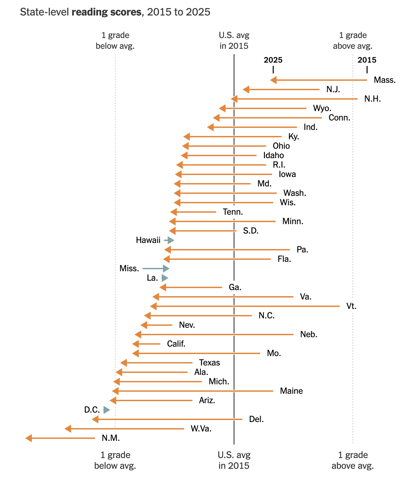
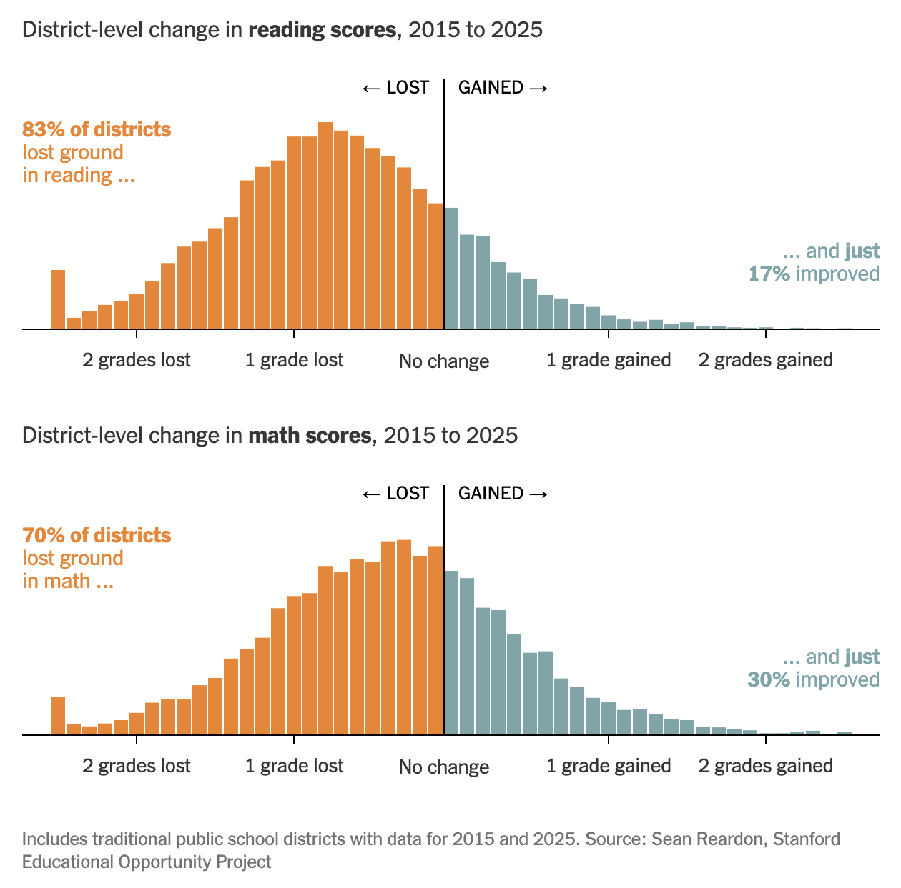



```{r}
#| label: setup
#| include: false
library(tidyverse)
library(DBI)
library(duckdb)
library(dbplyr)


con_seda <- dbConnect(duckdb::duckdb(),
                      dbdir = "data/seda_2025.duckdb",
                      read_only = TRUE)

dbplyr_dist <- tbl(con_seda, "district_scores")

score_change <- dbplyr_dist |>
  filter(year %in% c(2015, 2023), !is.na(rla_score)) |>
  select(district_id, district_name, state, year, rla_score) |>
  collect() |>
  pivot_wider(names_from = year, values_from = rla_score, names_prefix = "rla_") |>
  filter(!is.na(rla_2015), !is.na(rla_2023)) |>
  mutate(rla_change = rla_2023 - rla_2015)

state_change <- tbl(con_seda, "state_scores") |>
  filter(year %in% c(2015, 2023), !is.na(rla_score)) |>
  select(stateabb, state_name, year, rla_score) |>
  collect() |>
  pivot_wider(names_from = year, values_from = rla_score, names_prefix = "rla_") |>
  filter(!is.na(rla_2015), !is.na(rla_2023)) |>
  mutate(rla_change = rla_2023 - rla_2015)
```

## Information

```{r}
#| label: information-1
#| echo: false
learnr2::student_info()
```

## Introduction

This tutorial accompanies [Chapter 21: Databases](https://r4ds.hadley.nz/databases.html), [Chapter 12: Logical vectors](https://r4ds.hadley.nz/logicals.html), and [Chapter 13: Numbers](https://r4ds.hadley.nz/numbers.html) from [*R for Data Science (2e)*](https://r4ds.hadley.nz/) by Hadley Wickham, Mine Çetinkaya-Rundel, and Garrett Grolemund.

You will use the **[DBI](https://dbi.r-dbi.org/)**, **[duckdb](https://duckdb.org/docs/api/r)**, and **[dbplyr](https://dbplyr.tidyverse.org/)** packages to query the Stanford Education Data Archive (SEDA), recently featured in the *New York Times*: reading scores across 13,000 US school districts, rescaled so that districts and states can be compared with each other and across years.

Use AI however you like.

### Exercise 1

You should be doing this tutorial in a repo named `r4ds-3`. If you are not, create one and then connect to it.

Create a new file, `analysis.qmd`, with the title `"Analyzing School District Reading Scores"` and your name as the author. In a bash Terminal, render it:

```bash
quarto render analysis.qmd
```

Open `analysis.html` with Live Server (right-click it in the Explorer → **Open with Live Server**) and keep the tab open. It refreshes on every render. Going forward, we will just tell you to "Render" when we want you to take these steps.

Create a `.gitignore` with `analysis_files` followed by a blank line. Commit and push.

In the R Terminal, run:

```r
show_file(".gitignore")
```

If that fails, it is probably because you have not yet loaded `library(learnr2)` in the R Terminal.

CP/CR.

```{r}
#| label: introduction-1
#| echo: false
learnr2::question(
  "You should be doing this tutorial in a repo named r4ds-3. If you are not, create one and then connect to it. Create a new file, analysis.qmd, with the title \"Analyzing School District Reading Scores\" and your name as the author. In a bash Terminal, render it: quarto render analysis.qmd. Open analysis.html with Live Server (right-click it in the Explorer and choose Open with Live Server) and keep the tab open. It refreshes on every render. Going forward, we will just tell you to \"Render\" when we want you to take these steps. Create a .gitignore with analysis_files followed by a blank line. Commit and push. In the R Terminal, run show_file(\".gitignore\"). If that fails, it is probably because you have not yet loaded library(learnr2) in the R Terminal. CP/CR.",
  type = "reflection",
  show_text = FALSE
)
```

###

```{.output}
analysis_files
```

###

A database table lives on disk and can be arbitrarily large, while a data frame lives in memory. A database table almost always has indexes for fast row lookups, and a data frame does not.

### Exercise 2

In your QMD, put `library(tidyverse)`, `library(DBI)`, `library(duckdb)`, and `library(dbplyr)` in a new code chunk. Render.

Notice that the file does not look good because the code is visible and there are annoying messages. To take care of this, add `#| message: false` to remove all the messages in this code chunk. Also add the following to the YAML header to remove all code echoes from the HTML:

```yaml
execute:
  echo: false
```

Render. In the R Terminal, run:

```r
show_file("analysis.qmd")
```

CP/CR.

```{r}
#| label: introduction-2
#| echo: false
learnr2::question(
  "In your QMD, put library(tidyverse), library(DBI), library(duckdb), and library(dbplyr) in a new code chunk. Render. Notice that the file does not look good because the code is visible and there are annoying messages. To take care of this, add #| message: false to remove all the messages in this code chunk. Also add execute: echo: false to the YAML header to remove all code echoes from the HTML. Render. In the R Terminal, run show_file(\"analysis.qmd\"). CP/CR.",
  type = "reflection",
  show_text = FALSE
)
```

###

```{.output}
#| message: false
library(tidyverse)
library(DBI)
library(duckdb)
library(dbplyr)
```

###

**DBI** is the common interface R uses to talk to any database, and **duckdb** is one driver for it. DuckDB is *in-process*, running inside your R session with no server to administer. Other drivers: **[RSQLite](https://rsqlite.r-dbi.org/)** for the other common in-process engine, **[RPostgres](https://rpostgres.r-dbi.org/)** and **[RMariaDB](https://rmariadb.r-dbi.org/)** for the client-server databases most organizations run, and **[odbc](https://odbc.r-dbi.org/)** as a generic fallback.

### Exercise 3

Create a `data` directory at the top level of the `r4ds-3` repo. In the bash Terminal, run `ls`.

CP/CR.

```{r}
#| label: introduction-3
#| echo: false
learnr2::question(
  "Create a data directory at the top level of the r4ds-3 repo. In the bash Terminal, run ls. CP/CR.",
  type = "reflection",
  show_text = FALSE
)
```

###

```{.output}
AGENTS.md  analysis_files  analysis.html  analysis.qmd  data
```

###

At the simplest level, a database is a collection of data frames — called tables. Like a data frame, a table is a set of named columns where every value in a column has the same type.

## US education

This section uses the [Stanford Education Data Archive (SEDA)](https://edopportunity.org/),
which converts each state's standardized test results into a common
grade-equivalent scale so that achievement can be compared across districts and
years.

Here's [what the *New York Times* found](https://www.nytimes.com/2026/05/13/upshot/test-scores-school-districts-us.html)
from this same data in May of 2026.

{width=90%}

### Exercise 1

Download the DuckDB database `seda_2025.duckdb` from this URL and save it in your
`data/` directory:

```default
https://github.com/PPBDS/misc.tutorials/raw/refs/heads/main/inst/tutorials/r4ds-3/data/seda_2025.duckdb
```

In the bash Terminal, run `ls data`.

CP/CR.

```{r}
#| label: us-education-1
#| echo: false
learnr2::question(
  "Download the DuckDB database seda_2025.duckdb from this URL and save it in your data/ directory: https://github.com/PPBDS/misc.tutorials/raw/refs/heads/main/inst/tutorials/r4ds-3/data/seda_2025.duckdb In the bash Terminal, run ls data. CP/CR.",
  type = "reflection",
  show_text = FALSE
)
```

###

```{.output}
seda_2025.duckdb
```

###

Every state gives a different test, and those raw scores are not comparable to each other. SEDA's contribution is the rescaling: it anchors each state's results to the National Assessment of Educational Progress and reports everything in grade-equivalent units, which is what makes a district in Mississippi comparable to one in Vermont.

### Exercise 2

`seda_2025.duckdb` is 27 MB, far too big to commit. Add `data/*.duckdb` to your `.gitignore` on its own line, so that Git never offers to track it. In the R Terminal, run `show_file(".gitignore")`. CP/CR.

```{r}
#| label: us-education-18
#| echo: false
learnr2::question(
  "seda_2025.duckdb is 27 MB, far too big to commit. Add data/*.duckdb to your .gitignore on its own line, so that Git never offers to track it. In the R Terminal, run show_file(\".gitignore\"). CP/CR.",
  type = "reflection",
  show_text = FALSE
)
```

###

```{.output}
analysis_files
data/*.duckdb
```

###

Git keeps every version of every file it has ever tracked. A 27 MB database committed once would travel with every clone of this repo forever.

### Exercise 3

Create a new working chunk in `analysis.qmd`. Connect to the database file and display the names of the tables it contains. Render.

In the R Terminal, run `show_file("analysis.qmd")`. CP/CR.

```{r}
#| label: us-education-2
#| echo: false
learnr2::question(
  "Create a new working chunk in analysis.qmd. Connect to the database file and display the names of the tables it contains. Render. In the R Terminal, run show_file(\"analysis.qmd\"). CP/CR.",
  type = "reflection",
  show_text = FALSE
)
```

###

```{r}
#| label: us-education-2-answer
#| echo: true
dbListTables(con_seda)
```

###

The SEDA database has three tables: `district_scores` (one row per district per year), `district_demographics` (the same districts broken out by race, gender, and income), and `state_scores` (one row per state per year).

### Exercise 4

In the current working chunk, create a lazy reference to the `district_scores` table, assign it to `dbplyr_dist`, and print it. Render.

In the R Terminal, run `show_file("analysis.qmd")`. CP/CR.

```{r}
#| label: us-education-3
#| echo: false
learnr2::question(
  "In the current working chunk, create a lazy reference to the district_scores table, assign it to dbplyr_dist, and print it. Render. In the R Terminal, run show_file(\"analysis.qmd\"). CP/CR.",
  type = "reflection",
  show_text = FALSE
)
```

###

```{r}
#| label: us-education-3-answer
#| echo: true
dbplyr_dist <- tbl(con_seda, "district_scores")
dbplyr_dist
```

###

The `rla_score` column is on the SEDA grade-equivalent scale: 0 is roughly the national average, and 1.0 is one full grade level above it. `dbplyr_dist` is a lazy reference. It points to the table but pulls no data into R until you call `collect()`.

### Exercise 5

Count the number of district-year observations per year in `dbplyr_dist`. Collect and arrange by year. Render.

In the R Terminal, run `show_file("analysis.qmd")`. CP/CR.

```{r}
#| label: us-education-4
#| echo: false
learnr2::question(
  "Count the number of district-year observations per year in dbplyr_dist. Collect and arrange by year. Render. In the R Terminal, run show_file(\"analysis.qmd\"). CP/CR.",
  type = "reflection",
  show_text = FALSE
)
```

###

```{r}
#| label: us-education-4-answer
#| echo: true
dbplyr_dist |>
  count(year) |>
  collect() |>
  arrange(year)
```

###

The 191,547 district-year rows span 2009–2019 and 2022–2025, with no observations for 2020 or 2021 — most states suspended standardized testing during the COVID-19 pandemic. Coverage is not flat in the years that are present, either. 2014 has 10,855 districts against 14,322 the year before, because ten states, California and Ohio among them, contribute no rows that year.

### Exercise 6

Compute the mean `rla_score` grouped by year, for districts with non-missing scores. Arrange by year. Collect and print. Render.

In the R Terminal, run `show_file("analysis.qmd")`. CP/CR.

```{r}
#| label: us-education-6
#| echo: false
learnr2::question(
  "Compute the mean rla_score grouped by year, for districts with non-missing scores. Arrange by year. Collect and print. Render. In the R Terminal, run show_file(\"analysis.qmd\"). CP/CR.",
  type = "reflection",
  show_text = FALSE
)
```

###

```{r}
#| label: us-education-6-answer
#| echo: true
dbplyr_dist |>
  filter(!is.na(rla_score)) |>
  group_by(year) |>
  summarize(mean_rla = mean(rla_score, na.rm = TRUE)) |>
  arrange(year) |>
  collect()
```

###

Scores drift slightly above zero from 2012 through 2018, peaking at 0.064 in 2014, then turn negative in 2019, and the four post-COVID years are far worse and get worse every year: −0.069 in 2022, −0.099 in 2023, −0.122 in 2024, −0.124 in 2025. These are district averages, not student averages: a one-room district counts as much as Los Angeles Unified.

### Exercise 7

Databases do not run R. Instead of the result, display the query that the database will actually execute for the year-by-year average you just built. Render.

In the R Terminal, run `show_file("analysis.qmd")`. CP/CR.

```{r}
#| label: us-education-7
#| echo: false
learnr2::question(
  "Databases do not run R. Instead of the result, display the query that the database will actually execute for the year-by-year average you just built. Render. In the R Terminal, run show_file(\"analysis.qmd\"). CP/CR.",
  type = "reflection",
  show_text = FALSE
)
```

###

```{r}
#| label: us-education-7-answer
#| echo: true
dbplyr_dist |>
  filter(!is.na(rla_score)) |>
  group_by(year) |>
  summarize(mean_rla = mean(rla_score, na.rm = TRUE)) |>
  arrange(year) |>
  show_query()
```

###

You never wrote SQL, but SQL is what ran. **dbplyr** turns the pipeline into a query string, hands the string to the database, and lets the database do the work: the row filter becomes a `WHERE` clause, the grouping and averaging become `GROUP BY` and `AVG`, and the sort becomes `ORDER BY`.

### Exercise 8

For each district, compute the change in reading score from 2015 to 2023, where a positive value means improvement, keeping only districts with data in both years, and assign the result to `score_change`. Then build `state_change` the same way from the `state_scores` table — the same structure, aggregated at the state level — and print it. Render.

In the R Terminal, run `show_file("analysis.qmd")`. CP/CR.

```{r}
#| label: us-education-8
#| echo: false
learnr2::question(
  "For each district, compute the change in reading score from 2015 to 2023, where a positive value means improvement, keeping only districts with data in both years, and assign the result to score_change. Then build state_change the same way from the state_scores table, the same structure, aggregated at the state level, and print it. Render. In the R Terminal, run show_file(\"analysis.qmd\"). CP/CR.",
  type = "reflection",
  show_text = FALSE
)
```

###

```{r}
#| label: us-education-8-answer
#| echo: true
score_change <- dbplyr_dist |>
  filter(year %in% c(2015, 2023), !is.na(rla_score)) |>
  select(district_id, district_name, state, year, rla_score) |>
  collect() |>
  pivot_wider(names_from = year, values_from = rla_score, names_prefix = "rla_") |>
  filter(!is.na(rla_2015), !is.na(rla_2023)) |>
  mutate(rla_change = rla_2023 - rla_2015)
state_change <- tbl(con_seda, "state_scores") |>
  filter(year %in% c(2015, 2023), !is.na(rla_score)) |>
  select(stateabb, state_name, year, rla_score) |>
  collect() |>
  pivot_wider(names_from = year, values_from = rla_score, names_prefix = "rla_") |>
  filter(!is.na(rla_2015), !is.na(rla_2023)) |>
  mutate(rla_change = rla_2023 - rla_2015)
state_change
```

###

In 2015 the district scores had a standard deviation of 0.36 and ran from −1.69 to +1.76. The state scores had a standard deviation of 0.14 and ran from −0.27 to +0.36. Averaging cancels the extremes, which is why a state-level chart looks calm even when the districts inside it do not.

### Exercise 9

Now clean up the working chunk — but split it in two rather than leaving it as one.

`score_change` and `state_change` are ordinary tibbles: once computed, they can be saved to disk and reloaded. A database connection cannot. Put the connection and the `dbplyr_dist` reference in their own chunk, and leave a second chunk — now the last chunk in the file — holding only the `score_change` and `state_change` computations. Delete everything exploratory from Exercises 4 through 7.

Render.

In the R Terminal, run `show_file("analysis.qmd")`. CP/CR.

```{r}
#| label: us-education-10
#| echo: false
learnr2::question(
  "Now clean up the working chunk, but split it in two rather than leaving it as one. score_change and state_change are ordinary tibbles: once computed, they can be saved to disk and reloaded. A database connection cannot. Put the connection and the dbplyr_dist reference in their own chunk, and leave a second chunk, now the last chunk in the file, holding only the score_change and state_change computations. Delete everything exploratory from Exercises 4 through 7. Render. In the R Terminal, run show_file(\"analysis.qmd\"). CP/CR.",
  type = "reflection",
  show_text = FALSE
)
```

###

```{.output}
score_change <- dbplyr_dist |>
  filter(year %in% c(2015, 2023), !is.na(rla_score)) |>
  select(district_id, district_name, state, year, rla_score) |>
  collect() |>
  pivot_wider(names_from = year, values_from = rla_score, names_prefix = "rla_") |>
  filter(!is.na(rla_2015), !is.na(rla_2023)) |>
  mutate(rla_change = rla_2023 - rla_2015)
state_change <- tbl(con_seda, "state_scores") |>
  filter(year %in% c(2015, 2023), !is.na(rla_score)) |>
  select(stateabb, state_name, year, rla_score) |>
  collect() |>
  pivot_wider(names_from = year, values_from = rla_score, names_prefix = "rla_") |>
  filter(!is.na(rla_2015), !is.na(rla_2023)) |>
  mutate(rla_change = rla_2023 - rla_2015)
```

###

The connection is the one part of this analysis that must be rebuilt on every render. It is a live handle to a running database process, an *external pointer* in R's vocabulary, and external pointers do not survive being written to disk and read back.

### Exercise 10

Add these two lines as the first lines of the last chunk:

```r
#| cache: true
#| cache.extra: !expr file.mtime("data/seda_2025.duckdb")
```

Render. In the bash Terminal, run `ls`.

CP/CR.

```{r}
#| label: us-education-11
#| echo: false
learnr2::question(
  "Add these two lines as the first lines of the last chunk: #| cache: true and #| cache.extra: !expr file.mtime(\"data/seda_2025.duckdb\"). Render. In the bash Terminal, run ls. CP/CR.",
  type = "reflection",
  show_text = FALSE
)
```

###

```{.output}
AGENTS.md  analysis_cache  analysis_files  analysis.html  analysis.qmd  data
```

###

The first render with caching writes `analysis_cache/` to disk, and later renders read `score_change` and `state_change` back from those files instead of re-querying SEDA. The second line keys the cache on the database file's modification time, so a newer `seda_2025.duckdb` dropped into `data/` invalidates it.

### Exercise 11

Add `analysis_cache` to your `.gitignore` on its own line. In the R Terminal, run `show_file(".gitignore")`. CP/CR.

```{r}
#| label: us-education-12
#| echo: false
learnr2::question(
  "Add analysis_cache to your .gitignore on its own line. In the R Terminal, run show_file(\".gitignore\"). CP/CR.",
  type = "reflection",
  show_text = FALSE
)
```

###

```{.output}
analysis_files
data/*.duckdb
analysis_cache
```

###

The two tibbles in that cache are small, 9,644 district rows and 51 state rows, because the year filter ran inside DuckDB and only the survivors crossed into R. That is Chapter 21's central discipline: push the work to the database and `collect()` only what you need.

### Exercise 12

Start a new working chunk. Plot the distribution of `rla_change` from `score_change` as a histogram, coloring bars differently for positive and negative changes. Add a vertical reference line at 0. Include the district count in the subtitle. Give the plot a title, subtitle, and caption. Render.

Take a screenshot of the plot in your rendered page and paste it below. To take a screenshot, press `Cmd + Ctrl + Shift + 4` on a Mac, `Win + Shift + S` on Windows, or `Ctrl + Shift + Show windows` on a Chromebook, select the area, then click in the answer box and press `Cmd + V` (Mac) or `Ctrl + V` (Windows) to paste it.

```{r}
#| label: us-education-14
#| echo: false
learnr2::question(
  "Start a new working chunk. Plot the distribution of rla_change from score_change as a histogram, coloring bars differently for positive and negative changes. Add a vertical reference line at 0. Include the district count in the subtitle. Give the plot a title, subtitle, and caption. Render. Take a screenshot of the plot in your rendered page and paste it below.",
  type = "reflection",
  allow_image = TRUE,
  allow_text = FALSE,
  show_text = FALSE
)
```

###

```{r}
#| label: us-education-14-answer
#| echo: true
ggplot(score_change, aes(x = rla_change)) +
  geom_histogram(bins = 60, aes(fill = rla_change < 0), show.legend = FALSE) +
  scale_fill_manual(values = c("TRUE" = "tomato", "FALSE" = "steelblue")) +
  geom_vline(xintercept = 0, linetype = "dashed", color = "black") +
  labs(
    title = "Change in District Reading Scores, 2015 to 2023",
    subtitle = paste0("n = ", nrow(score_change), " districts; about 79% scored lower in 2023 than in 2015"),
    x = "Score change (grade-equivalents)",
    y = "Number of districts",
    caption = "Source: Reardon et al. (2026). Stanford Education Data Archive (SEDA 2025.1)."
  ) +
  theme_minimal()
```

###

79% of the 9,644 districts sit left of the dashed line. The *New York Times* got 83% over the longer 2015 to 2025 window, and its caption restricts the sample to "traditional public school districts." SEDA records special-education districts such as `Mo Schools For The Sev Disabled` (−2.44 in 2023) and `Specl. School Dst. St. Louis County` (−1.85) as ordinary rows, which is what fills your far left tail.

{width=90%}

### Exercise 13

Let's reconstruct the *New York Times* arrow chart from the beginning of this section. Recall:

{width=90%}

Build a state-level arrow chart of reading score changes from 2015 to 2023. Sort states by their 2023 reading score. For each state, draw an arrow from its 2015 score to its 2023 score, colored by direction of change. Add a gray dot at the 2015 starting point. Give the plot a title, subtitle, and caption with no y-axis label. Render.

Take a screenshot of the plot in your rendered page and paste it below.

```{r}
#| label: us-education-16
#| echo: false
learnr2::question(
  "Build a state-level arrow chart of reading score changes from 2015 to 2023. Sort states by their 2023 reading score. For each state, draw an arrow from its 2015 score to its 2023 score, colored by direction of change. Add a gray dot at the 2015 starting point. Give the plot a title, subtitle, and caption with no y-axis label. Render. Take a screenshot of the plot in your rendered page and paste it below.",
  type = "reflection",
  allow_image = TRUE,
  allow_text = FALSE,
  show_text = FALSE
)
```

###

```{r}
#| label: us-education-16-answer
#| echo: true
#| fig.height: 10
state_change |>
  arrange(rla_2023) |>
  mutate(state_name = fct_inorder(state_name)) |>
  ggplot(aes(y = state_name)) +
  geom_segment(
    aes(x = rla_2015, xend = rla_2023, yend = state_name,
        color = rla_change > 0),
    arrow = arrow(length = unit(0.15, "cm"), type = "closed"),
    linewidth = 0.7,
    show.legend = FALSE
  ) +
  geom_point(aes(x = rla_2015), color = "gray60", size = 1) +
  scale_color_manual(values = c("TRUE" = "steelblue", "FALSE" = "tomato")) +
  labs(
    title = "State Reading Score Changes, 2015 to 2023",
    subtitle = "Arrows point left (decline) in 49 of 51 jurisdictions; only Mississippi and Hawaii gained",
    x = "Reading score (grade-equivalents)",
    y = NULL,
    caption = "Source: Reardon et al. (2026). Stanford Education Data Archive (SEDA 2025.1)."
  ) +
  theme_minimal() +
  theme(axis.text.y = element_text(size = 9))
```

###

`state_change` has 51 rows because SEDA reports the District of Columbia alongside the states. Only two arrows point right, Mississippi (+0.061) and Hawaii (+0.043), and both are short next to the red ones: "improved" here means "declined by less than everyone else." Mississippi's 2013 Literacy-Based Promotion Act required phonics-based instruction, put literacy coaches in low-performing schools, and held back third graders who failed a reading screen.

### Exercise 14

Commit `analysis.qmd` with the message `"Add SEDA district reading analysis"` and push to GitHub. You may use your AI agent, the VS Code Source Control panel, or the bash Terminal.

In the bash Terminal, run:

```bash
git log --oneline -3
```

CP/CR.

```{r}
#| label: us-education-17
#| echo: false
learnr2::question(
  "Commit analysis.qmd with the message \"Add SEDA district reading analysis\" and push to GitHub. You may use your AI agent, the VS Code Source Control panel, or the bash Terminal. In the bash Terminal, run git log --oneline -3. CP/CR.",
  type = "reflection",
  show_text = FALSE
)
```

###

```{.output}
abc1234 Add SEDA district reading analysis
def5678 Add .gitignore
```

###

A decline this broad has exactly two exceptions. One has a famous literacy statute behind it and one does not, which is not enough evidence to credit legislation for the pattern.

## Summary

This tutorial covered [Chapter 21: Databases](https://r4ds.hadley.nz/databases.html), [Chapter 12: Logical vectors](https://r4ds.hadley.nz/logicals.html), and [Chapter 13: Numbers](https://r4ds.hadley.nz/numbers.html) from [*R for Data Science (2e)*](https://r4ds.hadley.nz/) by Hadley Wickham, Mine Çetinkaya-Rundel, and Garrett Grolemund.

You used **[DBI](https://dbi.r-dbi.org/)**, **[duckdb](https://duckdb.org/docs/api/r)**, and **[dbplyr](https://dbplyr.tidyverse.org/)** to query the Stanford Education Data Archive and produced a state-level arrow chart of reading score changes, a reconstruction of a chart featured in the *New York Times*.

### Exercise 1

Render. Check your Live Server tab. The page should show your arrow chart and nothing else.

In the R Terminal, run:

```r
show_file("analysis.qmd")
```

CP/CR.

```{r}
#| label: summary-1
#| echo: false
learnr2::question(
  "Render. Check your Live Server tab. The page should show your arrow chart and nothing else. In the R Terminal, run: show_file(\"analysis.qmd\") CP/CR.",
  type = "reflection",
  show_text = FALSE
)
```

###

````{verbatim}
---
title: "Analyzing School District Reading Scores"
author: "<your name>"
format: html
execute:
  echo: false
---

```{r}
#| message: false
library(tidyverse)
library(DBI)
library(duckdb)
library(dbplyr)
```

```{r}
con_seda <- dbConnect(duckdb::duckdb(), dbdir = "data/seda_2025.duckdb", read_only = TRUE)
dbplyr_dist <- tbl(con_seda, "district_scores")
```

```{r}
#| cache: true
#| cache.extra: !expr file.mtime("data/seda_2025.duckdb")
score_change <- dbplyr_dist |>
  filter(year %in% c(2015, 2023), !is.na(rla_score)) |>
  select(district_id, district_name, state, year, rla_score) |>
  collect() |>
  pivot_wider(names_from = year, values_from = rla_score, names_prefix = "rla_") |>
  filter(!is.na(rla_2015), !is.na(rla_2023)) |>
  mutate(rla_change = rla_2023 - rla_2015)
state_change <- tbl(con_seda, "state_scores") |>
  filter(year %in% c(2015, 2023), !is.na(rla_score)) |>
  select(stateabb, state_name, year, rla_score) |>
  collect() |>
  pivot_wider(names_from = year, values_from = rla_score, names_prefix = "rla_") |>
  filter(!is.na(rla_2015), !is.na(rla_2023)) |>
  mutate(rla_change = rla_2023 - rla_2015)
```

```{r}
state_change |>
  arrange(rla_2023) |>
  mutate(state_name = fct_inorder(state_name)) |>
  ggplot(aes(y = state_name)) +
  geom_segment(
    aes(x = rla_2015, xend = rla_2023, yend = state_name,
        color = rla_change > 0),
    arrow = arrow(length = unit(0.15, "cm"), type = "closed"),
    linewidth = 0.7,
    show.legend = FALSE
  ) +
  geom_point(aes(x = rla_2015), color = "gray60", size = 1) +
  scale_color_manual(values = c("TRUE" = "steelblue", "FALSE" = "tomato")) +
  labs(
    title = "State Reading Score Changes, 2015 to 2023",
    subtitle = "Arrows point left (decline) in 49 of 51 jurisdictions; only Mississippi and Hawaii gained",
    x = "Reading score (grade-equivalents)",
    y = NULL,
    caption = "Source: Reardon et al. (2026). Stanford Education Data Archive (SEDA 2025.1)."
  ) +
  theme_minimal() +
  theme(axis.text.y = element_text(size = 9))
```
````

###

Four chunks, and only one of them is cached. Neither the cache nor the database file goes to GitHub, so a reader of your published page gets the chart without needing 27 MB of DuckDB.

### Exercise 2

Publish your rendered QMD to GitHub Pages. In a bash Terminal, run:

```bash
quarto publish gh-pages analysis.qmd
```

Copy/paste the resulting URL below.

```{r}
#| label: summary-2
#| echo: false
learnr2::question(
  "Publish your rendered QMD to GitHub Pages. In a bash Terminal, run quarto publish gh-pages analysis.qmd. Copy/paste the resulting URL below.",
  type = "reflection",
  show_text = FALSE
)
```

###

```{.output}
? Publish site to https://<your-github-username>.github.io/r4ds-3/ using gh-pages? (Y/n) › Yes
Switched to a new branch 'gh-pages'
...
Rendering for publish:
...
Output created: analysis.html
...
[gh-pages abc1234] Built site for gh-pages
...
To https://github.com/<your-github-username>/r4ds-3.git
...
[✓] Deploying gh-pages branch to website (this may take a few minutes)
[✓] Published to https://<your-github-username>.github.io/r4ds-3/
```

###

The chart on that page was produced without ever loading a full SEDA table into R. The database did the filtering, and `collect()` pulled down 9,644 district rows and 51 state rows.

### Exercise 3

Commit and push all your files. Copy/paste the URL to your GitHub repo.

```{r}
#| label: summary-3
#| echo: false
learnr2::question(
  "Commit and push all your files. Copy/paste the URL to your GitHub repo.",
  type = "reflection",
  show_text = FALSE
)
```

###

```{.output}
https://github.com/<your-github-username>/r4ds-3
```

###

SEDA is maintained by Stanford's Educational Opportunity Project and reissued annually, which is why the cached chunk is keyed on the database file's modification time rather than on the code alone. Drop next year's file into `data/`, render, and the numbers update themselves.

## Download answers

```{r}
#| label: download-answers-1
#| echo: false
learnr2::question(
  "How many minutes, approximately, did it take you to complete this
  tutorial? For example, an hour and a half would be 90 minutes.",
  type = "reflection_editable",
  validate = "integer"
)
```

###

```{r}
#| label: download-answers-2
#| echo: false
learnr2::download_answers_button(filename_prefix = "r4ds-3")
```
