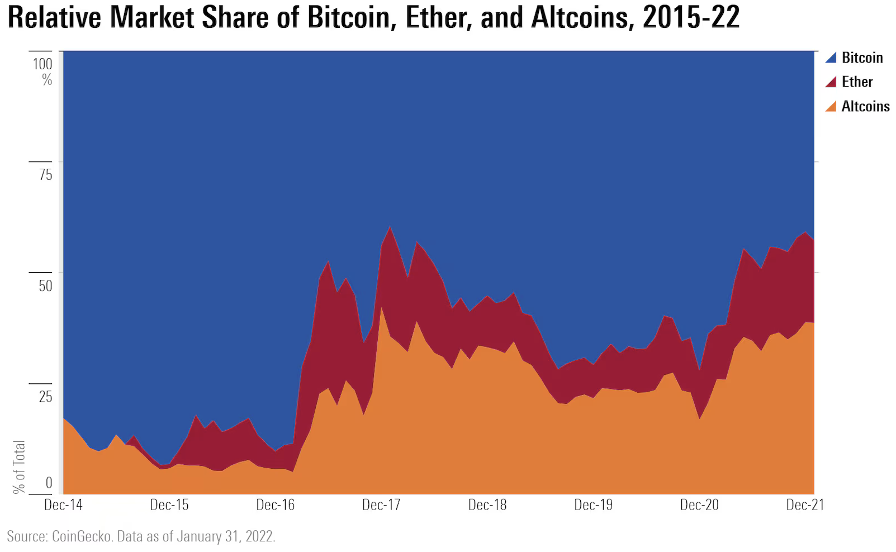



```{r}
#| label: setup
#| include: false
library(tidyverse)
library(arrow)
```

## Information

```{r}
#| label: information-1
#| echo: false
learnr2::student_info()
```

## Introduction

This tutorial covers key concepts from [Chapter 22: Arrow](https://r4ds.hadley.nz/arrow.html), [Chapter 19: Joins](https://r4ds.hadley.nz/joins.html), and [Chapter 17: Dates and Times](https://r4ds.hadley.nz/datetimes.html) from [*R for Data Science (2e)*](https://r4ds.hadley.nz/) by Hadley Wickham, Mine Çetinkaya-Rundel, and Garrett Grolemund.

You will use cryptocurrency price, metadata, and category files to analyze how the composition of the crypto market changed between 2018 and 2026, reading them with **[arrow](https://arrow.apache.org/docs/r/)**.

Use AI however you like.

### Exercise 1

You should be doing this tutorial in a repo named `r4ds-4`. If you are not, create one and then connect to it.

Create a new file, `analysis.qmd`, with the title `"Crypto Markets"` and your name as the author. In a bash Terminal, render it:

```bash
quarto render analysis.qmd
```

Open `analysis.html` with Live Server (right-click it in the Explorer → **Open with Live Server**) and keep the tab open. It refreshes on every render. Going forward, we will just tell you to "Render" when we want you to take these steps.

Create a `.gitignore` with `analysis_files` followed by a blank line. Commit and push.

In the R Terminal, run:

```r
show_file(".gitignore")
```

If that fails, it is probably because you have not yet loaded `library(learnr2)` in the R Terminal.

CP/CR.

```{r}
#| label: introduction-1
#| echo: false
learnr2::question(
  "Create a new file, analysis.qmd, with the title \"Crypto Markets\" and your name as the author. In a bash Terminal, render it: quarto render analysis.qmd. Open analysis.html with Live Server and keep the tab open. Create a .gitignore with analysis_files followed by a blank line. Commit and push. In the R Terminal, run: show_file(\".gitignore\") If that fails, it is probably because you have not yet loaded library(learnr2) in the R Terminal. CP/CR.",
  type = "reflection",
  show_text = FALSE
)
```

###

```{.output}
analysis_files
```

###

Parquet stores a table column-by-column instead of row-by-row. A query that needs one column reads only that column's bytes and skips the rest of the file, and repeated values inside a single column compress extremely well.

### Exercise 2

In your QMD, add a new code chunk with `#| message: false` to load all required libraries:

```r
library(tidyverse)
library(arrow)
```

Also add the following to the YAML header to remove all code echoes from the HTML:

```yaml
execute:
  echo: false
```

Render. In the R Terminal, run:

```r
show_file("analysis.qmd")
```

CP/CR.

```{r}
#| label: introduction-2
#| echo: false
learnr2::question(
  "In your QMD, add a new code chunk with #| message: false to load all required libraries: library(tidyverse) and library(arrow). Also add the following to the YAML header to remove all code echoes from the HTML: execute: echo: false. Render. In the R Terminal, run: show_file(\"analysis.qmd\") CP/CR.",
  type = "reflection",
  show_text = FALSE
)
```

###

```{.output}
#| message: false
library(tidyverse)
library(arrow)
```

###

**arrow** is one of several tools for data that is too large or too slow for ordinary in-memory work. **[duckdb](https://r.duckdb.org/)** runs SQL directly against parquet files and is usually the fastest option for big joins and aggregations. **[data.table](https://rdatatable.gitlab.io/data.table/)** is the classic in-memory speed package, and **[fst](https://www.fstpackage.org/)** is a fast R-only binary format for local caching.

### Exercise 3

Create a `data` directory at the top level of the `r4ds-4` repo. In the bash Terminal, run `ls`.

CP/CR.

```{r}
#| label: introduction-3
#| echo: false
learnr2::question(
  "Create a data directory at the top level of the r4ds-4 repo. In the bash Terminal, run ls. CP/CR.",
  type = "reflection",
  show_text = FALSE
)
```

###

```{.output}
AGENTS.md  analysis_files  analysis.html  analysis.qmd  data
```

###

In production, a parquet *dataset* is usually not one file but a directory of them — one file per day, per region, or per coin — read as a single table. A partition value lives in the directory name, so a query for one coin never opens the other folders.

## Crypto markets

Bitcoin launched the cryptocurrency market in 2009, and for its first several years it *was* the market. That had already stopped being true by the time this dataset opens: on January 1, 2018, Ethereum and the other smart-contract platforms held about 52% of the value of the 22 coins tracked here, against Bitcoin's 48%.

{width=90%}

In this section you will join three parquet files — daily prices, coin metadata, and category labels — to build a chart, similar to the one above from [this *Morningstar* article](https://global.morningstar.com/en-gb/economy/5-charts-on-crypto-s-past-present-and-future), showing how each category's share of the total crypto market evolved. **arrow** makes it practical to inspect, filter, and summarize those files before pulling anything into memory.

### Exercise 1

Download the three crypto parquet files into your `data/` directory so the analysis can run locally and reproducibly. Use these stable URLs:

`https://github.com/PPBDS/misc.tutorials/raw/refs/heads/main/inst/tutorials/r4ds-4/data/daily_prices.parquet`
`https://github.com/PPBDS/misc.tutorials/raw/refs/heads/main/inst/tutorials/r4ds-4/data/coin_metadata.parquet`
`https://github.com/PPBDS/misc.tutorials/raw/refs/heads/main/inst/tutorials/r4ds-4/data/categories.parquet`

In the bash Terminal, run:

```bash
ls data
```

CP/CR.

```{r}
#| label: crypto-markets-1
#| echo: false
learnr2::question(
  "Download the three crypto parquet files into your data/ directory so the analysis can run locally and reproducibly. Use these stable URLs: https://github.com/PPBDS/misc.tutorials/raw/refs/heads/main/inst/tutorials/r4ds-4/data/daily_prices.parquet https://github.com/PPBDS/misc.tutorials/raw/refs/heads/main/inst/tutorials/r4ds-4/data/coin_metadata.parquet https://github.com/PPBDS/misc.tutorials/raw/refs/heads/main/inst/tutorials/r4ds-4/data/categories.parquet In the bash Terminal, run: ls data CP/CR.",
  type = "reflection",
  show_text = FALSE
)
```

###

```{.output}
categories.parquet    coin_metadata.parquet    daily_prices.parquet
```

###

The three files hold 59,436 daily observations of 22 coins from 2018-01-01 through 2026-05-23, plus a 22-row coin table and a 6-row category table — a little over 2 MB in total. The prices come from Coin Metrics Community Data, one of the few crypto sources that publishes a long, documented, freely reusable history rather than a rate-limited API.

### Exercise 2

In a new code chunk, inspect the schema of `data/daily_prices.parquet` without pulling the full file into memory. Don't assign the result — just print it. Render.

In the R Terminal, run:

```r
show_file("analysis.qmd")
```

CP/CR.

```{r}
#| label: crypto-markets-2
#| echo: false
learnr2::question(
  "In a new code chunk, inspect the schema of data/daily_prices.parquet without pulling the full file into memory. Don't assign the result — just print it. Render. In the R Terminal, run: show_file(\"analysis.qmd\") CP/CR.",
  type = "reflection",
  show_text = FALSE
)
```

###

```{r}
#| label: crypto-markets-2-answer
#| echo: true
open_dataset("data/daily_prices.parquet")
```

###

Opening a parquet file does not read it: every parquet file ends with a footer holding its *schema* — the column names and types — and that footer is all that was read here. `date_raw` is stored as text, not as a date, so it must be parsed before any date-based analysis will behave.

### Exercise 3

Take a random sample of 10 rows from `data/daily_prices.parquet` and collect the result into a tibble. Do not assign it — just print it so you can see a variety of coins and dates. Render.

In the R Terminal, run:

```r
show_file("analysis.qmd")
```

CP/CR.

```{r}
#| label: crypto-markets-3
#| echo: false
learnr2::question(
  "Take a random sample of 10 rows from data/daily_prices.parquet and collect the result into a tibble. Do not assign it — just print it so you can see a variety of coins and dates. Render. In the R Terminal, run: show_file(\"analysis.qmd\") CP/CR.",
  type = "reflection",
  show_text = FALSE
)
```

###

```{r}
#| label: crypto-markets-3-answer
#| echo: true
set.seed(9)
open_dataset("data/daily_prices.parquet") |>
  collect() |>
  slice_sample(n = 10)
```

###

Each row records one coin on one day — for example, an `eth` row might show `market_cap_usd` near $200 billion alongside the human-readable `market_cap_str` like `$200.5B`. About 5% of `market_cap_str` values are missing even though `market_cap_usd` is complete.

### Exercise 4

That last answer read the entire file into memory before sampling it. This time, leave the data on disk: get each coin's average market cap since the start of 2025, ordered from largest to smallest, doing the filtering and the averaging inside the parquet file and bringing only the finished 22-row summary back into R. Render.

In the R Terminal, run:

```r
show_file("analysis.qmd")
```

CP/CR.

```{r}
#| label: crypto-markets-4
#| echo: false
learnr2::question(
  "That last answer read the entire file into memory before sampling it. This time, leave the data on disk: get each coin's average market cap since the start of 2025, ordered from largest to smallest, doing the filtering and the averaging inside the parquet file and bringing only the finished 22-row summary back into R. Render. In the R Terminal, run: show_file(\"analysis.qmd\") CP/CR.",
  type = "reflection",
  show_text = FALSE
)
```

###

```{r}
#| label: crypto-markets-4-answer
#| echo: true
open_dataset("data/daily_prices.parquet") |>
  filter(date_raw >= "2025-01-01") |>
  group_by(coin_id) |>
  summarise(mean_mcap = mean(market_cap_usd, na.rm = TRUE), days = n()) |>
  arrange(desc(mean_mcap)) |>
  collect()
```

###

**arrow** hands the filter and the grouping to the file itself, which is called *predicate pushdown*. Only rows that pass the filter, and only the three columns the query mentions, are ever decoded, so the result that comes back is 22 rows instead of 59,436. The same query works unchanged on a folder of files far larger than your computer's memory, because R only ever holds the answer.

### Exercise 5

Bring the whole price file into memory as an analysis table named `prices`. In the same chunk, below the `prices` line, load `coin_metadata.parquet` as `metadata`. Print `metadata` so you can inspect the coin-level fields before joining. Render.

In the R Terminal, run:

```r
show_file("analysis.qmd")
```

CP/CR.

```{r}
#| label: crypto-markets-7
#| echo: false
learnr2::question(
  "Bring the whole price file into memory as an analysis table named prices. In the same chunk, below the prices line, load coin_metadata.parquet as metadata. Print metadata so you can inspect the coin-level fields before joining. Render. In the R Terminal, run: show_file(\"analysis.qmd\") CP/CR.",
  type = "reflection",
  show_text = FALSE
)
```

###

```{r}
#| label: crypto-markets-7-answer
#| echo: true
prices <- open_dataset("data/daily_prices.parquet") |>
  collect()
metadata <- open_dataset("data/coin_metadata.parquet") |>
  collect()
metadata
```

###

`prices` has one row per coin per day. `metadata` has one row per coin, with `coin_id` linking back to `prices` and `category_id` linking forward to `categories`. It also carries hand-entered fields — a `description`, a `launch_date`, a `consensus` mechanism — and hand-entered fields are where messiness lives.

### Exercise 6

Load `categories.parquet` as `categories` in the same chunk, below the `metadata` line. Print `categories` instead of `metadata` so you can inspect the category lookup table before joining. Render.

In the R Terminal, run:

```r
show_file("analysis.qmd")
```

CP/CR.

```{r}
#| label: crypto-markets-8
#| echo: false
learnr2::question(
  "Load categories.parquet as categories in the same chunk, below the metadata line. Print categories instead of metadata so you can inspect the category lookup table before joining. Render. In the R Terminal, run: show_file(\"analysis.qmd\") CP/CR.",
  type = "reflection",
  show_text = FALSE
)
```

###

```{r}
#| label: crypto-markets-8-answer
#| echo: true
prices <- open_dataset("data/daily_prices.parquet") |>
  collect()
metadata <- open_dataset("data/coin_metadata.parquet") |>
  collect()
categories <- open_dataset("data/categories.parquet") |>
  collect()
categories
```

###

The `categories` table has one row per crypto category, and `category_id` is the key that connects it to `metadata`. Its `category_name` is the readable label we want for plots, but its `description` duplicates a column name already used in `metadata`.

### Exercise 7

`metadata` records when each coin launched. Show the coin, its name, and its launch date for the 22 coins so you can see how those dates were recorded. Render.

In the R Terminal, run:

```r
show_file("analysis.qmd")
```

CP/CR.

```{r}
#| label: crypto-markets-9
#| echo: false
learnr2::question(
  "metadata records when each coin launched. Show the coin, its name, and its launch date for the 22 coins so you can see how those dates were recorded. Render. In the R Terminal, run: show_file(\"analysis.qmd\") CP/CR.",
  type = "reflection",
  show_text = FALSE
)
```

###

```{r}
#| label: crypto-markets-9-answer
#| echo: true
metadata |>
  select(coin_id, coin_name, launch_date)
```

###

Two conventions are mixed in one column: `btc` reads `January 3, 2009` while `eth` reads `2015-07-30`. A parser told to expect one convention returns a missing value for every row written in the other, and a silent `NA` is much worse than an error.

### Exercise 8

Add a real date column to `metadata` that handles both conventions, then list the coins from oldest to newest, showing the original text next to the parsed date. Every coin should end up with a date and no missing values. Render.

In the R Terminal, run:

```r
show_file("analysis.qmd")
```

CP/CR.

```{r}
#| label: crypto-markets-10
#| echo: false
learnr2::question(
  "Add a real date column to metadata that handles both conventions, then list the coins from oldest to newest, showing the original text next to the parsed date. Every coin should end up with a date and no missing values. Render. In the R Terminal, run: show_file(\"analysis.qmd\") CP/CR.",
  type = "reflection",
  show_text = FALSE
)
```

###

```{r}
#| label: crypto-markets-10-answer
#| echo: true
metadata |>
  mutate(launch = as_date(parse_date_time(launch_date, orders = c("mdy", "ymd")))) |>
  arrange(launch) |>
  select(coin_id, launch_date, launch)
```

###

Parsing a date means telling the parser the *order of the components*, not their punctuation: month-day-year for `January 3, 2009`, year-month-day for `2015-07-30`. Give it both orders and it tries each in turn. [ISO 8601](https://en.wikipedia.org/wiki/ISO_8601) — `YYYY-MM-DD`, biggest unit first — is the only format worth writing down, because `03/04/2020` is March 4 in the United States and April 3 in most of Europe, and no parser can tell which one you meant.

### Exercise 9

In a new chunk, draw a line chart of Bitcoin's daily price over the whole period, using only the `btc` rows of `prices`. Render.

Take a screenshot of the plot in your rendered page and paste it below. To take a screenshot, press `Cmd + Ctrl + Shift + 4` on a Mac, `Win + Shift + S` on Windows, or `Ctrl + Shift + Show windows` on a Chromebook, select the area, then click in the answer box and press `Cmd + V` (Mac) or `Ctrl + V` (Windows) to paste it.

```{r}
#| label: crypto-markets-11
#| echo: false
learnr2::question(
  "In a new chunk, draw a line chart of Bitcoin's daily price over the whole period, using only the btc rows of prices. Render. Take a screenshot of the plot in your rendered page and paste it below.",
  type = "reflection",
  allow_image = TRUE,
  allow_text = FALSE,
  show_text = FALSE
)
```

###

```{r}
#| label: crypto-markets-11-answer
#| echo: true
prices |>
  filter(coin_id == "btc") |>
  mutate(date = ymd(date_raw)) |>
  ggplot(aes(x = date, y = price_usd)) +
  geom_line() +
  labs(x = NULL, y = "Price (USD)", title = "Bitcoin daily price") +
  theme_minimal()
```

###

Two cycles are visible, and the second dwarfs the first: Bitcoin's 2021 high was $67,542, it fell below $16,000 in late 2022, and it reached $124,824 in 2025 before falling back to $76,620 when the data ends on May 23, 2026. Market cap is price times circulating supply. Bitcoin's supply grows slowly and predictably, so the two series have nearly the same shape, and market cap, not price, is the unit for comparing coins.

### Exercise 10

Join `prices` to `metadata` by `coin_id` to attach coin-level details to each price row. Do not assign the result — just print it to see what columns were added. Render.

In the R Terminal, run:

```r
show_file("analysis.qmd")
```

CP/CR.

```{r}
#| label: crypto-markets-14
#| echo: false
learnr2::question(
  "Join prices to metadata by coin_id to attach coin-level details to each price row. Do not assign the result — just print it to see what columns were added. Render. In the R Terminal, run: show_file(\"analysis.qmd\") CP/CR.",
  type = "reflection",
  show_text = FALSE
)
```

###

```{r}
#| label: crypto-markets-14-answer
#| echo: true
prices |>
  left_join(metadata, by = "coin_id")
```

###

A left join keeps all 59,436 rows from `prices` and adds matching columns from `metadata`. Row count is unchanged because each coin appears exactly once in `metadata`.

### Exercise 11

Before joining `categories`, check whether it shares any column names with the table you just built. Resolve any collision, then add the category labels to the pipe by `category_id`. Still do not assign — just print the result. Render.

In the R Terminal, run:

```r
show_file("analysis.qmd")
```

CP/CR.

```{r}
#| label: crypto-markets-15
#| echo: false
learnr2::question(
  "Before joining categories, check whether it shares any column names with the table you just built. Resolve any collision, then add the category labels to the pipe by category_id. Still do not assign — just print the result. Render. In the R Terminal, run: show_file(\"analysis.qmd\") CP/CR.",
  type = "reflection",
  show_text = FALSE
)
```

###

```{r}
#| label: crypto-markets-15-answer
#| echo: true
prices |>
  left_join(metadata, by = "coin_id") |>
  left_join(select(categories, -description), by = "category_id")
```

###

Both `metadata` and `categories` have a `description` column. Joining without resolving that collision creates `description.x` and `description.y` — confusing names that require extra cleanup.

### Exercise 12

`date_raw` is still a character string, which means sorting, filtering by date range, and time-series plots all behave unexpectedly. Finalize the data-preparation chunk: merge the three file loads and the join pipe into a single chunk, add a proper date field to the pipe, assign the pipe's result to `crypto`, and keep nothing but those loads and that pipe. End by printing `crypto`. Render.

In the R Terminal, run:

```r
show_file("analysis.qmd")
```

CP/CR.

```{r}
#| label: crypto-markets-17
#| echo: false
learnr2::question(
  "date_raw is still a character string, which means sorting, filtering by date range, and time-series plots all behave unexpectedly. Finalize the data-preparation chunk: merge the three file loads and the join pipe into a single chunk, add a proper date field to the pipe, assign the pipe's result to crypto, and keep nothing but those loads and that pipe. End by printing crypto. Render. In the R Terminal, run: show_file(\"analysis.qmd\") CP/CR.",
  type = "reflection",
  show_text = FALSE
)
```

###

```{r}
#| label: crypto-markets-17-answer
#| echo: true
prices <- open_dataset("data/daily_prices.parquet") |>
  collect()
metadata <- open_dataset("data/coin_metadata.parquet") |>
  collect()
categories <- open_dataset("data/categories.parquet") |>
  collect()

crypto <- prices |>
  left_join(metadata, by = "coin_id") |>
  left_join(select(categories, -description), by = "category_id") |>
  mutate(date = ymd(date_raw))

crypto
```

###

Unlike the launch dates, `date_raw` is uniform ISO 8601 text, so one order of components parses every row, and the new `date` column runs from 2018-01-01 through 2026-05-23. The cleaned `crypto` table has one row per coin per day: 59,436 rows covering 22 coins.

### Exercise 13

Delete the `crypto` line at the bottom of that chunk, so it defines the table and nothing else. Render.

In the R Terminal, run:

```r
show_file("analysis.qmd")
```

CP/CR.

```{r}
#| label: crypto-markets-18
#| echo: false
learnr2::question(
  "Delete the crypto line at the bottom of that chunk, so it defines the table and nothing else. Render. In the R Terminal, run: show_file(\"analysis.qmd\") CP/CR.",
  type = "reflection",
  show_text = FALSE
)
```

###

```{.output}
prices <- open_dataset("data/daily_prices.parquet") |>
  collect()
metadata <- open_dataset("data/coin_metadata.parquet") |>
  collect()
categories <- open_dataset("data/categories.parquet") |>
  collect()

crypto <- prices |>
  left_join(metadata, by = "coin_id") |>
  left_join(select(categories, -description), by = "category_id") |>
  mutate(date = ymd(date_raw))
```

###

Across the whole period, Bitcoin's median daily market cap is about $560B and Ethereum's $209B, against $72B for Tether, the next coin down. The table you just stopped printing opened with `aave` rows from October 2020 because the price file is sorted by coin rather than by date, so its first rows were never a cross-section of the market.

### Exercise 14

Add `#| cache: true` to that chunk and render. This first render with caching will take a moment. Later renders load the table from disk.

In the bash Terminal, run:

```bash
ls
```

CP/CR.

```{r}
#| label: crypto-markets-19
#| echo: false
learnr2::question(
  "Add #| cache: true to that chunk and render. This first render with caching will take a moment. Later renders load the table from disk. In the bash Terminal, run: ls CP/CR.",
  type = "reflection",
  show_text = FALSE
)
```

###

```{.output}
AGENTS.md  analysis_cache  analysis_files  analysis.html  analysis.qmd  data
```

###

Stablecoin market cap can rise even when token prices stay pinned near $1: for coins like USDT, USDC, and DAI, market-cap growth mostly reflects more dollars flowing into stable crypto-denominated assets.

### Exercise 15

Add `analysis_cache` to your `.gitignore`. The Source Control change count in VS Code jumped when the cache directory appeared. Adding it to `.gitignore` drops it back.

In the R Terminal, run:

```r
show_file(".gitignore")
```

CP/CR.

```{r}
#| label: crypto-markets-20
#| echo: false
learnr2::question(
  "Add analysis_cache to your .gitignore. The Source Control change count in VS Code jumped when the cache directory appeared. Adding it to .gitignore drops it back. In the R Terminal, run: show_file(\".gitignore\") CP/CR.",
  type = "reflection",
  show_text = FALSE
)
```

###

```{.output}
analysis_files
analysis_cache
```

###

Those inflows into USDT, USDC, and DAI are why the stablecoin share of this market grew from almost nothing in 2018 to double digits later on.

### Exercise 16

Start a new analysis chunk that gives market context: calculate total crypto market cap for each day in `crypto` and plot it as a line chart, with market cap shown in trillions of dollars. Render.

Take a screenshot of the plot in your rendered page and paste it below.

```{r}
#| label: crypto-markets-21
#| echo: false
learnr2::question(
  "Start a new analysis chunk that gives market context: calculate total crypto market cap for each day in crypto and plot it as a line chart, with market cap shown in trillions of dollars. Render. Take a screenshot of the plot in your rendered page and paste it below.",
  type = "reflection",
  allow_image = TRUE,
  allow_text = FALSE,
  show_text = FALSE
)
```

###

```{r}
#| label: crypto-markets-21-answer
#| echo: true
crypto |>
  group_by(date) |>
  summarise(total_mcap = sum(market_cap_usd, na.rm = TRUE)) |>
  ggplot(aes(x = date, y = total_mcap / 1e12)) +
  geom_line() +
  labs(x = NULL, y = "Total market cap (trillions USD)",
       title = "Total crypto market capitalization, 2018–2026")
```

###

These 22 coins were worth $0.58T on the first day of the data and $2.35T on the last, a fourfold increase across two full boom-and-bust cycles. Bitcoin dominates that dollar scale and every category rises and falls with the market, so when one group dwarfs the others, plotting each group's *share* of the total reveals patterns the raw values hide.

### Exercise 17

Replace the line chart in that chunk with a stacked area chart of category market-cap shares over time: aggregate the coin-level market caps for each day and category, and make the total height of the chart always sum to 100%, with each colored band representing one category's share. This is the format of the Morningstar chart shown at the start of the section. Render.

Take a screenshot of the plot in your rendered page and paste it below.

```{r}
#| label: crypto-markets-23
#| echo: false
learnr2::question(
  "Replace the line chart in that chunk with a stacked area chart of category market-cap shares over time: aggregate the coin-level market caps for each day and category, and make the total height of the chart always sum to 100%, with each colored band representing one category's share. This is the format of the Morningstar chart shown at the start of the section. Render. Take a screenshot of the plot in your rendered page and paste it below.",
  type = "reflection",
  allow_image = TRUE,
  allow_text = FALSE,
  show_text = FALSE
)
```

###

```{r}
#| label: crypto-markets-23-answer
#| echo: true
crypto |>
  group_by(date, category_name) |>
  summarise(cat_mcap = sum(market_cap_usd, na.rm = TRUE), .groups = "drop") |>
  ggplot(aes(x = date, y = cat_mcap, fill = category_name)) +
  geom_area(position = "fill") +
  scale_y_continuous(labels = scales::percent) +
  labs(x = NULL, y = "Share of total market cap", fill = NULL,
       title = "Crypto market cap share by category, 2018–2026")
```

###

Bitcoin starts at 48%, bottoms out near 42% in late 2022, and finishes at 66%, while smart-contract platforms fall from 52% to 21%. Stablecoins are the genuine newcomer, going from 0.2% to a 21% spike in mid-2022 and 11% at the end.

### Exercise 18

Polish the market-share chart for publication. Order the legend by typical category size, use a colorblind-safe palette, and add a clear title, subtitle, axis labels, and source caption. The subtitle should state what the chart actually shows. Then add event context by marking two major crypto shocks: the Luna/UST crash (approximately May 7–12, 2022) and the FTX collapse (approximately November 8–11, 2022). Render.

Take a screenshot of the plot in your rendered page and paste it below.

```{r}
#| label: crypto-markets-24
#| echo: false
learnr2::question(
  "Polish the market-share chart for publication. Order the legend by typical category size, use a colorblind-safe palette, and add a clear title, subtitle, axis labels, and source caption. The subtitle should state what the chart actually shows. Then add event context by marking two major crypto shocks: the Luna/UST crash (approximately May 7–12, 2022) and the FTX collapse (approximately November 8–11, 2022). Render. Take a screenshot of the plot in your rendered page and paste it below.",
  type = "reflection",
  allow_image = TRUE,
  allow_text = FALSE,
  show_text = FALSE
)
```

###

```{r}
#| label: crypto-markets-24-answer
#| echo: true
crypto |>
  group_by(date, category_name) |>
  summarise(cat_mcap = sum(market_cap_usd, na.rm = TRUE), .groups = "drop") |>
  mutate(category_name = fct_reorder(category_name, cat_mcap, .fun = median, .desc = TRUE)) |>
  ggplot(aes(x = date, y = cat_mcap, fill = category_name)) +
  geom_area(position = "fill") +
  scale_fill_viridis_d(option = "plasma", end = 0.9) +
  scale_y_continuous(labels = scales::percent) +
  annotate("rect", xmin = as.Date("2022-05-07"), xmax = as.Date("2022-05-12"),
           ymin = -Inf, ymax = Inf, alpha = 0.15, fill = "red") +
  annotate("rect", xmin = as.Date("2022-11-08"), xmax = as.Date("2022-11-11"),
           ymin = -Inf, ymax = Inf, alpha = 0.15, fill = "red") +
  labs(x = NULL, y = "Share of total market cap", fill = NULL,
       title = "Crypto market cap share by category, 2018–2026",
       subtitle = "Bitcoin gained share as smart-contract platforms shrank and stablecoins grew",
       caption = "Source: Coin Metrics Community Data (CC BY 4.0)")
```

###

A subtitle is a claim that a reader will trust more readily than the picture beneath it, so write it last and check every clause against the bands — this one has to survive the fact that Bitcoin's share *rose* over the period. Both shaded windows sit where Bitcoin's share reached its low of 42% and the stablecoin band its high of 21%: when risk assets fall, dollars parked in stablecoins become a larger slice of a smaller pie.

### Exercise 19

Commit `analysis.qmd` with the message `"Crypto market composition analysis"` and push to GitHub. In the bash Terminal, run:

```bash
git log --oneline -3
```

CP/CR.

```{r}
#| label: crypto-markets-26
#| echo: false
learnr2::question(
  "Commit analysis.qmd with the message \"Crypto market composition analysis\" and push to GitHub. In the bash Terminal, run: git log --oneline -3 CP/CR.",
  type = "reflection",
  show_text = FALSE
)
```

###

```{.output}
abc1234 Crypto market composition analysis
def5678 Add analysis.qmd and .gitignore
```

###

The 22 coins in this dataset represent the major categories but exclude thousands of smaller coins, so the category shares are approximations rather than exact measures of the full crypto market.

## Summary

This tutorial covered key concepts from [Chapter 22: Arrow](https://r4ds.hadley.nz/arrow.html), [Chapter 19: Joins](https://r4ds.hadley.nz/joins.html), and [Chapter 17: Dates and Times](https://r4ds.hadley.nz/datetimes.html) from [*R for Data Science (2e)*](https://r4ds.hadley.nz/) by Hadley Wickham, Mine Çetinkaya-Rundel, and Garrett Grolemund.

You read parquet files with **arrow**, inspected schemas and summarized data on disk before pulling anything into memory, and joined market metadata and category labels onto a daily price series by shared keys. You parsed dates written in two different formats, then aggregated and visualized the result using **[tidyverse](https://www.tidyverse.org/)** tools before publishing it to GitHub Pages.

### Exercise 1

Render to ensure that everything works. Check your Live Server tab — the resulting HTML page should be attractive, showing a clean version of your final plots.

In the R Terminal, run:

```r
show_file("analysis.qmd")
```

CP/CR.

```{r}
#| label: summary-1
#| echo: false
learnr2::question(
  "Render to ensure that everything works. Check your Live Server tab — the resulting HTML page should be attractive, showing a clean version of your final plots. In the R Terminal, run: show_file(\"analysis.qmd\") CP/CR.",
  type = "reflection",
  show_text = FALSE
)
```

###

````{verbatim}
---
title: "Crypto Markets"
author: <your name>
execute:
  echo: false
---

```{r}
#| message: false
library(tidyverse)
library(arrow)
```

```{r}
#| cache: true
prices <- open_dataset("data/daily_prices.parquet") |>
  collect()
metadata <- open_dataset("data/coin_metadata.parquet") |>
  collect()
categories <- open_dataset("data/categories.parquet") |>
  collect()

crypto <- prices |>
  left_join(metadata, by = "coin_id") |>
  left_join(select(categories, -description), by = "category_id") |>
  mutate(date = ymd(date_raw))
```

```{r}
crypto |>
  group_by(date, category_name) |>
  summarise(cat_mcap = sum(market_cap_usd, na.rm = TRUE), .groups = "drop") |>
  mutate(category_name = fct_reorder(category_name, cat_mcap, .fun = median, .desc = TRUE)) |>
  ggplot(aes(x = date, y = cat_mcap, fill = category_name)) +
  geom_area(position = "fill") +
  scale_fill_viridis_d(option = "plasma", end = 0.9) +
  scale_y_continuous(labels = scales::percent) +
  annotate("rect", xmin = as.Date("2022-05-07"), xmax = as.Date("2022-05-12"),
           ymin = -Inf, ymax = Inf, alpha = 0.15, fill = "red") +
  annotate("rect", xmin = as.Date("2022-11-08"), xmax = as.Date("2022-11-11"),
           ymin = -Inf, ymax = Inf, alpha = 0.15, fill = "red") +
  labs(x = NULL, y = "Share of total market cap", fill = NULL,
       title = "Crypto market cap share by category, 2018–2026",
       subtitle = "Bitcoin gained share as smart-contract platforms shrank and stablecoins grew",
       caption = "Source: Coin Metrics Community Data (CC BY 4.0)")
```
````

###

The finished document is three chunks: the libraries, one cached data chunk, and one plot. Only the steps whose results appear in the output survive in a finished analysis.

### Exercise 2

Publish your rendered QMD to GitHub Pages. In the bash Terminal, run:

```bash
quarto publish gh-pages analysis.qmd
```

Copy/paste the resulting URL below.

```{r}
#| label: summary-2
#| echo: false
learnr2::question(
  "Publish your rendered QMD to GitHub Pages. In the bash Terminal, run: quarto publish gh-pages analysis.qmd Copy/paste the resulting URL below.",
  type = "reflection",
  show_text = FALSE
)
```

###

```{.output}
? Publish site to https://your-username.github.io/r4ds-4/ using gh-pages? (Y/n) › Yes
Switched to a new branch 'gh-pages'
...
Rendering for publish:
...
Output created: analysis.html
...
[gh-pages abc1234] Built site for gh-pages
...
To https://github.com/your-username/r4ds-4.git
[✓] Deploying gh-pages branch to website (this may take a few minutes)
[✓] Published to https://your-username.github.io/r4ds-4/
```

Your answer is the last line's URL:

```{.output}
https://your-username.github.io/r4ds-4/
```

###

Only the file's *output* travels: readers see the charts, not the parquet files behind them, which is why the caption naming the data source is the only provenance they get.

### Exercise 3

Commit and push any remaining changes. Copy/paste the URL to your GitHub repo.

```{r}
#| label: summary-3
#| echo: false
learnr2::question(
  "Commit and push any remaining changes. Copy/paste the URL to your GitHub repo.",
  type = "reflection",
  show_text = FALSE
)
```

###

```{.output}
https://github.com/your-username/r4ds-4
```

###

**arrow** understands only a subset of R expressions before data is collected into memory, so a good workflow is to push filtering, selecting, and simple aggregation down to the files, then do more flexible work on the small result that comes back.

## Download answers

```{r}
#| label: download-answers-1
#| echo: false
learnr2::question(
  "How many minutes, approximately, did it take you to complete this
  tutorial? For example, an hour and a half would be 90 minutes.",
  type = "reflection_editable",
  validate = "integer"
)
```

###

```{r}
#| label: download-answers-2
#| echo: false
learnr2::download_answers_button(filename_prefix = "r4ds-4")
```
