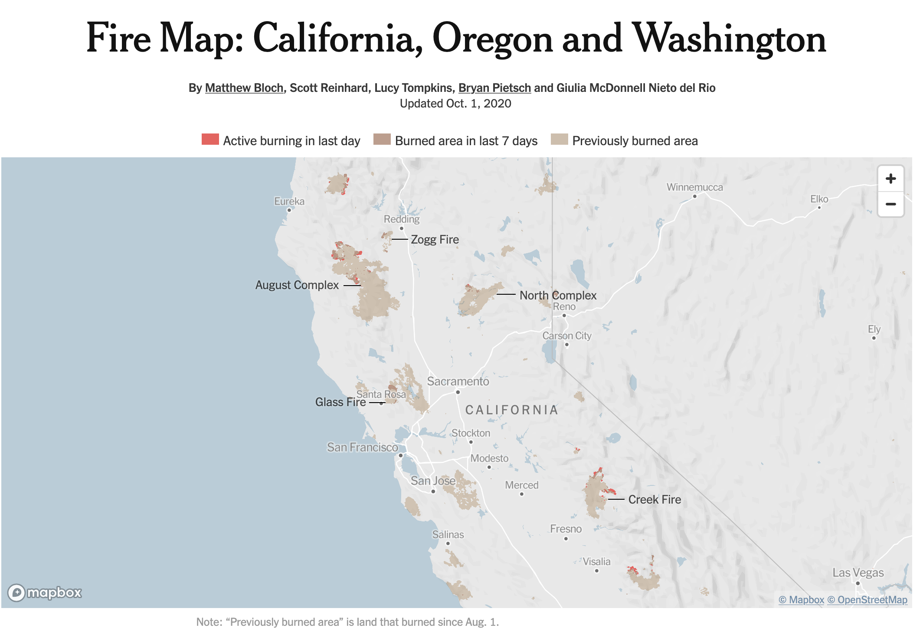



```{r}
#| label: setup
#| include: false
library(tidyverse)
library(leaflet)
library(purrr)

centroid_lon <- function(coords) {
  mean(map_dbl(coords[[1]], 1))
}
centroid_lat <- function(coords) {
  mean(map_dbl(coords[[1]], 2))
}

raw <- jsonlite::read_json("data/wildfires.geojson")

fires <- raw |>
  pluck("features") |>
  tibble(features = _) |>
  unnest_wider(features) |>
  unnest_wider(properties) |>
  unnest_wider(geometry, names_sep = "_") |>
  select(incident, gis_acres, fire_year, agency, state, geometry_coordinates) |>
  mutate(
    gis_acres = as.numeric(gis_acres),
    fire_year = as.integer(fire_year)
  )

big_fires <- fires |>
  filter(gis_acres >= 100000) |>
  mutate(
    lon = map_dbl(geometry_coordinates, centroid_lon),
    lat = map_dbl(geometry_coordinates, centroid_lat)
  )
```

## Information

```{r}
#| label: information-1
#| echo: false
learnr2::student_info()
```

## Introduction

This section covers key concepts from [Chapter 23: Hierarchical Data](https://r4ds.hadley.nz/rectangling.html) and [Chapter 9: Layers](https://r4ds.hadley.nz/layers.html) from [*R for Data Science (2e)*](https://r4ds.hadley.nz/) by Hadley Wickham, Mine Çetinkaya-Rundel, and Garrett Grolemund.

Using core packages such as **[jsonlite](https://cran.r-project.org/package=jsonlite)**, **[tidyr](https://tidyr.tidyverse.org/)**, **[purrr](https://purrr.tidyverse.org/)**, and **[leaflet](https://rstudio.github.io/leaflet/)**, you will extract nested elements from lists, expand list-columns into a tidy table, chart burned acreage over time and across states, and render geographic polygon boundaries as an interactive map. The data is a GeoJSON file of wildfire perimeter polygons from the National Interagency Fire Center.

Use AI however you like.

### Exercise 1

You should be doing this tutorial in a repo named `r4ds-5`. If you are not, create one and then connect to it. You may need to restart this tutorial after you do so.

Create a new file, `analysis.qmd`, with the title `"Wildfires"` and your name as the author. In a bash Terminal, render it:

```
quarto render analysis.qmd
```

Open `analysis.html` with Live Server (right-click it in the Explorer → **Open with Live Server**) and keep the tab open. It refreshes on every render. Going forward, we will just tell you to "Render" when we want you to take these steps.

Create a `.gitignore` with `analysis_files` followed by a blank line. Commit and push.

In the R Terminal, run:

```
show_file(".gitignore")
```

If that fails, it is probably because you have not yet loaded `library(learnr2)` in the R Terminal.

CP/CR.

```{r}
#| label: introduction-1
#| echo: false
learnr2::question(
  "You should be doing this tutorial in a repo named r4ds-5. If you are not, create one and then connect to it. You may need to restart this tutorial after you do so. Create a new file, analysis.qmd, with the title \"Wildfires\" and your name as the author. In a bash Terminal, render it: quarto render analysis.qmd Open analysis.html with Live Server (right-click it in the Explorer, then Open with Live Server) and keep the tab open. It refreshes on every render. Going forward, we will just tell you to \"Render\" when we want you to take these steps. Create a .gitignore with analysis_files followed by a blank line. Commit and push. In the R Terminal, run: show_file(\".gitignore\") If that fails, it is probably because you have not yet loaded library(learnr2) in the R Terminal. CP/CR.",
  type = "reflection",
  show_text = FALSE
)
```

###

```
analysis_files
```

###

This tutorial works with a GeoJSON file from the National Interagency Fire Center containing 883 finalized wildfire perimeter polygons across the western US, every one of them at least 10,000 acres, from 1990 to 2023. It is a study in one of the messiest storage formats data scientists encounter: deeply nested geographic JSON.

### Exercise 2

In your QMD, add the following `library()` commands in a new code chunk with `#| message: false`:

```
library(tidyverse)
library(purrr)
library(leaflet)
library(jsonlite)
```

Also add the following to the YAML header to remove all code from the HTML output:

```
execute:
  echo: false
```

Render.

In the R Terminal, run:

```
show_file("analysis.qmd", chunk = "Last")
```

CP/CR.

```{r}
#| label: introduction-2
#| echo: false
learnr2::question(
  "In your QMD, add the following library() commands in a new code chunk with #| message: false: library(tidyverse), library(purrr), library(leaflet), library(jsonlite). Also add execute: echo: false to the YAML header to remove all code from the HTML output. In the R Terminal, run: show_file(\"analysis.qmd\", chunk = \"Last\") CP/CR.",
  type = "reflection",
  show_text = FALSE
)
```

###

```
#| message: false
library(tidyverse)
library(purrr)
library(leaflet)
library(jsonlite)
```

###

JSON is a machine-readable format with six data types: null (like R's `NA`), string, number, boolean (lowercase `true`/`false`), array (like unnamed R lists), and object (like named R lists).

```json
{
  "place": "Northern California",
  "magnitude": 4.2,
  "felt": true,
  "tags": ["minor", "shallow"]
}
```

### Exercise 3

Create a `data` directory at the top level of the `r4ds-5` repo. In the bash Terminal, run `ls`.

CP/CR.

```{r}
#| label: introduction-3
#| echo: false
learnr2::question(
  "Create a data directory at the top level of the r4ds-5 repo. In the bash Terminal, run ls. CP/CR.",
  type = "reflection",
  show_text = FALSE
)
```

###

```
AGENTS.md  analysis_files  analysis.html  analysis.qmd  data
```

###

**jsonlite** is R's standard package for reading and writing JSON; it reads a local file like the GeoJSON you are about to download into nested R lists, one level per level of braces. Every element of the fire file sits three or four lists deep, which is why the first few exercises are about navigating a list before any table exists.

## Wildfire perimeters

The **[National Interagency Fire Center](https://data-nifc.opendata.arcgis.com/)** maintains a consolidated archive of finalized wildfire perimeter polygons — one polygon per fire, with metadata on name, acreage, year, state, and managing agency — published as a GeoJSON file. GeoJSON stores geometry as deeply nested lists that often must be reformatted before they can be analyzed. Using **jsonlite**, **[tidyr](https://tidyr.tidyverse.org/)**, **purrr**, and **leaflet**, you will flatten that nested structure, analyze 33 years of burned acreage, and render the actual fire boundaries as an interactive polygon map — the kind of visualization the [New York Times](https://www.nytimes.com/interactive/2020/us/fires-map-tracker.html) built during the 2020 fire season:

{width=90%}

###

We use `wildfires.geojson` from the **National Interagency Fire Center (NIFC) InterAgencyFirePerimeterHistory** dataset — a consolidated archive of finalized wildfire perimeter polygons contributed by the USFS, NPS, BLM, BIA, CAL FIRE, and state agencies. Each feature is a polygon representing one fire's surveyed boundary. The 2020 season was one of the most destructive on record — the August Complex burned over a million acres, becoming the largest fire in California history.

### Exercise 1

Download the file `wildfires.geojson` from this URL and save it in your `data/` directory:

```
https://github.com/PPBDS/misc.tutorials/raw/refs/heads/main/inst/tutorials/r4ds-5/data/wildfires.geojson
```

In a bash Terminal, run:

```
ls data
```

CP/CR.

```{r}
#| label: wildfire-perimeters-1
#| echo: false
learnr2::question(
  "Download the file wildfires.geojson from this URL and save it in your data/ directory: https://github.com/PPBDS/misc.tutorials/raw/refs/heads/main/inst/tutorials/r4ds-5/data/wildfires.geojson In a bash Terminal, run: ls data CP/CR.",
  type = "reflection",
  show_text = FALSE
)
```

###

```
wildfires.geojson
```

###

GeoJSON is a standard format for geographic data built on JSON. Each feature pairs a **geometry** — the spatial shape, stored as nested coordinate arrays — with a **properties** object holding tabular metadata like name, acreage, and year.

### Exercise 2

Read `data/wildfires.geojson` as JSON and assign it to `raw`. Print the number of features it contains.

Render.

In the R Terminal, run `show_file("analysis.qmd", chunk = "Last")`. CP/CR.

```{r}
#| label: wildfire-perimeters-2
#| echo: false
learnr2::question(
  "Read data/wildfires.geojson as JSON and assign it to raw. Print the number of features it contains. Render. In the R Terminal, run show_file(\"analysis.qmd\", chunk = \"Last\"). CP/CR.",
  type = "reflection",
  show_text = FALSE
)
```

###

```{r}
#| label: wildfire-perimeters-2-answer
#| echo: true
# your path will be "data/wildfires.geojson"
raw <- jsonlite::read_json("data/wildfires.geojson")
length(raw$features)
```

###

`raw` has two top-level keys: `type` (the string `"FeatureCollection"`, a GeoJSON standard marker) and `features` (the list of fires). `raw$features` holds 883 elements — one per fire — each a named list containing the fire's geographic shape and tabular metadata.

### Exercise 3

Extract the first fire from `raw` and show its component names. Then navigate into that fire's geometry to extract the first coordinate pair of its boundary.

Render.

In the R Terminal, run `show_file("analysis.qmd", chunk = "Last")`. CP/CR.

```{r}
#| label: wildfire-perimeters-3
#| echo: false
learnr2::question(
  "Extract the first fire from raw and show its component names. Then navigate into that fire's geometry to extract the first coordinate pair of its boundary. Render. In the R Terminal, run show_file(\"analysis.qmd\", chunk = \"Last\"). CP/CR.",
  type = "reflection",
  show_text = FALSE
)
```

###

```{r}
#| label: wildfire-perimeters-3-answer
#| echo: true
pluck(raw, "features", 1) |> names()
pluck(raw, "features", 1, "geometry", "coordinates", 1, 1)
```

###

Each fire is a named list with four keys — `type`, `id`, `geometry` (the coordinate arrays that define the boundary), and `properties` (tabular metadata like name, year, and acreage) — and GeoJSON stores each coordinate as `[longitude, latitude]`, longitude first, the opposite of the spoken convention. A pair of numbers means something only relative to a **coordinate reference system**, the model of the earth's shape that fixes where zero is and what one unit is worth; GeoJSON is always WGS84, the same system a phone's GPS reports, so `-121.5, 40.1` here is unambiguous.

### Exercise 4

Wrap `raw$features` in a tibble with a column called `features`, then expand that list-column so each named element becomes its own column, and expand the `properties` list-column the same way. Print the result.

Render.

In the R Terminal, run `show_file("analysis.qmd", chunk = "Last")`. CP/CR.

```{r}
#| label: wildfire-perimeters-6
#| echo: false
learnr2::question(
  "Wrap raw$features in a tibble with a column called features, then expand that list-column so each named element becomes its own column, and expand the properties list-column the same way. Print the result. Render. In the R Terminal, run show_file(\"analysis.qmd\", chunk = \"Last\"). CP/CR.",
  type = "reflection",
  show_text = FALSE
)
```

###

```{r}
#| label: wildfire-perimeters-6-answer
#| echo: true
tibble(features = raw$features) |>
  unnest_wider(features) |>
  unnest_wider(properties)
```

###

A list-column holds one complete R list per row — here one fire feature — and widening it turns each named element of those lists into a column of its own; repeating that move until nothing is nested is called **rectangling**. The eight attributes (`incident`, `gis_acres`, `fire_year`, `agency`, `state`, `map_method`, `date_current`, `unique_fire_id`) are now flat columns, while `geometry` is still a list-column holding the polygon coordinates and needs separate handling.

### Exercise 5

Continue the pipeline by expanding the `geometry` list-column. Note that a `type` column already exists at the feature level, so the geometry expansion will create a naming conflict — make sure the geometry columns get distinct names. Then keep only the six columns you will need: `incident`, `gis_acres`, `fire_year`, `agency`, `state`, and `geometry_coordinates`. Coerce `gis_acres` to numeric and `fire_year` to integer. Assign the result to `fires`. Print `fires`.

Render.

In the R Terminal, run `show_file("analysis.qmd", chunk = "Last")`. CP/CR.

```{r}
#| label: wildfire-perimeters-8
#| echo: false
learnr2::question(
  "Continue the pipeline by expanding the geometry list-column. Note that a type column already exists at the feature level, so the geometry expansion will create a naming conflict — make sure the geometry columns get distinct names. Then keep only the six columns you will need: incident, gis_acres, fire_year, agency, state, and geometry_coordinates. Coerce gis_acres to numeric and fire_year to integer. Assign the result to fires. Print fires. Render. In the R Terminal, run show_file(\"analysis.qmd\", chunk = \"Last\"). CP/CR.",
  type = "reflection",
  show_text = FALSE
)
```

###

```
fires <- jsonlite::read_json("data/wildfires.geojson") |>
  pluck("features") |>
  tibble(features = _) |>
  unnest_wider(features) |>
  unnest_wider(properties) |>
  unnest_wider(geometry, names_sep = "_") |>
  select(incident, gis_acres, fire_year, agency, state, geometry_coordinates) |>
  mutate(
    gis_acres = as.numeric(gis_acres),
    fire_year = as.integer(fire_year)
  )
fires
```

###

```{r}
#| label: wildfire-perimeters-8-answer
#| echo: true
fires
```

###

If your `fires` does not match ours, replace your code with the pipeline above before continuing.

`geometry` holds two fields: `type` (the string `"Polygon"`) and `coordinates`. A `type` column already exists from the feature level, so widening geometry without a naming rule overwrites one `type` with the other — a **name collision**, the most common way a rectangling pipeline loses a column without raising an error. Asking for the parent's name to be prefixed onto its children gives `geometry_type` and `geometry_coordinates` instead.

### Exercise 6

That GeoJSON pipeline takes time on every render. Strip the `fires` print line from the chunk, leaving only the pipeline that defines `fires`.

In the R Terminal, run `show_file("analysis.qmd", chunk = "Last")`. CP/CR.

```{r}
#| label: wildfire-perimeters-9
#| echo: false
learnr2::question(
  "That GeoJSON pipeline takes time on every render. Strip the fires print line from the chunk, leaving only the pipeline that defines fires. In the R Terminal, run show_file(\"analysis.qmd\", chunk = \"Last\"). CP/CR.",
  type = "reflection",
  show_text = FALSE
)
```

###

```
fires <- jsonlite::read_json("data/wildfires.geojson") |>
  pluck("features") |>
  tibble(features = _) |>
  unnest_wider(features) |>
  unnest_wider(properties) |>
  unnest_wider(geometry, names_sep = "_") |>
  select(incident, gis_acres, fire_year, agency, state, geometry_coordinates) |>
  mutate(
    gis_acres = as.numeric(gis_acres),
    fire_year = as.integer(fire_year)
  )
```

###

The cleaned pipeline is a readable map of the GeoJSON nesting: each step corresponds to one level of structure in the raw file — features, then properties, then geometry.

### Exercise 7

Add `#| cache: true` as the first line inside the `fires` chunk. Render. Rendering with caching turned on creates an `analysis_cache/` directory next to your `analysis.qmd`. To confirm the directory is there, in the bash Terminal, run `ls`.

CP/CR.

```{r}
#| label: wildfire-perimeters-10
#| echo: false
learnr2::question(
  "Add #| cache: true as the first line inside the fires chunk. Render. Rendering with caching turned on creates an analysis_cache/ directory next to your analysis.qmd. To confirm the directory is there, in the bash Terminal, run ls. CP/CR.",
  type = "reflection",
  show_text = FALSE
)
```

###

```
AGENTS.md  analysis_cache  analysis_files  analysis.html  analysis.qmd  data
```

###

`analysis_cache/` now holds the saved `fires` tibble. Every subsequent render loads it from disk instead of re-reading and re-rectangling the 8.8 MB GeoJSON file.

### Exercise 8

The Source Control change count jumped because `analysis_cache/` now looks like untracked work to git. Cached files should never go to GitHub.

Add `analysis_cache` to your `.gitignore` on its own line. In the R Terminal, run `show_file(".gitignore")`. CP/CR.

```{r}
#| label: wildfire-perimeters-11
#| echo: false
learnr2::question(
  "Add analysis_cache to your .gitignore on its own line. In the R Terminal, run show_file(\".gitignore\"). CP/CR.",
  type = "reflection",
  show_text = FALSE
)
```

###

```
analysis_files
analysis_cache
```

###

`wildfires.geojson` holds only fires of at least 10,000 acres, so its 883 perimeters are the large end of 33 years of western wildfire, not every fire.

### Exercise 9

In a new working chunk, search `fires` for any fire whose name contains the word "August". How many rows come back? Then show the ten largest fires by acreage.

Render.

In the R Terminal, run `show_file("analysis.qmd", chunk = "Last")`. CP/CR.

```{r}
#| label: wildfire-perimeters-12
#| echo: false
learnr2::question(
  "In a new working chunk, search fires for any fire whose name contains the word \"August\". How many rows come back? Then show the ten largest fires by acreage. Render. In the R Terminal, run show_file(\"analysis.qmd\", chunk = \"Last\"). CP/CR.",
  type = "reflection",
  show_text = FALSE
)
```

###

```{r}
#| label: wildfire-perimeters-12-answer
#| echo: true
fires |> filter(str_detect(incident, "August"))
fires |> arrange(desc(gis_acres)) |> head(10)
```

###

The search returns zero rows, yet the second-largest record is "DOE" (CA, 2020, ~590k acres), the Doe component of the August Complex, which together burned over a million acres and became the largest fire in California history — the dataset records component fires under their own names, not the complex name the news reported. Those ten are the extreme tail: most of the 883 fires sit near the file's 10,000-acre floor, and only three exceed 500,000 acres.

### Exercise 10

Plot the total acres burned per year in `fires` as a line chart. Give it a proper title, axis labels, and caption.

Render.

Take a screenshot of the plot in your rendered page and paste it below.

```{r}
#| label: wildfire-perimeters-14
#| echo: false
learnr2::question(
  "Plot the total acres burned per year in fires as a line chart. Give it a proper title, axis labels, and caption. Render. Take a screenshot of the plot in your rendered page and paste it below.",
  type = "reflection",
  allow_image = TRUE,
  show_text = FALSE
)
```

###

```{r}
#| label: wildfire-perimeters-14-answer
#| echo: true
fires |>
  group_by(fire_year) |>
  summarize(total_acres = sum(gis_acres, na.rm = TRUE), .groups = "drop") |>
  ggplot(aes(x = fire_year, y = total_acres)) +
  geom_line() +
  labs(
    title = "Western US Wildfire Burned Area, 1990–2023",
    subtitle = "Fires ≥ 10,000 acres",
    x = "Year",
    y = "Total acres burned",
    caption = "Source: NIFC InterAgencyFirePerimeterHistory"
  )
```

###

Annual burned acreage in fires ≥ 10,000 acres averaged 414,000 acres in the 1990s and 1.5 million in the 2010s — roughly a tripling. The line peaks in 2020 at 5.4 million acres, with 2021 next at 4.0 million; no year in the 1990s cleared 1.2 million, and 1991 contributed no qualifying fire at all.

### Exercise 11

Evolve the working chunk to show total acres burned by state in `fires`. Show only the top 10 states, ordered by total acreage.

Render.

Take a screenshot of the plot in your rendered page and paste it below.

```{r}
#| label: wildfire-perimeters-15
#| echo: false
learnr2::question(
  "Evolve the working chunk to show total acres burned by state in fires. Show only the top 10 states, ordered by total acreage. Render. Take a screenshot of the plot in your rendered page and paste it below.",
  type = "reflection",
  allow_image = TRUE,
  show_text = FALSE
)
```

###

```{r}
#| label: wildfire-perimeters-15-answer
#| echo: true
fires |>
  group_by(state) |>
  summarize(total_acres = sum(gis_acres, na.rm = TRUE), .groups = "drop") |>
  slice_max(total_acres, n = 10) |>
  mutate(state = fct_reorder(state, total_acres)) |>
  ggplot(aes(x = total_acres, y = state)) +
  geom_col() +
  labs(
    title = "Total Acres Burned by State, 1990–2023",
    x = "Total acres burned",
    y = NULL,
    caption = "Source: NIFC InterAgencyFirePerimeterHistory"
  )
```

###

California's bar comes first, and by a wide margin: 12.6 million acres over the dataset's 33 years against Idaho's 6.9 million. Idaho burns more than Arizona (4.7 million), Oregon (4.7 million), or New Mexico (4.2 million), and yet almost nobody outside the interior west could name an Idaho fire: its large burns run through remote rangeland and forest, while California's threaten towns and structures.

### Exercise 12

The working chunk has done its job. Replace its contents with code that filters `fires` to fires of at least 100,000 acres and adds `lon` and `lat` columns holding a single representative point for each fire: each boundary is a polygon of many coordinate pairs, and averaging the longitudes and averaging the latitudes is a simple way to reduce it to one point. Assign the result to `big_fires` and print it.

Render.

In the R Terminal, run `show_file("analysis.qmd", chunk = "Last")`. CP/CR.

```{r}
#| label: wildfire-perimeters-16
#| echo: false
learnr2::question(
  "The working chunk has done its job. Replace its contents with code that filters fires to fires of at least 100,000 acres and adds lon and lat columns holding a single representative point for each fire: each boundary is a polygon of many coordinate pairs, and averaging the longitudes and averaging the latitudes is a simple way to reduce it to one point. Assign the result to big_fires and print it. Render. In the R Terminal, run show_file(\"analysis.qmd\", chunk = \"Last\"). CP/CR.",
  type = "reflection",
  show_text = FALSE
)
```

###

```{r}
#| label: wildfire-perimeters-16-answer
#| echo: true
centroid_lon <- function(coords) {
  mean(map_dbl(coords[[1]], 1))
}
centroid_lat <- function(coords) {
  mean(map_dbl(coords[[1]], 2))
}

big_fires <- fires |>
  filter(gis_acres >= 100000) |>
  mutate(
    lon = map_dbl(geometry_coordinates, centroid_lon),
    lat = map_dbl(geometry_coordinates, centroid_lat)
  )
big_fires
```

###

Eighty-seven of the 883 fires clear 100,000 acres — about 156 square miles each — with California holding 25 of them, Idaho 16, and the US Forest Service listed as managing agency for 79. `lon` and `lat` are the plain average of the boundary's vertices, not the polygon's centroid: vertices bunch up where a boundary wiggles, so the average drifts toward the crinkly side of a fire — close enough to drop a dot in the right valley, though **[sf](https://r-spatial.github.io/sf/)** computes area-weighted centers properly when position has to be right.

### Exercise 13

The `big_fires` chunk is finished, so delete the `big_fires` print line from the bottom of it. Then, in a new working chunk, build a circle-marker leaflet map of `big_fires` where each circle's size reflects the fire's acreage. Zoom the map to the western US.

Render.

Take a screenshot of the map in your rendered page and paste it below.

```{r}
#| label: wildfire-perimeters-19
#| echo: false
learnr2::question(
  "The big_fires chunk is finished, so delete the big_fires print line from the bottom of it. Then, in a new working chunk, build a circle-marker leaflet map of big_fires where each circle's size reflects the fire's acreage. Zoom the map to the western US. Render. Take a screenshot of the map in your rendered page and paste it below.",
  type = "reflection",
  allow_image = TRUE,
  show_text = FALSE
)
```

###

```{r}
#| label: wildfire-perimeters-19-answer
#| echo: true
leaflet(big_fires) |>
  addTiles() |>
  setView(lng = -115, lat = 42, zoom = 4) |>
  addCircleMarkers(
    lng    = ~lon,
    lat    = ~lat,
    radius = ~sqrt(gis_acres) / 30,
    stroke = FALSE,
    fillOpacity = 0.6
  )
```

###

The circles cluster along the Sierra Nevada, Cascades, and northern Rockies — the fire-prone landscapes of the interior west. Circle size communicates acreage, but not shape: a compact high-elevation burn and a wind-driven valley fire can look identical on this map.

### Exercise 14

Replace the circle markers with the actual boundary shapes of the ten largest fires in `big_fires`. Give each shape a popup naming the fire, its year, and its acreage, and set the view so those ten are all on screen.

Render.

Take a screenshot of the map in your rendered page and paste it below.

```{r}
#| label: wildfire-perimeters-20
#| echo: false
learnr2::question(
  "Replace the circle markers with the actual boundary shapes of the ten largest fires in big_fires. Give each shape a popup naming the fire, its year, and its acreage, and set the view so those ten are all on screen. Render. Take a screenshot of the map in your rendered page and paste it below.",
  type = "reflection",
  allow_image = TRUE,
  show_text = FALSE
)
```

###

```{r}
#| label: wildfire-perimeters-20-answer
#| echo: true
top_ten <- big_fires |> slice_max(gis_acres, n = 10)

leaflet() |>
  addTiles() |>
  setView(lng = -117, lat = 40, zoom = 5) |>
  addPolygons(
    data = top_ten |>
      transmute(pts = purrr::map(geometry_coordinates,
                                 \(g) tibble(lng = map_dbl(g[[1]], 1),
                                             lat = map_dbl(g[[1]], 2)) |>
                                   add_row(lng = NA, lat = NA))) |>
      unnest(pts),
    lng = ~lng,
    lat = ~lat,
    weight      = 1,
    color       = "#cc4400",
    fillColor   = "#ff7733",
    fillOpacity = 0.5,
    popup = paste0(top_ten$incident, " (", top_ten$fire_year, "), ",
                   format(round(top_ten$gis_acres), big.mark = ","), " acres")
  )
```

###

Circle size told you how much burned; the outline tells you how it burned: click the biggest shape and it is Dixie (2021, 963,309 acres), a long ragged perimeter running north and east through the northern Sierra, while the compact block on Arizona's Mogollon Rim is Rodeo-Chediski (2002, 460,563 acres). Ten shapes is a deliberate limit: the full file holds 391,027 coordinate pairs, and handing all of them to a browser ships several megabytes of geometry to every reader for detail that no one can resolve at this zoom.

### Exercise 15

Commit `analysis.qmd` with the message `"Add wildfire perimeters analysis"` and push to GitHub.

In the bash Terminal, run:

```
git log --oneline -3
```

CP/CR.

```{r}
#| label: wildfire-perimeters-21
#| echo: false
learnr2::question(
  "Commit analysis.qmd with the message \"Add wildfire perimeters analysis\" and push to GitHub. In the bash Terminal, run: git log --oneline -3 CP/CR.",
  type = "reflection",
  show_text = FALSE
)
```

###

```
abc1234 Add wildfire perimeters analysis
...
```

###

The **NIFC** also publishes current-year fire perimeters in real time — the **IRWIN** (Integrated Reporting of Wildland-Fire Information) feed is updated multiple times per day during active fire season. The historical archive used here is finalized geometry; the live feed shows boundaries as incident command teams map them in the field.

## Summary

This section covered key concepts from [Chapter 23: Hierarchical Data](https://r4ds.hadley.nz/rectangling.html) and [Chapter 9: Layers](https://r4ds.hadley.nz/layers.html) from [*R for Data Science (2e)*](https://r4ds.hadley.nz/) by Hadley Wickham, Mine Çetinkaya-Rundel, and Garrett Grolemund.

You learned about working with nested JSON data using core packages such as **jsonlite**, **tidyr**, **purrr**, and **leaflet**. Key concepts included rectangling nested GeoJSON into a tidy table, charting burned acreage over 33 years and across states, and building an interactive leaflet map from polygon geometry.

### Exercise 1

Render. Check your Live Server tab.

In the R Terminal, run:

```
show_file("analysis.qmd")
```

CP/CR.

```{r}
#| label: summary-1
#| echo: false
learnr2::question(
  "Render. Check your Live Server tab. In the R Terminal, run: show_file(\"analysis.qmd\") CP/CR.",
  type = "reflection",
  show_text = FALSE
)
```

###

````{verbatim}
---
title: "Wildfires"
author: Your Name
execute:
  echo: false
---

```{r}
#| message: false
library(tidyverse)
library(purrr)
library(leaflet)
library(jsonlite)
```

```{r}
#| cache: true
fires <- jsonlite::read_json("data/wildfires.geojson") |>
  pluck("features") |>
  tibble(features = _) |>
  unnest_wider(features) |>
  unnest_wider(properties) |>
  unnest_wider(geometry, names_sep = "_") |>
  select(incident, gis_acres, fire_year, agency, state, geometry_coordinates) |>
  mutate(
    gis_acres = as.numeric(gis_acres),
    fire_year = as.integer(fire_year)
  )
```

```{r}
centroid_lon <- function(coords) {
  mean(map_dbl(coords[[1]], 1))
}
centroid_lat <- function(coords) {
  mean(map_dbl(coords[[1]], 2))
}

big_fires <- fires |>
  filter(gis_acres >= 100000) |>
  mutate(
    lon = map_dbl(geometry_coordinates, centroid_lon),
    lat = map_dbl(geometry_coordinates, centroid_lat)
  )
```

```{r}
top_ten <- big_fires |> slice_max(gis_acres, n = 10)

leaflet() |>
  addTiles() |>
  setView(lng = -117, lat = 40, zoom = 5) |>
  addPolygons(
    data = top_ten |>
      transmute(pts = purrr::map(geometry_coordinates,
                                 \(g) tibble(lng = map_dbl(g[[1]], 1),
                                             lat = map_dbl(g[[1]], 2)) |>
                                   add_row(lng = NA, lat = NA))) |>
      unnest(pts),
    lng = ~lng,
    lat = ~lat,
    weight      = 1,
    color       = "#cc4400",
    fillColor   = "#ff7733",
    fillOpacity = 0.5,
    popup = paste0(top_ten$incident, " (", top_ten$fire_year, "), ",
                   format(round(top_ten$gis_acres), big.mark = ","), " acres")
  )
```
````

###

One of the four chunks in that file is cached, so the 8.8 MB GeoJSON is read and rectangled once and then loaded from disk, which is why the render you just did was fast. The `fires` tibble is 883 rows, but its `geometry_coordinates` column alone carries 391,027 coordinate pairs, almost all of the file's bulk.

### Exercise 2

Publish your rendered QMD to GitHub Pages. In a bash Terminal, run:

```
quarto publish gh-pages analysis.qmd
```

Copy/paste the resulting URL below.

```{r}
#| label: summary-2
#| echo: false
learnr2::question(
  "Publish your rendered QMD to GitHub Pages. In a bash Terminal, run: quarto publish gh-pages analysis.qmd Copy/paste the resulting URL below.",
  type = "reflection",
  show_text = FALSE
)
```

###

```
? Publish site to https://your-username.github.io/r4ds-5/ using gh-pages? (Y/n) › Yes
Switched to a new branch 'gh-pages'
...
Rendering for publish:
...
Output created: analysis.html
...
[gh-pages abc1234] Built site for gh-pages
...
To https://github.com/your-username/r4ds-5.git
[✓] Deploying gh-pages branch to website (this may take a few minutes)
[✓] Published to https://your-username.github.io/r4ds-5/
```

Your answer is the URL on the last line: `https://your-username.github.io/r4ds-5/`.

###

The leaflet polygon map you built is fully interactive in the published page — readers can pan, zoom, and inspect individual fire boundaries. This kind of interactivity only works in HTML output, which is one of the main reasons to publish to the web rather than share a static PDF.

### Exercise 3

Commit and push all your files. Copy/paste the URL to your GitHub repo.

```{r}
#| label: summary-3
#| echo: false
learnr2::question(
  "Commit and push all your files. Copy/paste the URL to your GitHub repo.",
  type = "reflection",
  show_text = FALSE
)
```

###

```
https://github.com/your-username/r4ds-5
```

###

The polygons you published are finalized perimeters, surveyed after containment, and the file's builder removed 25 duplicate records where a fire had been mapped more than once as its boundary was revised. `date_current` in the raw properties is the date the record was last edited, not the date of the fire, which is why every chart here used `fire_year`.

## Download answers

```{r}
#| label: download-answers-1
#| echo: false
learnr2::question(
  "How many minutes, approximately, did it take you to complete this
  tutorial? For example, an hour and a half would be 90 minutes.",
  type = "reflection_editable",
  validate = "integer"
)
```

###

```{r}
#| label: download-answers-2
#| echo: false
learnr2::download_answers_button(filename_prefix = "r4ds-5")
```
