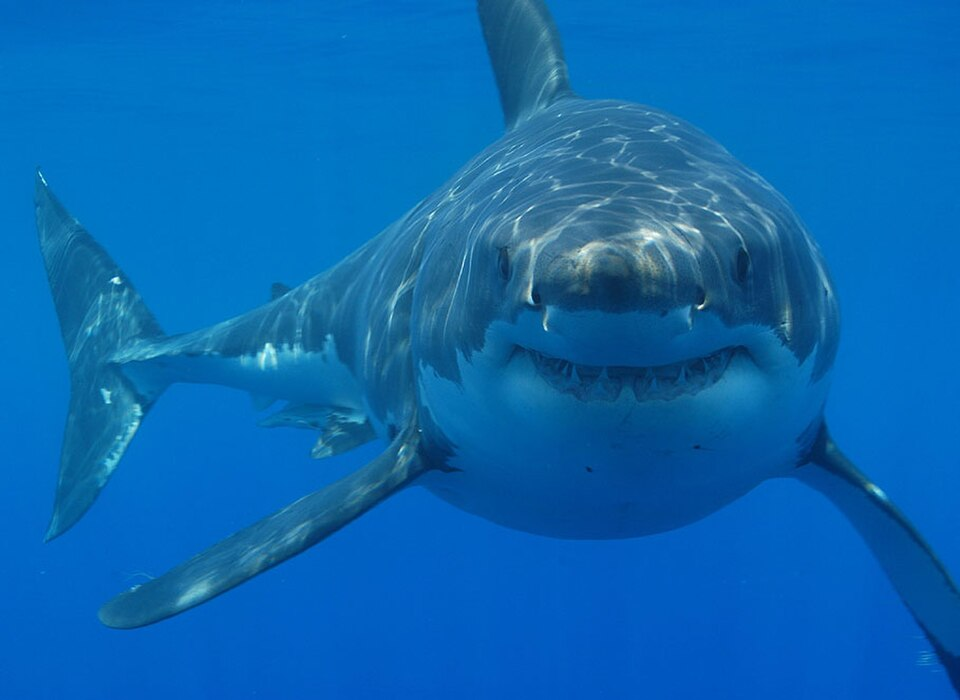



```{r}
#| label: setup
#| include: false
library(tidyverse)
library(maps)

attacks <- read_csv("data/attacks_clean.csv", show_col_types = FALSE) |>
  mutate(
    Country_lower = str_to_lower(str_trim(Country)),
    Fatal_clean = case_when(
      Fatal == "Y" ~ "Fatal",
      Fatal == "N" ~ "Non-fatal",
      TRUE ~ "Unknown"
    )
  )
```

## Information

```{r}
#| label: information-1
#| echo: false
learnr2::student_info()
```

## Introduction

Sharks have patrolled the world's oceans for over 400 million years — long before dinosaurs existed. Yet most people fear them far more than the numbers suggest. In this tutorial you will build a small **website** that uses the **Global Shark Attack File (GSAF)**, a database maintained by the Shark Research Institute that records over a century of shark incidents worldwide, to ask: **are sharks actually as dangerous as we think?** Your job is to steer the analysis, render often, inspect the output, and write the words that turn a map and a few charts into a site worth reading.

<div style="display: flex; justify-content: center;">
  
</div>

###

Use AI however you like.

### Exercise 1

You should be doing this tutorial in a repo named `sharks`. If you are not, create one and then connect to it. You may need to restart this tutorial after you do so.

In this repo, create a new Quarto **website** project, as you did in the Websites tutorials. The project should include a `_quarto.yml` configuration file and a home page named `index.qmd`. Give the site the title `"Shark Attacks"`. Quarto also creates an `about.qmd` page and a `styles.css` file: delete both, and remove the lines that mention them from `_quarto.yml`, so the site starts with just the home page.

In a bash Terminal, render the whole site:

```bash
quarto render
```

Quarto builds the site into a `_site` directory. Open `_site/index.html` with Live Server (right-click it in the Explorer → **Open with Live Server**) and keep the tab open. It refreshes every time you render. Going forward, we will just tell you to "Render" when we want you to take these steps.

Make sure your `.gitignore` ignores the generated site and Quarto's intermediate files, each entry on its own line:

```default
/_site/
/.quarto/
/*_files/
```

Commit and push. Use the commit message:

```default
Create sharks website
```

In the R Terminal, run:

```r
show_file(".gitignore")
```

If that fails, it is probably because you have not yet loaded `library(learnr2)` in the R Terminal.

CP/CR.

```{r}
#| label: introduction-1
#| echo: false
learnr2::question(
  "You should be doing this tutorial in a repo named sharks. If you are not, create one and then connect to it. You may need to restart this tutorial after you do so. In this repo, create a new Quarto website project, as you did in the Websites tutorials. The project should include a _quarto.yml configuration file and a home page named index.qmd. Give the site the title \"Shark Attacks\". Quarto also creates an about.qmd page and a styles.css file: delete both, and remove the lines that mention them from _quarto.yml. In a bash Terminal, render the whole site with quarto render. Open _site/index.html with Live Server and keep the tab open. Make sure your .gitignore ignores /_site/, /.quarto/, and /*_files/, each entry on its own line. Commit and push with the message Create sharks website. In the R Terminal, run show_file(\".gitignore\"). If that fails, it is probably because you have not yet loaded library(learnr2) in the R Terminal. CP/CR.",
  type = "reflection",
  show_text = FALSE
)
```

###

```{.output}
/.quarto/
**/*.quarto_ipynb
/_site/
/*_files/
```

###

The GSAF classifies each incident: 3,762 of the 5,094 in our data are unprovoked and 507 provoked, and the rest are boat incidents, sea disasters, or cases the investigators marked invalid or questionable.

### Exercise 2

Tell Quarto to hide code across the whole site. In `_quarto.yml`, add:

```yaml
execute:
  echo: false
```

Render. In the R Terminal, run:

```r
show_file("_quarto.yml")
```

CP/CR.

```{r}
#| label: introduction-2
#| echo: false
learnr2::question(
  "Tell Quarto to hide code across the whole site. In _quarto.yml, add execute: echo: false. Render. In the R Terminal, run show_file(\"_quarto.yml\"). CP/CR.",
  type = "reflection",
  show_text = FALSE
)
```

###

```{.output}
project:
  type: website

website:
  title: "Shark Attacks"
  navbar:
    left:
      - href: index.qmd
        text: Home

format:
  html:
    theme:
      - cosmo
      - brand
    toc: true

execute:
  echo: false
```

###

Each row of the GSAF is one reported incident, not one shark: the file records who was in the water, what they were doing, and how it ended, and names a species in only 3,073 of the 5,094 cases.

### Exercise 3

Create a `data` directory at the top level of the `sharks` repo. In the bash Terminal, run `ls`.

CP/CR.

```{r}
#| label: introduction-3
#| echo: false
learnr2::question(
  "Create a data directory at the top level of the sharks repo. In the bash Terminal, run ls. CP/CR.",
  type = "reflection",
  show_text = FALSE
)
```

###

```{.output}
AGENTS.md  data  index.qmd  _quarto.yml  _site
```

###

`ls` shows the `_site` directory that the render built beside the new, still empty, `data` directory.

## Where do attacks happen?

Shark attacks are not evenly distributed around the world. Some countries account for the vast majority of incidents — a pattern driven by coastline length, water temperature, beach culture, and reporting practices. The GSAF data lets us map exactly where attacks have occurred over the past century.

### Exercise 1

Download the shark attack data from this URL and save it in your `data/` directory:

```default
https://github.com/PPBDS/misc.tutorials/raw/refs/heads/main/inst/tutorials/sharks/data/attacks_clean.csv
```

In the bash Terminal, run:

```bash
ls data
```

CP/CR.

```{r}
#| label: where-1
#| echo: false
learnr2::question(
  "Download the shark attack data from this URL and save it in your data/ directory: https://github.com/PPBDS/misc.tutorials/raw/refs/heads/main/inst/tutorials/sharks/data/attacks_clean.csv. In the bash Terminal, run ls data. CP/CR.",
  type = "reflection",
  show_text = FALSE
)
```

###

```{.output}
attacks_clean.csv
```

###

The original Global Shark Attack File contains over 25,000 rows going back centuries, but most are incomplete. This cleaned version keeps only records with a known year (after 1900), country, and activity — 5,094 incidents in total.

### Exercise 2

Create a new page in your website named `map.qmd`, giving it the title `"Map"`, and add it to the site navigation in `_quarto.yml` so it appears in the navbar with the same label.

At the top of `map.qmd`, add a code chunk that loads `library(tidyverse)` and `library(maps)`, with `#| message: false` so startup messages stay out of the page. Keep the `library()` lines in a chunk of their own, and add a second chunk below it that reads `data/attacks_clean.csv` and prints it.

Render. In the R Terminal, run `show_file("map.qmd")`.

CP/CR.

```{r}
#| label: where-2
#| echo: false
learnr2::question(
  "Create a new page in your website named map.qmd, giving it the title \"Map\", and add it to the site navigation in _quarto.yml so it appears in the navbar with the same label. At the top of map.qmd, add a code chunk that loads library(tidyverse) and library(maps), with #| message: false so startup messages stay out of the page. Keep the library() lines in a chunk of their own, and add a second chunk below it that reads data/attacks_clean.csv and prints it. Render. In the R Terminal, run show_file(\"map.qmd\"). CP/CR.",
  type = "reflection",
  show_text = FALSE
)
```

###

```{r}
#| label: where-2-answer
#| echo: true
read_csv("data/attacks_clean.csv", show_col_types = FALSE)
```

###

Each row is one shark incident. The `Activity` column records what the person was doing — surfing, swimming, fishing, and so on — and `Fatal` records whether the attack was fatal (Y) or not (N).

### Exercise 3

Count fatal vs non-fatal attacks. Render.

In the R Terminal, run `show_file("map.qmd")`.

CP/CR.

```{r}
#| label: where-4
#| echo: false
learnr2::question(
  "Count fatal vs non-fatal attacks. Render. In the R Terminal, run show_file(\"map.qmd\"). CP/CR.",
  type = "reflection",
  show_text = FALSE
)
```

###

```{r}
#| label: where-4-answer
#| echo: true
read_csv("data/attacks_clean.csv", show_col_types = FALSE) |>
  count(Fatal, sort = TRUE)
```

###

Only 943 of the 5,094 incidents were fatal — about 18.5% — but the column is messy: 359 rows are NA, 27 say UNKNOWN, and one row each says 2017 and M. `Country` needs work too, since the GSAF writes it in capitals, so the next exercise cleans both columns at once.

### Exercise 4

Replace the contents of your working chunk with a cleaning pipeline. Read `data/attacks_clean.csv`, add a `Country_lower` column holding the trimmed, lowercase country name, add a `Fatal_clean` column that labels `Y` as "Fatal", `N` as "Non-fatal", and everything else as "Unknown", assign the result to `attacks`, and print it. Render.

In the R Terminal, run `show_file("map.qmd")`.

CP/CR.

```{r}
#| label: where-11
#| echo: false
learnr2::question(
  "Replace the contents of your working chunk with a cleaning pipeline. Read data/attacks_clean.csv, add a Country_lower column holding the trimmed, lowercase country name, add a Fatal_clean column that labels Y as \"Fatal\", N as \"Non-fatal\", and everything else as \"Unknown\", assign the result to attacks, and print it. Render. In the R Terminal, run show_file(\"map.qmd\"). CP/CR.",
  type = "reflection",
  show_text = FALSE
)
```

###

```{r}
#| label: where-11-answer
#| echo: true
attacks <- read_csv("data/attacks_clean.csv", show_col_types = FALSE) |>
  mutate(
    Country_lower = str_to_lower(str_trim(Country)),
    Fatal_clean = case_when(
      Fatal == "Y" ~ "Fatal",
      Fatal == "N" ~ "Non-fatal",
      TRUE ~ "Unknown"
    )
  )

attacks
```

###

`attacks` has 17 columns: the 15 from the CSV plus the two you added. `Fatal_clean` sorts the 5,094 incidents into 943 Fatal, 3,763 Non-fatal, and 388 Unknown — the 359 blanks, the 27 UNKNOWNs, and the two typos.

### Exercise 5

Before caching anything, tidy the chunk. Delete the line that prints `attacks`, and add a last line that saves the cleaned table with `write_rds(attacks, "data/attacks.rds")`, so the trends page you build later can read it instead of repeating the cleaning. Render.

In the R Terminal, run `show_file("map.qmd")`.

CP/CR.

```{r}
#| label: where-12
#| echo: false
learnr2::question(
  "Before caching anything, tidy the chunk. Delete the line that prints attacks, and add a last line that saves the cleaned table with write_rds(attacks, \"data/attacks.rds\"), so the trends page you build later can read it instead of repeating the cleaning. Render. In the R Terminal, run show_file(\"map.qmd\"). CP/CR.",
  type = "reflection",
  show_text = FALSE
)
```

###

```{.output}
attacks <- read_csv("data/attacks_clean.csv", show_col_types = FALSE) |>
  mutate(
    Country_lower = str_to_lower(str_trim(Country)),
    Fatal_clean = case_when(
      Fatal == "Y" ~ "Fatal",
      Fatal == "N" ~ "Non-fatal",
      TRUE ~ "Unknown"
    )
  )

write_rds(attacks, "data/attacks.rds")
```

###

`Country_lower` exists for the map: the **[maps](https://cran.r-project.org/package=maps)** package spells its regions `Australia` and the GSAF writes `AUSTRALIA`, and lowercasing both sides is the simplest way to make them match. Of the 388 Unknown outcomes, 359 were simply blank in the export; they stay in `attacks`, but every fatality figure below leaves them out.

### Exercise 6

Now cache the data chunk. Add `#| cache: true` as the first line inside the `attacks` chunk. Render. Caching saves that chunk's result to disk so later renders reload it instead of recomputing; the first cached render creates a `map_cache/` directory next to `map.qmd`.

To confirm the directory is there, in the bash Terminal, run `ls`.

CP/CR.

```{r}
#| label: where-13
#| echo: false
learnr2::question(
  "Now cache the data chunk. Add #| cache: true as the first line inside the attacks chunk. Render. To confirm the map_cache/ directory is there, in the bash Terminal, run ls. CP/CR.",
  type = "reflection",
  show_text = FALSE
)
```

###

```{.output}
AGENTS.md  data  index.qmd  map_cache  map.qmd  _quarto.yml  _site
```

###

The cleaned table is small — 5,094 rows — so this cache saves little time, but the habit matters: the full GSAF export is five times larger, 25,723 rows, and grows with every reported incident.

### Exercise 7

The Source Control change count just jumped, because `map_cache/` and `data/attacks.rds` now look like untracked work to git. Both are rebuilt from `attacks_clean.csv` whenever the data chunk runs, so neither should go to GitHub.

Add two lines to your `.gitignore`, one that ignores the cache directories and one that ignores the saved table:

```default
/*_cache/
data/attacks.rds
```

In the R Terminal, run `show_file(".gitignore")`.

CP/CR.

```{r}
#| label: where-14
#| echo: false
learnr2::question(
  "Add two lines to your .gitignore, one that ignores the cache directories and one that ignores the saved table: /*_cache/ and data/attacks.rds. In the R Terminal, run show_file(\".gitignore\"). CP/CR.",
  type = "reflection",
  show_text = FALSE
)
```

###

```{.output}
/.quarto/
**/*.quarto_ipynb
/_site/
/*_files/
/*_cache/
data/attacks.rds
```

###

`attacks_clean.csv` is now the only data file your repo carries: a reader who clones it gets the same 5,094 incidents and rebuilds `attacks.rds` with one render.

### Exercise 8

Start a new working chunk below the data chunk that draws a world map in which each country is colored by its number of shark attacks. Render.

Take a screenshot of the map in your rendered page and paste it below. To take a screenshot, press `Cmd + Ctrl + Shift + 4` on a Mac, `Win + Shift + S` on Windows, or `Ctrl + Shift + Show windows` on a Chromebook, select the area, then click in the answer box and press `Cmd + V` (Mac) or `Ctrl + V` (Windows) to paste it.

```{r}
#| label: where-9
#| echo: false
learnr2::question(
  "Start a new working chunk below the data chunk that draws a world map in which each country is colored by its number of shark attacks. Render. Take a screenshot of the map in your rendered page and paste it below.",
  type = "reflection",
  allow_image = TRUE,
  allow_text = FALSE,
  show_text = FALSE
)
```

###

```{r}
#| label: where-9-answer
#| echo: true
world_map <- map_data("world") |>
  mutate(region = str_to_lower(region))

attacks_by_country <- attacks |>
  count(Country_lower, name = "n_attacks")

map_with_attacks <- world_map |>
  left_join(attacks_by_country, by = c("region" = "Country_lower"))

ggplot(map_with_attacks, aes(x = long, y = lat, group = group)) +
  geom_polygon(aes(fill = n_attacks), color = "white", linewidth = 0.1) +
  scale_fill_viridis_c(
    option = "inferno", na.value = "gray90",
    trans = "log10",
    breaks = c(1, 10, 100, 1000),
    labels = c("1", "10", "100", "1,000+"),
    name = "Attacks\n(log scale)"
  ) +
  coord_fixed(1.3) +
  labs(
    title    = "Shark attacks are concentrated in a handful of countries",
    subtitle = "Total incidents 1901–2018, log scale",
    caption  = "Source: Global Shark Attack File (GSAF). Gray = no recorded\nincidents in this dataset, not necessarily zero risk."
  ) +
  theme_void() +
  theme(legend.position = "right")
```

###

The USA (1,958 incidents), Australia (1,077), and South Africa (506) account for nearly 70% of all recorded attacks and get the darkest shades. Gray does not always mean no attacks: the join matches lowercase country names, and 187 incidents — Hong Kong (21), England (12), and the United Kingdom (11) among them — have no matching region in the map data.

### Exercise 9

Commit and push the map page. Use the commit message:

```default
Add shark attack map
```

In the bash Terminal, run:

```bash
git log --oneline -3
```

CP/CR.

```{r}
#| label: where-10
#| echo: false
learnr2::question(
  "Commit and push the map page, using the commit message Add shark attack map. In the bash Terminal, run git log --oneline -3. CP/CR.",
  type = "reflection",
  show_text = FALSE
)
```

###

```{.output}
9b1c3e7 (HEAD -> main, origin/main) Add shark attack map
3a8f2d1 Create sharks website
```

###

Papua New Guinea (108) and Brazil (100) are the only countries outside the top three with 100 or more incidents; the Bahamas (96) and New Zealand (94) come next.

## When and why?

Shark attacks are not random — they cluster around certain activities, certain seasons, and certain decades. Understanding these patterns helps reframe the risk. If most attacks happen to surfers, the question becomes not "are sharks dangerous?" but "what is the risk per surfing session?" — a very different number.

### Exercise 1

Create a new page named `trends.qmd`, giving it the title `"Trends"`, and add it to the navbar in `_quarto.yml` with the same label.

At the top of the page, add a code chunk that loads `library(tidyverse)` with `#| message: false`. Below it, add a data chunk that reads `data/attacks.rds` into `attacks`, and below that a working chunk that counts attacks per year. Render.

In the R Terminal, run `show_file("trends.qmd")`.

CP/CR.

```{r}
#| label: when-1
#| echo: false
learnr2::question(
  "Create a new page named trends.qmd, giving it the title \"Trends\", and add it to the navbar in _quarto.yml with the same label. At the top of the page, add a code chunk that loads library(tidyverse) with #| message: false. Below it, add a data chunk that reads data/attacks.rds into attacks, and below that a working chunk that counts attacks per year. Render. In the R Terminal, run show_file(\"trends.qmd\"). CP/CR.",
  type = "reflection",
  show_text = FALSE
)
```

###

```{r}
#| label: when-1-answer
#| echo: true
attacks |>
  count(Year)
```

###

Attacks were rare before 1950 — not because sharks were less common, but because ocean recreation was less common. As surfing and swimming grew into mass activities in the second half of the 20th century, encounters with sharks increased proportionally.

### Exercise 2

Update your chunk to show a line chart of attacks per year. 2018 is a partial year, so drop it. Render.

Take a screenshot of the plot in your rendered page and paste it below.

```{r}
#| label: when-2
#| echo: false
learnr2::question(
  "Update your chunk to show a line chart of attacks per year. 2018 is a partial year, so drop it. Render. Take a screenshot of the plot in your rendered page and paste it below.",
  type = "reflection",
  allow_image = TRUE,
  allow_text = FALSE,
  show_text = FALSE
)
```

###

```{r}
#| label: when-2-answer
#| echo: true
#| message: false
attacks |>
  count(Year) |>
  filter(Year < 2018) |>
  ggplot(aes(x = Year, y = n)) +
  geom_line() +
  geom_smooth(method = "loess", se = FALSE, color = "steelblue") +
  labs(
    title   = "Shark attacks have increased over the past century",
    subtitle = "Likely driven by growth in beach tourism, not more dangerous water",
    x       = "Year",
    y       = "Number of attacks",
    caption = "Source: Global Shark Attack File (GSAF). 2018 excluded — incomplete\nat time of data collection."
  ) +
  theme_minimal()
```

###

The line jumps to 81, 84, 72, and 77 incidents in 1959–1962 — roughly double the 40 or so a year on either side — before falling back, a bump the smooth curve hides. Without knowing how many hours people spent swimming or surfing each year, we cannot say whether the *rate* of attacks has changed.

### Exercise 3

Update your chunk to count attacks by activity, keeping only activities with at least 50 incidents. Render.

In the R Terminal, run `show_file("trends.qmd")`.

CP/CR.

```{r}
#| label: when-3
#| echo: false
learnr2::question(
  "Update your chunk to count attacks by activity, keeping only activities with at least 50 incidents. Render. In the R Terminal, run show_file(\"trends.qmd\"). CP/CR.",
  type = "reflection",
  show_text = FALSE
)
```

###

```{r}
#| label: when-3-answer
#| echo: true
attacks |>
  count(Activity, sort = TRUE) |>
  filter(n >= 50)
```

###

Surfing leads with 972 incidents — well ahead of swimming (791) despite far fewer people surfing than swimming. Surfers spend more time in deeper water, make more noise and splashing, and wear wetsuits that can resemble prey.

### Exercise 4

Update your chunk to show fatal vs non-fatal attacks by activity, for activities with at least 50 incidents, leaving out incidents whose outcome is unknown. Render.

Take a screenshot of the plot in your rendered page and paste it below.

```{r}
#| label: when-5
#| echo: false
learnr2::question(
  "Update your chunk to show fatal vs non-fatal attacks by activity, for activities with at least 50 incidents, leaving out incidents whose outcome is unknown. Render. Take a screenshot of the plot in your rendered page and paste it below.",
  type = "reflection",
  allow_image = TRUE,
  allow_text = FALSE,
  show_text = FALSE
)
```

###

```{r}
#| label: when-5-answer
#| echo: true
attacks |>
  filter(Fatal_clean %in% c("Fatal", "Non-fatal")) |>
  count(Activity, Fatal_clean) |>
  filter(sum(n) >= 50, .by = Activity) |>
  ggplot(aes(x = n, y = fct_reorder(Activity, n, sum),
             fill = Fatal_clean)) +
  geom_col() +
  scale_fill_manual(values = c("Fatal" = "#d62728", "Non-fatal" = "#1f77b4")) +
  labs(
    title   = "Most shark attacks are not fatal",
    subtitle = "Activities with 50 or more recorded incidents, 1901–2018",
    x       = "Number of attacks",
    y       = NULL,
    fill    = NULL,
    caption = "Source: Global Shark Attack File (GSAF)"
  ) +
  theme_minimal() +
  theme(legend.position = "bottom")
```

###

Non-fatal attacks outnumber fatal ones in every activity category. The fatal share is highest for bathing (47%) and swimming (35%) and lowest for surfing (5%).

### Exercise 5

Commit and push the trends page. Use the commit message:

```default
Add trends analysis
```

In the bash Terminal, run:

```bash
git log --oneline -3
```

CP/CR.

```{r}
#| label: when-6
#| echo: false
learnr2::question(
  "Commit and push the trends page, using the commit message Add trends analysis. In the bash Terminal, run git log --oneline -3. CP/CR.",
  type = "reflection",
  show_text = FALSE
)
```

###

```{.output}
4e7a1d9 (HEAD -> main, origin/main) Add trends analysis
9b1c3e7 Add shark attack map
3a8f2d1 Create sharks website
```

###

The last full year in the data, 2017, has 129 incidents; 2018 has only 52 because the export was taken partway through the year.

## Summary

This tutorial used AI to build a three-page website from the **Global Shark Attack File**. You found that the export's `Fatal` column needed cleaning before it could be trusted, mapped a century of incidents by country, and charted them by year and by activity — showing that most attacks are not fatal and that the rise over time tracks beach tourism rather than more dangerous water. Now add introductory text to the home page and publish the site.

### Exercise 1

Turn the home page into a real introduction to the finished site. In `index.qmd`, replace the placeholder content with two or three short paragraphs: what the Global Shark Attack File is, why fear of sharks is out of proportion to the risk, and what the Map and Trends pages in the navbar show. Draft the prose with AI and keep what reads well.

Render. In the R Terminal, run:

```r
show_file("index.qmd")
```

CP/CR.

```{r}
#| label: summary-2
#| echo: false
learnr2::question(
  "Turn the home page into a real introduction to the finished site. In index.qmd, replace the placeholder content with two or three short paragraphs: what the Global Shark Attack File is, why fear of sharks is out of proportion to the risk, and what the Map and Trends pages in the navbar show. Draft the prose with AI and keep what reads well. Render. In the R Terminal, run show_file(\"index.qmd\"). CP/CR.",
  type = "reflection",
  show_text = FALSE
)
```

###

```{.output}
---
title: "Shark Attacks"
---

The Global Shark Attack File (GSAF), maintained by the Shark Research
Institute, records shark incidents reported anywhere in the world. This
site uses an export of 5,094 incidents from 1901 to 2018, each with a
known year, country, and activity.

Sharks are feared far out of proportion to the harm they do. Fewer than
one in five of the recorded incidents was fatal, and the yearly count has
risen mostly because far more people now surf and swim, not because the
ocean has become more dangerous.

The **Map** page shows where incidents cluster, and the **Trends** page
shows how they have changed over time and which activities carry the
most risk.
```

###

The home page should give a reader who knows nothing about the dataset enough context to understand the map and trends pages. Good introductory text names the data source, frames the central question, and previews the main findings.

### Exercise 2

Publish the website to GitHub Pages. In the bash Terminal, run:

```bash
quarto publish gh-pages
```

Copy/paste the resulting URL below.

```{r}
#| label: summary-3
#| echo: false
learnr2::question(
  "Publish the website to GitHub Pages. In the bash Terminal, run quarto publish gh-pages. Copy/paste the resulting URL below.",
  type = "reflection",
  show_text = FALSE
)
```

###

```{.output}
? Publish site to https://your-username.github.io/sharks/ using gh-pages? (Y/n) › Yes
Switched to a new branch 'gh-pages'
...
Rendering for publish:

[1/3] index.qmd
[2/3] map.qmd
[3/3] trends.qmd

Output created: _site/index.html
...
[gh-pages abc1234] Built site for gh-pages
...
To https://github.com/your-username/sharks.git
[✓] Deploying gh-pages branch to website (this may take a few minutes)
[✓] Published to https://your-username.github.io/sharks/
```

Your answer is the URL on the last line: `https://your-username.github.io/sharks/`.

###

The `[1/3]` to `[3/3]` lines show all three pages being rendered before the site is pushed, and the last line is the public address of your site, with the navbar linking its three pages.

### Exercise 3

Commit and push any remaining changes. Copy/paste the URL to your GitHub repo.

```{r}
#| label: summary-4
#| echo: false
learnr2::question(
  "Commit and push any remaining changes. Copy/paste the URL to your GitHub repo.",
  type = "reflection",
  show_text = FALSE
)
```

###

```{.output}
https://github.com/your-username/sharks
```

###

The Global Shark Attack File is updated regularly and is freely available at [sharkattackfile.net](https://www.sharkattackfile.net/). The same workflow used here — download a CSV, clean it, map locations, chart patterns, build a website — applies to any incident database.

## Download answers

```{r}
#| label: download-answers-1
#| echo: false
learnr2::question(
  "How many minutes, approximately, did it take you to complete this
  tutorial? For example, an hour and a half would be 90 minutes.",
  type = "reflection_editable",
  validate = "integer"
)
```

###

```{r}
#| label: download-answers-2
#| echo: false
learnr2::download_answers_button(filename_prefix = "sharks")
```
