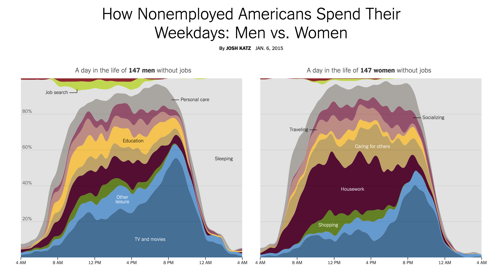



```{r}
#| label: setup
#| include: false
library(tidyverse)
library(DBI)
library(duckdb)
library(dbplyr)

con_atus <- dbConnect(duckdb::duckdb(),
                      dbdir = "data/atus.duckdb",
                      read_only = TRUE)

dbplyr_act   <- tbl(con_atus, "activities")
dbplyr_resp  <- tbl(con_atus, "respondents")
dbplyr_codes <- tbl(con_atus, "activity_codes")

keep_cats <- c(
  "Personal Care Activities",
  "Household Activities",
  "Caring For & Helping Household (HH) Members",
  "Socializing, Relaxing, and Leisure"
)

activity_avg <- dbplyr_act |>
  left_join(dbplyr_codes |> select(activity_code, major_name),
            by = "activity_code") |>
  inner_join(dbplyr_resp |>
               filter(str_starts(employment_status, "Not"),
                      day_type == "Weekday") |>
               select(tucaseid, sex),
             by = "tucaseid") |>
  group_by(tucaseid, sex, major_name) |>
  summarize(daily_min = sum(duration_min, na.rm = TRUE), .groups = "drop") |>
  group_by(sex, major_name) |>
  summarize(avg_daily_min = mean(daily_min, na.rm = TRUE), .groups = "drop") |>
  collect()

hourly_avg <- dbplyr_act |>
  mutate(hour = start_hhmm %/% 100L) |>
  filter(hour >= 6L, hour <= 23L) |>
  left_join(dbplyr_codes |> select(activity_code, major_name),
            by = "activity_code") |>
  filter(major_name %in% keep_cats) |>
  inner_join(dbplyr_resp |>
               filter(str_starts(employment_status, "Not"),
                      day_type == "Weekday") |>
               select(tucaseid, sex),
             by = "tucaseid") |>
  group_by(sex, hour, major_name) |>
  summarize(avg_min = mean(duration_min, na.rm = TRUE), .groups = "drop") |>
  collect()
```

## Information

```{r}
#| label: information-1
#| echo: false
learnr2::student_info()
```

## Introduction

This tutorial accompanies [Chapter 21: Databases](https://r4ds.hadley.nz/databases.html), [Chapter 17: Dates and times](https://r4ds.hadley.nz/datetimes.html), and [Chapter 16: Factors](https://r4ds.hadley.nz/factors.html) from [*R for Data Science (2e)*](https://r4ds.hadley.nz/) by Hadley Wickham, Mine Çetinkaya-Rundel, and Garrett Grolemund.

You will use the **[DBI](https://dbi.r-dbi.org/)**, **[duckdb](https://duckdb.org/docs/api/r)**, and **[dbplyr](https://dbplyr.tidyverse.org/)** packages to query the American Time Use Survey (ATUS), which records how Americans spend a single day; this tutorial looks at how people who are not in the labor force spend their weekdays, a question the *New York Times* asked of the same survey.

Use AI however you like.

### Exercise 1

You should be doing this tutorial in a repo named `time-use`. If you are not, create one and then connect to it. You may need to restart this tutorial after you do so.

Create a new file, `analysis.qmd`, with the title `"Analyzing Americans' Time Use"` and your name as the author. In a bash Terminal, render it:

```bash
quarto render analysis.qmd
```

Open `analysis.html` with Live Server (right-click it in the Explorer → **Open with Live Server**) and keep the tab open. It refreshes on every render. Going forward, we will just tell you to "Render" when we want you to take these steps.

Create a `.gitignore` with `analysis_files` followed by a blank line. Commit and push.

In the R Terminal, run:

```r
show_file(".gitignore")
```

If that fails, it is probably because you have not yet loaded `library(learnr2)` in the R Terminal.

CP/CR.

```{r}
#| label: introduction-1
#| echo: false
learnr2::question(
  "You should be doing this tutorial in a repo named time-use. If you are not, create one and then connect to it. You may need to restart this tutorial after you do so. Create a new file, analysis.qmd, with the title \"Analyzing Americans' Time Use\" and your name as the author. In a bash Terminal, render it: quarto render analysis.qmd. Open analysis.html with Live Server (right-click it in the Explorer and choose Open with Live Server) and keep the tab open. It refreshes on every render. Going forward, we will just tell you to \"Render\" when we want you to take these steps. Create a .gitignore with analysis_files followed by a blank line. Commit and push. In the R Terminal, run show_file(\".gitignore\"). If that fails, it is probably because you have not yet loaded library(learnr2) in the R Terminal. CP/CR.",
  type = "reflection",
  show_text = FALSE
)
```

###

```{.output}
analysis_files
```

###

A database table lives on disk and can be arbitrarily large, while a data frame lives in memory. The ATUS activity table you are about to use has 4.9 million rows, which is why it ships as a DuckDB file rather than as a CSV you would read into R.

### Exercise 2

In your QMD, put `library(tidyverse)`, `library(DBI)`, `library(duckdb)`, and `library(dbplyr)` in a new code chunk. Render.

Notice that the file does not look good because the code is visible and there are annoying messages. To take care of this, add `#| message: false` to remove all the messages in this code chunk. Also add the following to the YAML header to remove all code echoes from the HTML:

```yaml
execute:
  echo: false
```

Render. In the R Terminal, run:

```r
show_file("analysis.qmd", chunk = "Last")
```

CP/CR.

```{r}
#| label: introduction-2
#| echo: false
learnr2::question(
  "In your QMD, put library(tidyverse), library(DBI), library(duckdb), and library(dbplyr) in a new code chunk. Render. Notice that the file does not look good because the code is visible and there are annoying messages. To take care of this, add #| message: false to remove all the messages in this code chunk. Also add execute: echo: false to the YAML header to remove all code echoes from the HTML. Render. In the R Terminal, run show_file(\"analysis.qmd\", chunk = \"Last\"). CP/CR.",
  type = "reflection",
  show_text = FALSE
)
```

###

```{.output}
#| message: false
library(tidyverse)
library(DBI)
library(duckdb)
library(dbplyr)
```

###

**dbplyr** is the translator: you write an ordinary **dplyr** pipeline against a database table, it turns the pipeline into SQL, and the database — here DuckDB, running inside your R session through the **duckdb** driver and the **DBI** interface — does the work. R receives only the rows you ask for with `collect()`.

### Exercise 3

Create a `data` directory at the top level of the `time-use` repo. In the bash Terminal, run `ls`.

CP/CR.

```{r}
#| label: introduction-3
#| echo: false
learnr2::question(
  "Create a data directory at the top level of the time-use repo. In the bash Terminal, run ls. CP/CR.",
  type = "reflection",
  show_text = FALSE
)
```

###

```{.output}
AGENTS.md  analysis_files  analysis.html  analysis.qmd  data
```

###

ATUS interviews one randomly selected person, aged 15 or older, from a household that has just completed its final month in the Current Population Survey, so the sample inherits the CPS's national coverage. Each respondent accounts for a single diary day, assigned in advance, which is why the survey can say how a weekday differs from a weekend.

## Time use

This section uses a DuckDB database built from the Bureau of Labor Statistics
[American Time Use Survey (ATUS)](https://www.bls.gov/tus/), which asks one
randomly selected person per household to record every activity they did across
a single 24-hour diary day. The survey has run each year since 2003; this build
covers 2003 through 2024, 252,808 respondents, and 4,880,021 activity records.

###

In 2015, here's [what the *New York Times* found](https://www.nytimes.com/interactive/2015/01/06/upshot/how-nonemployed-americans-spend-their-weekdays-men-vs-women.html)
from this same survey.

{width=90%}

### Exercise 1

Download the DuckDB database `atus.duckdb` from this URL and save it in your `data/` directory:

```default
https://github.com/PPBDS/misc.tutorials/raw/refs/heads/main/inst/tutorials/time-use/data/atus.duckdb
```

In the bash Terminal, run `ls data`.

CP/CR.

```{r}
#| label: time-use-1
#| echo: false
learnr2::question(
  "Download the DuckDB database atus.duckdb from this URL and save it in your data/ directory: https://github.com/PPBDS/misc.tutorials/raw/refs/heads/main/inst/tutorials/time-use/data/atus.duckdb In the bash Terminal, run ls data. CP/CR.",
  type = "reflection",
  show_text = FALSE
)
```

###

```{.output}
atus.duckdb
```

###

ATUS is a *diary* survey, not a recall survey. The interviewer walks the respondent through the previous day in order — "and what did you do next, and how long did that take?" — which is why the activity records for one person tile the whole day end to end, with no gaps and no overlaps.

### Exercise 2

`atus.duckdb` is 47 MB, far too big to commit. Add `data/*.duckdb` to your `.gitignore` on its own line, so that Git never offers to track it. In the R Terminal, run `show_file(".gitignore")`. CP/CR.

```{r}
#| label: time-use-17
#| echo: false
learnr2::question(
  "atus.duckdb is 47 MB, far too big to commit. Add data/*.duckdb to your .gitignore on its own line, so that Git never offers to track it. In the R Terminal, run show_file(\".gitignore\"). CP/CR.",
  type = "reflection",
  show_text = FALSE
)
```

###

```{.output}
analysis_files
data/*.duckdb
```

###

GitHub warns about any file over 50 MB and refuses one over 100 MB, and Git keeps every version of every file it has ever tracked, so a 47 MB database committed once would travel with every clone of this repo forever, which is why the tutorial has you download the file rather than commit it.

### Exercise 3

Create a new working chunk in `analysis.qmd`. Connect to `data/atus.duckdb` and create lazy references to its three tables: `dbplyr_act` for `activities`, `dbplyr_resp` for `respondents`, and `dbplyr_codes` for `activity_codes`. Print `dbplyr_act`. Render.

In the R Terminal, run `show_file("analysis.qmd", chunk = "Last")`. CP/CR.

```{r}
#| label: time-use-2
#| echo: false
learnr2::question(
  "Create a new working chunk in analysis.qmd. Connect to data/atus.duckdb and create lazy references to its three tables: dbplyr_act for activities, dbplyr_resp for respondents, and dbplyr_codes for activity_codes. Print dbplyr_act. Render. In the R Terminal, run show_file(\"analysis.qmd\", chunk = \"Last\"). CP/CR.",
  type = "reflection",
  show_text = FALSE
)
```

###

```{r}
#| label: time-use-2-answer
#| echo: true
dbplyr_act   <- tbl(con_atus, "activities")
dbplyr_resp  <- tbl(con_atus, "respondents")
dbplyr_codes <- tbl(con_atus, "activity_codes")
dbplyr_act
```

###

Three tables: `activities` records every diary entry with its start time and duration, `respondents` holds one row per person with sex, age, and employment status, and `activity_codes` maps numeric codes to category names. The six-digit `activity_code` packs a three-level hierarchy into one integer — 120303 is Socializing, Relaxing, and Leisure (12) > TV and Movies (03) > Watching TV (03) — and `start_hhmm` uses the same packing trick: 1430 means 2:30 PM.

### Exercise 4

Collect the entire `dbplyr_codes` table and print it. Because `activity_codes` is only a few hundred rows, `collect()` is fine here — it is the large tables we defer. Render.

In the R Terminal, run `show_file("analysis.qmd", chunk = "Last")`. CP/CR.

```{r}
#| label: time-use-5
#| echo: false
learnr2::question(
  "Collect the entire dbplyr_codes table and print it. Because activity_codes is only a few hundred rows, collect() is fine here; it is the large tables we defer. Render. In the R Terminal, run show_file(\"analysis.qmd\", chunk = \"Last\"). CP/CR.",
  type = "reflection",
  show_text = FALSE
)
```

###

```{r}
#| label: time-use-5-answer
#| echo: true
dbplyr_codes |>
  collect()
```

###

426 detailed codes roll up into 18 major categories, running from `Personal Care Activities` (01) through `Traveling` (18), with 17 unused and one oddity at the end: major code 50, `Data Codes`, which is where the survey files unclassifiable, refused, and missing answers rather than an actual activity. This section works with four of the real ones — 01 Personal Care, 02 Household Activities, 03 Caring For & Helping Household (HH) Members, and 12 Socializing, Relaxing, and Leisure — and note the exact spelling of that third label: it uses an ampersand and the abbreviation `(HH)`, and a filter written from the plain-English name will silently match nothing.

### Exercise 5

Join the activity records to their major category names from `dbplyr_codes` and compute the average length of a single activity record in each major category, longest first. Collect and print. Render.

In the R Terminal, run `show_file("analysis.qmd", chunk = "Last")`. CP/CR.

```{r}
#| label: time-use-8
#| echo: false
learnr2::question(
  "Join the activity records to their major category names from dbplyr_codes and compute the average length of a single activity record in each major category, longest first. Collect and print. Render. In the R Terminal, run show_file(\"analysis.qmd\", chunk = \"Last\"). CP/CR.",
  type = "reflection",
  show_text = FALSE
)
```

###

```{r}
#| label: time-use-8-answer
#| echo: true
dbplyr_act |>
  left_join(dbplyr_codes |> select(activity_code, major_name),
            by = "activity_code") |>
  group_by(major_name) |>
  summarize(avg_min = mean(duration_min, na.rm = TRUE)) |>
  arrange(desc(avg_min)) |>
  collect()
```

###

Traveling comes last at 18.7 minutes per record even though it has more records than any other category — 938,689, because every leg of a trip is its own entry — while Personal Care Activities averages 159 minutes, behind only Work & Work-Related Activities at 180, because a night's sleep enters the file as one very long row. A database is not the only way to handle a 4.9-million-row table: **[arrow](https://arrow.apache.org/docs/r/)** gives you the same aggregate-then-collect discipline over Parquet files with no database at all, and **[duckplyr](https://duckplyr.tidyverse.org/)** runs the DuckDB engine underneath ordinary data-frame code.

### Exercise 6

Count the number of respondents by `sex` and `employment_status`. Collect and print. Render.

In the R Terminal, run `show_file("analysis.qmd", chunk = "Last")`. CP/CR.

```{r}
#| label: time-use-9
#| echo: false
learnr2::question(
  "Count the number of respondents by sex and employment_status. Collect and print. Render. In the R Terminal, run show_file(\"analysis.qmd\", chunk = \"Last\"). CP/CR.",
  type = "reflection",
  show_text = FALSE
)
```

###

```{r}
#| label: time-use-9-answer
#| echo: true
dbplyr_resp |>
  count(sex, employment_status, sort = FALSE) |>
  arrange(sex, employment_status) |>
  collect()
```

###

"Not in labor force" means the person was neither working nor job-hunting — retirees, full-time caregivers, and non-enrolled students all qualify — and that group, the focus of the *New York Times* graphic, holds 56,492 women and 30,349 men, nearly two to one, against an employed group that is almost evenly split (78,566 women, 76,716 men). The `weight` column adjusts each respondent to represent the full US population, but nothing you do in this tutorial uses it, so every average you produce is an average over *respondents*, not over Americans.

### Exercise 7

For weekday respondents who are not in the labor force, compute how many minutes each person spent in each major activity category over their diary day. Collect and print the result. Render.

In the R Terminal, run `show_file("analysis.qmd", chunk = "Last")`. CP/CR.

```{r}
#| label: time-use-11
#| echo: false
learnr2::question(
  "For weekday respondents who are not in the labor force, compute how many minutes each person spent in each major activity category over their diary day. Collect and print the result. Render. In the R Terminal, run show_file(\"analysis.qmd\", chunk = \"Last\"). CP/CR.",
  type = "reflection",
  show_text = FALSE
)
```

###

```{r}
#| label: time-use-11-answer
#| echo: true
dbplyr_act |>
  left_join(dbplyr_codes |> select(activity_code, major_name),
            by = "activity_code") |>
  inner_join(dbplyr_resp |>
               filter(str_starts(employment_status, "Not"),
                      day_type == "Weekday") |>
               select(tucaseid, sex),
             by = "tucaseid") |>
  group_by(tucaseid, sex, major_name) |>
  summarize(daily_min = sum(duration_min, na.rm = TRUE), .groups = "drop") |>
  collect()
```

###

269,718 rows, one per person per category they touched that day — not one per activity record. Someone who watched TV in three separate stretches contributes a single leisure total, not three.

### Exercise 8

Collapse those person-level totals one step further: average them across respondents, so you have the mean weekday minutes a non-employed person of each sex spends in each major category. Assign the result to `activity_avg` and print it. Render.

In the R Terminal, run `show_file("analysis.qmd", chunk = "Last")`. CP/CR.

```{r}
#| label: time-use-12
#| echo: false
learnr2::question(
  "Collapse those person-level totals one step further: average them across respondents, so you have the mean weekday minutes a non-employed person of each sex spends in each major category. Assign the result to activity_avg and print it. Render. In the R Terminal, run show_file(\"analysis.qmd\", chunk = \"Last\"). CP/CR.",
  type = "reflection",
  show_text = FALSE
)
```

###

```{r}
#| label: time-use-12-answer
#| echo: true
activity_avg <- dbplyr_act |>
  left_join(dbplyr_codes |> select(activity_code, major_name),
            by = "activity_code") |>
  inner_join(dbplyr_resp |>
               filter(str_starts(employment_status, "Not"),
                      day_type == "Weekday") |>
               select(tucaseid, sex),
             by = "tucaseid") |>
  group_by(tucaseid, sex, major_name) |>
  summarize(daily_min = sum(duration_min, na.rm = TRUE), .groups = "drop") |>
  group_by(sex, major_name) |>
  summarize(avg_daily_min = mean(daily_min, na.rm = TRUE), .groups = "drop") |>
  collect()
activity_avg
```

###

If your result differs from ours, replace your code with the code above before moving on, so that `activity_avg` matches for the rest of the section.

`activity_avg` has 36 rows: 18 categories × 2 sexes. Read `avg_daily_min` carefully — it is the average over the people who did that activity at all, since someone who never gardened has no Household Activities row to contribute.

### Exercise 9

Now clean up the working chunk — but split it in two rather than leaving it as one.

`activity_avg` is an ordinary tibble: once computed, it can be saved to disk and reloaded. A database connection cannot. Put the connection and the three lazy references in their own chunk, and leave a second chunk — now the last chunk in the file — holding only the `activity_avg` computation. Delete everything exploratory from Exercises 4 through 7, and delete the print of `activity_avg`.

Render.

In the R Terminal, run `show_file("analysis.qmd", chunk = "Last")`. CP/CR.

```{r}
#| label: time-use-18
#| echo: false
learnr2::question(
  "Now clean up the working chunk, but split it in two rather than leaving it as one. activity_avg is an ordinary tibble: once computed, it can be saved to disk and reloaded. A database connection cannot. Put the connection and the three lazy references in their own chunk, and leave a second chunk, now the last chunk in the file, holding only the activity_avg computation. Delete everything exploratory from Exercises 4 through 7, and delete the print of activity_avg. Render. In the R Terminal, run show_file(\"analysis.qmd\", chunk = \"Last\"). CP/CR.",
  type = "reflection",
  show_text = FALSE
)
```

###

```{.output}
activity_avg <- dbplyr_act |>
  left_join(dbplyr_codes |> select(activity_code, major_name),
            by = "activity_code") |>
  inner_join(dbplyr_resp |>
               filter(str_starts(employment_status, "Not"),
                      day_type == "Weekday") |>
               select(tucaseid, sex),
             by = "tucaseid") |>
  group_by(tucaseid, sex, major_name) |>
  summarize(daily_min = sum(duration_min, na.rm = TRUE), .groups = "drop") |>
  group_by(sex, major_name) |>
  summarize(avg_daily_min = mean(daily_min, na.rm = TRUE), .groups = "drop") |>
  collect()
```

###

A connection is a live handle to a running database process — an *external pointer*, in R's vocabulary — and external pointers do not survive being written to disk and read back, which is why it must sit outside the chunk you are about to cache. The chunk that remains collapses 4.9 million activity rows to 36, and the collapse happened inside DuckDB; the 36-row answer is the only thing that crossed into R.

### Exercise 10

Add `#| cache: true` as the first line of the last chunk. Render. In the bash Terminal, run `ls`.

CP/CR.

```{r}
#| label: time-use-19
#| echo: false
learnr2::question(
  "Add #| cache: true as the first line of the last chunk. Render. In the bash Terminal, run ls. CP/CR.",
  type = "reflection",
  show_text = FALSE
)
```

###

```{.output}
AGENTS.md  analysis_cache  analysis_files  analysis.html  analysis.qmd  data
```

###

That render took as long as the last one, because the two-level aggregation over 4.9 million rows still had to run once to fill `analysis_cache/`; from now on every render reads the 36-row `activity_avg` back from disk and never touches the database. The cache is keyed on the chunk's code, not on the database file, so if you ever drop a newer `atus.duckdb` into `data/`, delete `analysis_cache/` before trusting the numbers.

### Exercise 11

Your editor's Source Control view now shows a pile of new files from `analysis_cache/`. Add `analysis_cache` to your `.gitignore` on its own line, and the count drops back. In the R Terminal, run `show_file(".gitignore")`. CP/CR.

```{r}
#| label: time-use-20
#| echo: false
learnr2::question(
  "Your editor's Source Control view now shows a pile of new files from analysis_cache/. Add analysis_cache to your .gitignore on its own line, and the count drops back. In the R Terminal, run show_file(\".gitignore\"). CP/CR.",
  type = "reflection",
  show_text = FALSE
)
```

###

```{.output}
analysis_files
data/*.duckdb
analysis_cache
```

###

The averages sitting in that cache rest on 42,490 diaries — the weekday respondents who were not in the labor force, about a sixth of the 252,808 people the survey interviewed. Three things now stay out of GitHub: the rendered page, the cache, and the 47 MB database, and `analysis.qmd` plus a fresh download of `atus.duckdb` is enough to rebuild all three.

### Exercise 12

Start a new code chunk. Build the dataset behind the final chart: for weekday non-employed respondents, the average minutes spent in activities *starting* in each hour of the day, broken out by sex and major category. Keep only the four categories named in Exercise 4, and only hours 6 through 23. Assign the result to `hourly_avg` and print it. Render.

In the R Terminal, run `show_file("analysis.qmd", chunk = "Last")`. CP/CR.

```{r}
#| label: time-use-13
#| echo: false
learnr2::question(
  "Start a new code chunk. Build the dataset behind the final chart: for weekday non-employed respondents, the average minutes spent in activities starting in each hour of the day, broken out by sex and major category. Keep only the four categories named in Exercise 4, and only hours 6 through 23. Assign the result to hourly_avg and print it. Render. In the R Terminal, run show_file(\"analysis.qmd\", chunk = \"Last\"). CP/CR.",
  type = "reflection",
  show_text = FALSE
)
```

###

```{r}
#| label: time-use-13-answer
#| echo: true
keep_cats <- c(
  "Personal Care Activities",
  "Household Activities",
  "Caring For & Helping Household (HH) Members",
  "Socializing, Relaxing, and Leisure"
)

hourly_avg <- dbplyr_act |>
  mutate(hour = start_hhmm %/% 100L) |>
  filter(hour >= 6L, hour <= 23L) |>
  left_join(dbplyr_codes |> select(activity_code, major_name),
            by = "activity_code") |>
  filter(major_name %in% keep_cats) |>
  inner_join(dbplyr_resp |>
               filter(str_starts(employment_status, "Not"),
                      day_type == "Weekday") |>
               select(tucaseid, sex),
             by = "tucaseid") |>
  group_by(sex, hour, major_name) |>
  summarize(avg_min = mean(duration_min, na.rm = TRUE), .groups = "drop") |>
  collect()
hourly_avg
```

###

`hourly_avg` should have exactly 144 rows: 4 categories × 2 sexes × 18 hours. If yours has 108, the category filter matched only three labels — check the spelling of the caregiving category against the table you printed in Exercise 4.

### Exercise 13

Start a new code chunk. Make a horizontal grouped bar chart from `activity_avg` showing average daily minutes by category, with the bars colored by sex and ordered by average minutes. Leave out the `Data Codes` bucket, which is missing-data bookkeeping rather than an activity. Give the chart a title, subtitle, axis labels, and a data source caption. Render.

Take a screenshot of the plot in your rendered page and paste it below. To take a screenshot, press `Cmd + Ctrl + Shift + 4` on a Mac, `Win + Shift + S` on Windows, or `Ctrl + Shift + Show windows` on a Chromebook, select the area, then click in the answer box and press `Cmd + V` (Mac) or `Ctrl + V` (Windows) to paste it.

```{r}
#| label: time-use-14
#| echo: false
learnr2::question(
  "Start a new code chunk. Make a horizontal grouped bar chart from activity_avg showing average daily minutes by category, with the bars colored by sex and ordered by average minutes. Leave out the Data Codes bucket, which is missing-data bookkeeping rather than an activity. Give the chart a title, subtitle, axis labels, and a data source caption. Render. Take a screenshot of the plot in your rendered page and paste it below.",
  type = "reflection",
  allow_image = TRUE,
  allow_text = FALSE,
  show_text = FALSE
)
```

###

```{r}
#| label: time-use-14-answer
#| echo: true
activity_avg |>
  filter(major_name != "Data Codes") |>
  mutate(major_name = fct_reorder(major_name, avg_daily_min)) |>
  ggplot(aes(x = avg_daily_min, y = major_name, fill = sex)) +
  geom_col(position = "dodge") +
  labs(
    title = "How Non-Employed Americans Spend Weekdays",
    subtitle = "Women devote more time to housework and caregiving; men spend more on leisure",
    x = "Average minutes per weekday",
    y = NULL,
    fill = "Sex",
    caption = "Source: BLS American Time Use Survey (2003–2024). Weekday non-employed respondents."
  ) +
  theme_minimal()
```

###

The caregiving gap is the biggest one on the chart, and it is much bigger than the housework gap: 167 minutes for women against 96.9 for men, a difference of 70 minutes a day. Sociologist Arlie Hochschild named this pattern the "second shift" in 1989 — even as women entered paid work, they kept the bulk of unpaid domestic labor — and what ATUS adds is that the pattern survives when nobody in the comparison has a job at all.

### Exercise 14

Start a new code chunk. Recall the *New York Times* chart from the beginning of this section:

{width=90%}

Build a stacked area chart from `hourly_avg` showing how the day fills up: hour along the horizontal axis, average minutes vertically, one colored band per activity category, and a separate panel for each sex. Label the hour axis in clock time rather than in numbers. Give the chart a title, subtitle, and data source caption. Render.

Take a screenshot of the plot in your rendered page and paste it below.

```{r}
#| label: time-use-15
#| echo: false
learnr2::question(
  "Start a new code chunk. Build a stacked area chart from hourly_avg showing how the day fills up: hour along the horizontal axis, average minutes vertically, one colored band per activity category, and a separate panel for each sex. Label the hour axis in clock time rather than in numbers. Give the chart a title, subtitle, and data source caption. Render. Take a screenshot of the plot in your rendered page and paste it below.",
  type = "reflection",
  allow_image = TRUE,
  allow_text = FALSE,
  show_text = FALSE
)
```

###

```{r}
#| label: time-use-15-answer
#| echo: true
ggplot(hourly_avg, aes(x = hour, y = avg_min, fill = major_name)) +
  geom_area(alpha = 0.85) +
  facet_wrap(~ sex) +
  scale_x_continuous(
    breaks = c(6, 9, 12, 15, 18, 21),
    labels = c("6 AM", "9 AM", "Noon", "3 PM", "6 PM", "9 PM")
  ) +
  labs(
    title = "Time Use by Hour of Day, Non-Employed Americans (Weekdays)",
    subtitle = "Men's afternoon leisure peak is taller; women's morning housework block is wider",
    x = NULL,
    y = "Average minutes in activities starting this hour",
    fill = "Activity",
    caption = "Source: BLS American Time Use Survey (2003–2024). Weekday non-employed respondents."
  ) +
  theme_minimal() +
  theme(legend.position = "bottom")
```

###

Four bands, and the caregiving one is the band that carries the sex difference — it is visible across the women's morning and afternoon and barely there for men. The *New York Times* version measures the fraction of people in each activity at each minute, which is more precise and arrives at the same picture: the leisure band is taller for men all afternoon, and the household band is wider and starts earlier for women.

### Exercise 15

Commit `analysis.qmd` with the message `"Add ATUS time-use analysis"` and push to GitHub.

In the bash Terminal, run:

```bash
git log --oneline -3
```

CP/CR.

```{r}
#| label: time-use-16
#| echo: false
learnr2::question(
  "Commit analysis.qmd with the message \"Add ATUS time-use analysis\" and push to GitHub. In the bash Terminal, run git log --oneline -3. CP/CR.",
  type = "reflection",
  show_text = FALSE
)
```

###

```{.output}
9876fed Add ATUS time-use analysis
def5678 Add .gitignore
```

###

ATUS microdata is released every June for the prior year and is free from the BLS, but the sample is not stable: it falls from 20,720 respondents in 2003 — the first year was fielded at roughly double the later scale — to 7,669 in 2024, so your pooled 2003–2024 averages lean toward the mid-2000s. The published BLS estimates all apply the survey weight you ignored, so your numbers describe ATUS respondents rather than the US population — close enough to see the pattern, not close enough to quote.

## Summary

This tutorial covered [Chapter 21: Databases](https://r4ds.hadley.nz/databases.html), [Chapter 17: Dates and times](https://r4ds.hadley.nz/datetimes.html), and [Chapter 16: Factors](https://r4ds.hadley.nz/factors.html) from [*R for Data Science (2e)*](https://r4ds.hadley.nz/) by Hadley Wickham, Mine Çetinkaya-Rundel, and Garrett Grolemund.

You used **[DBI](https://dbi.r-dbi.org/)**, **[duckdb](https://duckdb.org/docs/api/r)**, and **[dbplyr](https://dbplyr.tidyverse.org/)** to query the American Time Use Survey and produced two graphics about how non-employed Americans spend their weekdays, one of them a reconstruction of a chart featured in the *New York Times*.

### Exercise 1

Render. Check your Live Server tab. The page should show your two graphics and nothing else, so if the `hourly_avg` chunk still prints a tibble, delete that print first.

In the R Terminal, run:

```r
show_file("analysis.qmd")
```

CP/CR.

```{r}
#| label: summary-1
#| echo: false
learnr2::question(
  "Render. Check your Live Server tab. The page should show your two graphics and nothing else, so if the hourly_avg chunk still prints a tibble, delete that print first. In the R Terminal, run: show_file(\"analysis.qmd\") CP/CR.",
  type = "reflection",
  show_text = FALSE
)
```

###

````{verbatim}
---
title: "Analyzing Americans' Time Use"
author: "<your name>"
format: html
execute:
  echo: false
---

```{r}
#| message: false
library(tidyverse)
library(DBI)
library(duckdb)
library(dbplyr)
```

```{r}
con_atus <- dbConnect(duckdb::duckdb(), dbdir = "data/atus.duckdb", read_only = TRUE)
dbplyr_act   <- tbl(con_atus, "activities")
dbplyr_resp  <- tbl(con_atus, "respondents")
dbplyr_codes <- tbl(con_atus, "activity_codes")
```

```{r}
#| cache: true
activity_avg <- dbplyr_act |>
  left_join(dbplyr_codes |> select(activity_code, major_name),
            by = "activity_code") |>
  inner_join(dbplyr_resp |>
               filter(str_starts(employment_status, "Not"),
                      day_type == "Weekday") |>
               select(tucaseid, sex),
             by = "tucaseid") |>
  group_by(tucaseid, sex, major_name) |>
  summarize(daily_min = sum(duration_min, na.rm = TRUE), .groups = "drop") |>
  group_by(sex, major_name) |>
  summarize(avg_daily_min = mean(daily_min, na.rm = TRUE), .groups = "drop") |>
  collect()
```

```{r}
keep_cats <- c(
  "Personal Care Activities",
  "Household Activities",
  "Caring For & Helping Household (HH) Members",
  "Socializing, Relaxing, and Leisure"
)

hourly_avg <- dbplyr_act |>
  mutate(hour = start_hhmm %/% 100L) |>
  filter(hour >= 6L, hour <= 23L) |>
  left_join(dbplyr_codes |> select(activity_code, major_name),
            by = "activity_code") |>
  filter(major_name %in% keep_cats) |>
  inner_join(dbplyr_resp |>
               filter(str_starts(employment_status, "Not"),
                      day_type == "Weekday") |>
               select(tucaseid, sex),
             by = "tucaseid") |>
  group_by(sex, hour, major_name) |>
  summarize(avg_min = mean(duration_min, na.rm = TRUE), .groups = "drop") |>
  collect()
```

```{r}
activity_avg |>
  filter(major_name != "Data Codes") |>
  mutate(major_name = fct_reorder(major_name, avg_daily_min)) |>
  ggplot(aes(x = avg_daily_min, y = major_name, fill = sex)) +
  geom_col(position = "dodge") +
  labs(
    title = "How Non-Employed Americans Spend Weekdays",
    subtitle = "Women devote more time to housework and caregiving; men spend more on leisure",
    x = "Average minutes per weekday",
    y = NULL,
    fill = "Sex",
    caption = "Source: BLS American Time Use Survey (2003–2024). Weekday non-employed respondents."
  ) +
  theme_minimal()
```

```{r}
ggplot(hourly_avg, aes(x = hour, y = avg_min, fill = major_name)) +
  geom_area(alpha = 0.85) +
  facet_wrap(~ sex) +
  scale_x_continuous(
    breaks = c(6, 9, 12, 15, 18, 21),
    labels = c("6 AM", "9 AM", "Noon", "3 PM", "6 PM", "9 PM")
  ) +
  labs(
    title = "Time Use by Hour of Day, Non-Employed Americans (Weekdays)",
    subtitle = "Men's afternoon leisure peak is taller; women's morning housework block is wider",
    x = NULL,
    y = "Average minutes in activities starting this hour",
    fill = "Activity",
    caption = "Source: BLS American Time Use Survey (2003–2024). Weekday non-employed respondents."
  ) +
  theme_minimal() +
  theme(legend.position = "bottom")
```
````

###

Six chunks, and only one of them is cached. Neither the cache nor the database file goes to GitHub — a reader of your published page gets the graphics without needing 47 MB of DuckDB.

### Exercise 2

Publish your rendered QMD to GitHub Pages. In a bash Terminal, run:

```bash
quarto publish gh-pages analysis.qmd
```

Copy/paste the resulting URL below.

```{r}
#| label: summary-2
#| echo: false
learnr2::question(
  "Publish your rendered QMD to GitHub Pages. In a bash Terminal, run quarto publish gh-pages analysis.qmd. Copy/paste the resulting URL below.",
  type = "reflection",
  show_text = FALSE
)
```

###

```{.output}
? Publish site to https://<your-github-username>.github.io/time-use/ using gh-pages? (Y/n) › Yes
Switched to a new branch 'gh-pages'
...
Rendering for publish:
...
Output created: analysis.html
...
[gh-pages abc1234] Built site for gh-pages
...
To https://github.com/<your-github-username>/time-use.git
...
[✓] Deploying gh-pages branch to website (this may take a few minutes)
[✓] Published to https://<your-github-username>.github.io/time-use/
```

###

Every band and bar on that page was produced without ever loading a full ATUS table into R. The database did the joining and averaging; `collect()` pulled down 36 rows for one chart and 144 for the other.

### Exercise 3

Commit and push all your files. Copy/paste the URL to your GitHub repo.

```{r}
#| label: summary-3
#| echo: false
learnr2::question(
  "Commit and push all your files. Copy/paste the URL to your GitHub repo.",
  type = "reflection",
  show_text = FALSE
)
```

###

```{.output}
https://github.com/<your-github-username>/time-use
```

###

The *New York Times* chart measured the fraction of people engaged in each activity at each minute of the day, which is finer than your hourly averages and arrives at the same picture; the BLS publishes those minute-level estimates itself, weighted, in its annual ATUS tables, which is where to go for a number you can quote.

## Download answers

```{r}
#| label: download-answers-1
#| echo: false
learnr2::question(
  "How many minutes, approximately, did it take you to complete this
  tutorial? For example, an hour and a half would be 90 minutes.",
  type = "reflection_editable",
  validate = "integer"
)
```

###

```{r}
#| label: download-answers-2
#| echo: false
learnr2::download_answers_button(filename_prefix = "time-use")
```
